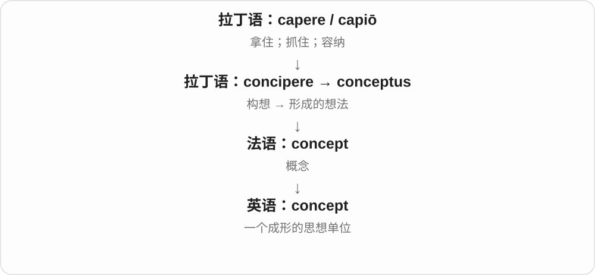

# 1507 · concept — 概念；构想

[逐词精讲目录](../00_逐词精讲目录.md) · [总目录](../00_总目录_按常用程度.md)

## 核心词根与来源

concept 接拉丁 conceptus，联系 concipere 接受、构思一支。历史上有抓住、容纳的画面，现代不必逐次想象用手拿。

**CONCEPT：在头脑中把一个意思抓成整体**

先有核心想法，再用图或样品把它说明白。

- **想法的整体**：concept

## 词形与演化规律

concept 是可数名词，可谈基本概念或设计构想。它不是现代 conceive 直接去尾形成的普通名词。

## 单词速览（按词族由简到繁）

同一基础词的相关扩展放在一起，先读基础形式，再读扩展；各组之间优先读常用的。具体词源关系见各词讲解。

| 单词 | 音标 | 核心意思 |
|---|---|---|
| [concept](#w-1) | 英 /ˈkɒnsept/；美 /ˈkɑːnsept/ | 概念；构想 |

## 逐词讲解

### 1. concept — 概念；构想

**音标**：英 /ˈkɒnsept/；美 /ˈkɑːnsept/

**先抓住这个画面**

把一组零散认识抓到一起，在脑子里形成一个清楚的整体，这个整体就是 concept，比如“公平”“能量”或一个产品构想。

**怎么拆**

来自拉丁语 conceptus，与 concipere“收集、构想”同源。concept 和 conceive 是历史词形不同的亲戚，不能仅凭结尾判断互不相关。

**怎么变成今天的意思**

词义重点落在构想的结果上。a design concept 是设计背后的基本想法，还不一定是可直接生产的详细方案。

**常见搭配与例句**

a basic concept；the concept of…；a design concept。

> The teacher explained the concept of gravity with a simple experiment.

老师用一个简单实验解释了重力的概念。

> We liked the design concept but changed the details.

我们喜欢这个设计构想，但修改了细节。

**别混淆**

idea 很宽泛，随手想到的点子也算；concept 往往是可以说明、组织或反复使用的一套概念。

## 这一组要分清什么

concept 可指抽象概念，idea 范围更宽；prototype 是可供检验的原型，不能与构想本身混同。

## 串起来练习

用 a basic concept 与 a design concept 分别说明学习概念和设计构想。
