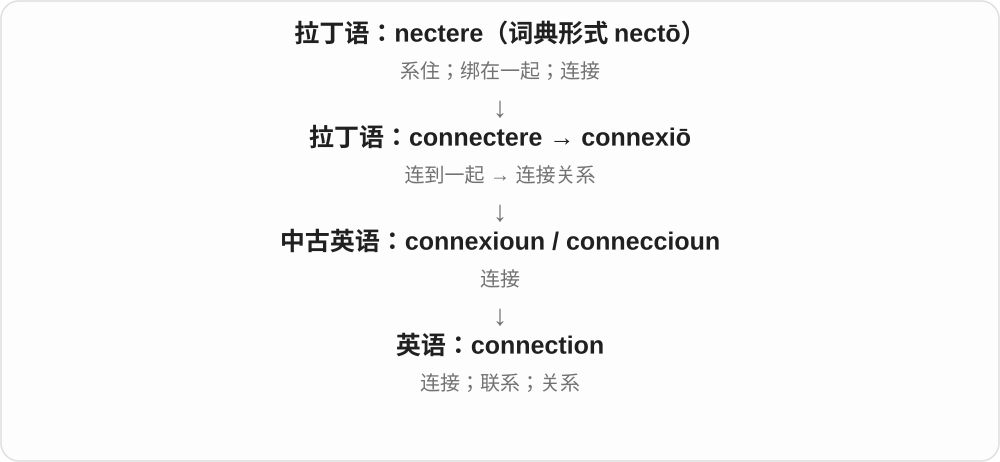
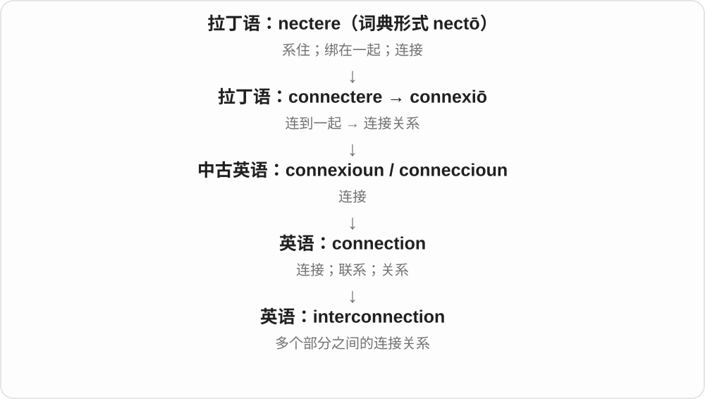
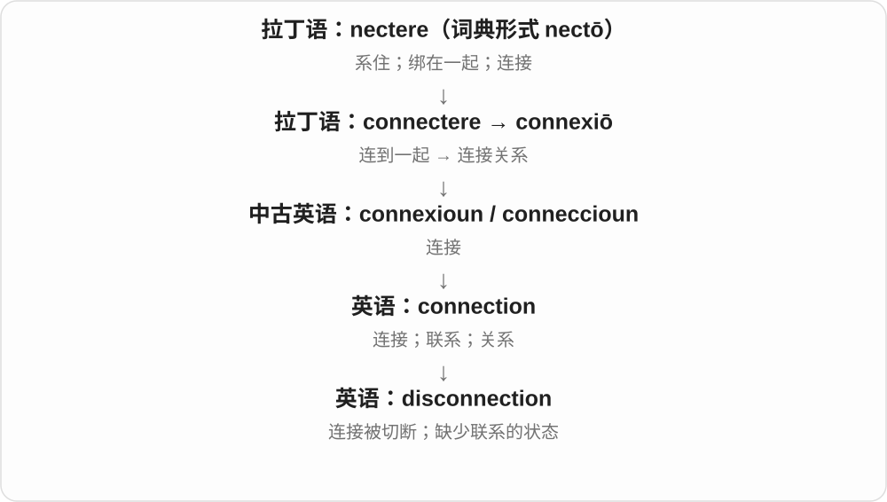
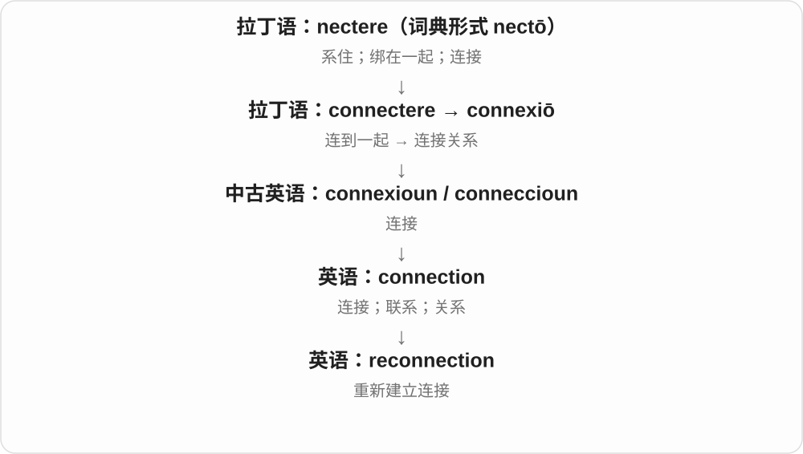

# 1508 · connection — 连接；关系；接头

[逐词精讲目录](../00_逐词精讲目录.md) · [总目录](../00_总目录_按常用程度.md)

## 核心词根与来源

connection 来自拉丁连结一支，联系 connect。interconnection 是互连，disconnection 是断开，reconnection 是重新接通，分别突出连接关系的变化。

**CONNECTION：把两端接上，或建立关系**

线缆接好，人与人相识，事实之间也能有联系。

- **连接状态**：connection
- **互连、断开与重连**：interconnection · disconnection · reconnection

## 词形与演化规律

connection／connexion 有历史拼写差别，现代 connection 普遍；inter- 互相、dis- 分开、re- 再次。

## 单词速览（按词族由简到繁）

同一基础词的相关扩展放在一起，先读基础形式，再读扩展；各组之间优先读常用的。具体词源关系见各词讲解。

| 单词 | 音标 | 核心意思 |
|---|---|---|
| [connection](#w-1) | /kəˈnekʃən/ | 连接；关系；衔接；人脉 |
| [interconnection](#w-2) | 英 /ˌɪntəkəˈnekʃən/；美 /ˌɪntərkəˈnekʃən/ | 互联；相互联系；互连通道 |
| [disconnection](#w-3) | /ˌdɪskəˈnekʃən/ | 断开；断连；疏离感 |
| [reconnection](#w-4) | /ˌriːkəˈnekʃən/ | 重新接通；恢复联系 |

## 逐词讲解

### 1. connection — 连接；关系；衔接；人脉

**音标**：/kəˈnekʃən/

**先抓住这个画面**

connection 是接上之后形成的那条线或关系：网络连通、两件事有关、车次接得上，都可以这样说。

**怎么拆**

来自拉丁语 connexiō，经中古英语传入；现代 connection 的拼写使 connect + -ion 的关系更明显。

**怎么变成今天的意思**

联系可以是物理的，也可以是因果、社交和交通上的。connections 还常指认识的人，因为这些关系能提供信息或机会。

**常见搭配与例句**

an internet connection；a connection between…；miss a connection；have connections；in connection with… 。

> We lost our internet connection during the meeting.

开会时，我们的网络连接断了。

> Is there a connection between these two problems?

这两个问题之间有联系吗？

**别混淆**

connection 只说明有某种联系，不自动证明因果。两件事同时发生，也需要进一步解释它们怎样有关。

### 2. interconnection — 互联；相互联系；互连通道

**音标**：英 /ˌɪntəkəˈnekʃən/；美 /ˌɪntərkəˈnekʃən/

**先抓住这个画面**

interconnection 把网络里的连接关系本身拿出来看：哪些部分相通，通过什么路径影响彼此。

**怎么拆**

inter- + connection，是“各部分之间的连接”。

**怎么变成今天的意思**

可指互联过程，也可指具体的连接路径。复数 interconnections 常用于讨论一组彼此交织的关系。

**常见搭配与例句**

the interconnection of…；interconnections between…；network interconnection。

> The diagram shows the interconnections between the power systems.

图示展示了各供电系统之间的互联关系。

> The course explores the interconnection of language and culture.

这门课程探讨语言与文化的相互联系。

**别混淆**

connection 可以只谈一条关联；interconnection 常把它放在多个部分组成的系统里看。并不要求每个点都直接接到所有其他点。

### 3. disconnection — 断开；断连；疏离感

**音标**：/ˌdɪskəˈnekʃən/

**先抓住这个画面**

disconnection 是从接通到断开的那件事，也可以是断开后留下的状态。

**怎么拆**

dis- + connection；也可与 disconnect 的动作名词关系一起理解。

**怎么变成今天的意思**

网络中它常是一次中断；人际语境中则可能指长期缺少交流和归属的感受。

**常见搭配与例句**

a sudden disconnection；service disconnection；a sense of disconnection；disconnection from… 。

> A brief disconnection interrupted the video call.

一次短暂断连打断了视频通话。

> The essay explores her sense of disconnection from city life.

这篇文章探讨了她对城市生活的疏离感。

**别混淆**

disconnection 可说实际连接中断；isolation 更突出孤立、缺少接触的处境。两者不必同时发生。

### 4. reconnection — 重新接通；恢复联系

**音标**：/ˌriːkəˈnekʃən/

**先抓住这个画面**

reconnection 是断开之后重新通起来的过程或结果，重点从“去重连”转到“重连这件事”。

**怎么拆**

re- + connection，也与 reconnect 相呼应。

**怎么变成今天的意思**

它既能谈电力和网络服务恢复，也能谈人与某个地方或群体重新建立联系。

**常见搭配与例句**

automatic reconnection；reconnection to the network；reconnection with family；a reconnection fee。

> The software supports automatic reconnection after a network failure.

软件支持在网络故障后自动重新连接。

> The visit marked her reconnection with the town where she grew up.

这次回访标志着她重新与自己长大的小镇建立了联系。

**别混淆**

reconnection 说恢复连接；recovery 更宽，可以是整个系统或身体恢复。连上网络不代表所有系统功能都恢复了。

## 这一组要分清什么

connection 可以是社会关系或交通换乘，不只是一根实体线。reconnection 也不保证恢复全部功能，须看语境。

## 串起来练习

After the disconnection, reconnection restored the link between the systems.

断开之后，重新连接恢复了系统之间的链路。
