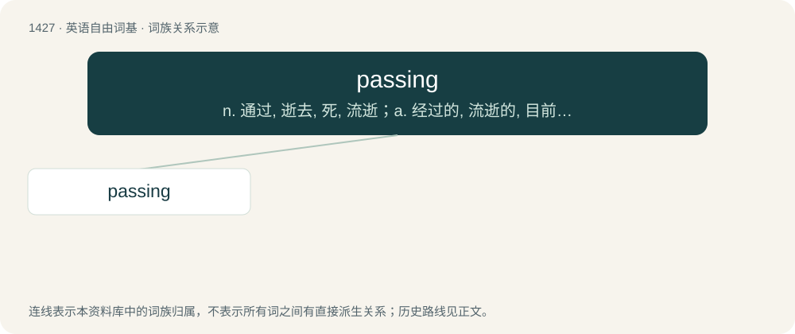

# 1508 · passing — n. 通过, 逝去, 死, 流逝；a. 经过的, 流逝的, 目前的, 短暂的, 及格的, 仓促的

[总目录](../00_总目录_按常用程度.md)

**类型**：英语自由词基　｜　**来源语言**：见词源记录

## 核心含义与来源

- 核心含义：n. 通过, 逝去, 死, 流逝；a. 经过的, 流逝的, 目前的, 短暂的, 及格的, 仓促的
- 英文含义：That passes away; ephemeral.
- 词形：passing

**来源记录 1**（形容词；That passes away; ephemeral.）

From pass + -ing.

## 词族图

## 单词速览（常用到不常用）

| 单词 | 音标 | 释义 |
|---|---|---|
| [passing](#w-1) | 英 /ˈpɑːsɪŋ/ | n. 通过, 逝去, 死, 流逝；a. 经过的, 流逝的, 目前的, 短暂的, 及格的, 仓促的 |

## 逐词详解

### 1. passing

**词性**：形容词　｜　**音标**：英 /ˈpɑːsɪŋ/

**中文释义**：n. 通过, 逝去, 死, 流逝；a. 经过的, 流逝的, 目前的, 短暂的, 及格的, 仓促的

**英文义项**：That passes away; ephemeral. / Vague, cursory.

**构词拆分**：pass + -ing

**词源与演化**：

From pass + -ing.

**用法示例／搭配（非完整句）**：

> to have a passing acquaintance with somebody or something

该用例对应义项：Vague, cursory.
