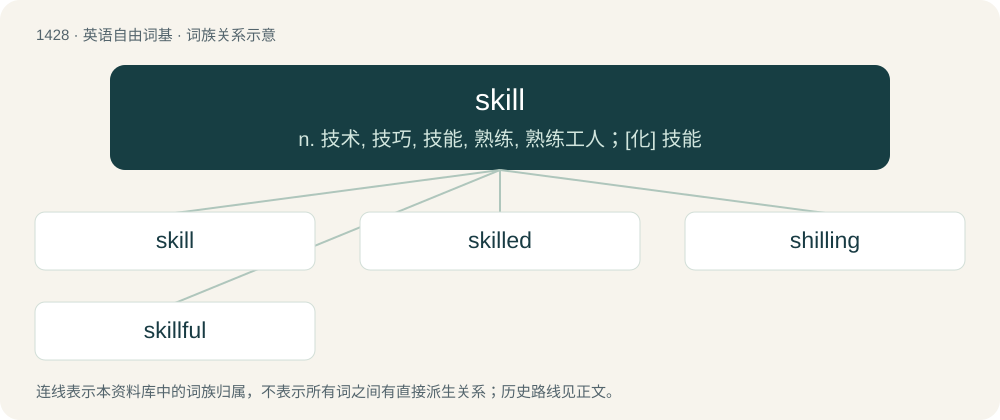

# 1509 · skill — n. 技术, 技巧, 技能, 熟练, 熟练工人；\[化\] 技能

[总目录](../00_总目录_按常用程度.md)

**类型**：英语自由词基　｜　**来源语言**：见词源记录

## 核心含义与来源

- 核心含义：n. 技术, 技巧, 技能, 熟练, 熟练工人；\[化\] 技能
- 英文含义：A capacity to do something well; a technique, an ability, usually acquired or learned, as opposed to abilities that are regarded as innate.
- 词形：skill

**多个词源／构词路径**：同一拼写可能有不同来源；以下按词性和含义分别列出。

**来源记录 1**（名词；A capacity to do something well; a technique, an ability, usually acquired or learned, as opposed to abilities that are regarded as innate.）

From Middle English skill, skille (also schil, schile), from Old Norse skil (“a distinction, discernment, knowledge”), from Proto-Germanic \*skilją (“separation, limit”), from Proto-Indo-European \*(s)kelH- (“to split, cut”). Cognate with Danish skel (“a separation, boundary, divide”), Swedish skäl (“reason”), Dutch verschil (“difference”) and schillen (“to separate the outer layer (schil) from the product”, verb).

**来源记录 2**（动词；To set apart; separate.）

From Middle English skilen (also schillen), partly from Old English scilian (“to separate, part, divide off”); and partly from Old Norse skilja (“to divide, separate”); both from Proto-Germanic \*skilōną, \*skiljaną (“to divide, limit”), from Proto-Indo-European \*(s)kelH- (“to split, cut”). Cognate with Danish skille (“to separate, discard”), Swedish skilja (“to distinguish, differentiate, part”), Icelandic skilja (“to understand”), Low German schelen (“to make a difference; to be squint-eyed”), Dutch schelen (“to make a difference”).

## 词族图

## 单词速览（常用到不常用）

| 单词 | 音标 | 释义 |
|---|---|---|
| [skill](#w-1) | /skɪl/ | n. 技术, 技巧, 技能, 熟练, 熟练工人；\[化\] 技能 |
| [skilled](#w-2) | /skɪld/ | a. 熟练的；\[经\] 熟练的, 有技能的 |
| [shilling](#w-3) | 英 /ˈʃɪlɪŋ/ | n. 先令；\[经\] 先令 |
| [skillful](#w-4) | /ˈskɪl.fəl/ | a. 熟练的, 巧妙的；\[机\] 熟练的 |

## 逐词详解

### 1. skill

**词性**：名词　｜　**音标**：/skɪl/

**中文释义**：n. 技术, 技巧, 技能, 熟练, 熟练工人；\[化\] 技能

**英文义项**：A capacity to do something well; a technique, an ability, usually acquired or learned, as opposed to abilities that are regarded as innate. / A reusable configuration (prompt) that defines how an AI agent performs a specific task.

**词源与演化**：

From Middle English skill, skille (also schil, schile), from Old Norse skil (“a distinction, discernment, knowledge”), from Proto-Germanic \*skilją (“separation, limit”), from Proto-Indo-European \*(s)kelH- (“to split, cut”). Cognate with Danish skel (“a separation, boundary, divide”), Swedish skäl (“reason”), Dutch verschil (“difference”) and schillen (“to separate the outer layer (schil) from the product”, verb).

**例句**：

> Doing that coaching course not only taught me useful skills on the field, but also some important life skills.

该用例对应义项：A capacity to do something well; a technique, an ability, usually acquired or learned, as opposed to abilities that are regarded as innate.

### 2. skilled

**词性**：形容词　｜　**音标**：/skɪld/

**中文释义**：a. 熟练的；\[经\] 熟练的, 有技能的

**英文义项**：Having or showing skill; skillful. / Requiring special abilities or training.

**构词拆分**：skill + -ed

**词源与演化**：

From skill (noun) + -ed.

**例句**：

> Only the most skilled gymnasts make an Olympic team.

该用例对应义项：having or showing or requiring special skill

### 3. shilling

**词性**：名词　｜　**音标**：英 /ˈʃɪlɪŋ/

**中文释义**：n. 先令；\[经\] 先令

**英文义项**：The currency of Kenya, Somalia, Tanzania and Uganda.

**构词拆分**：skill + -ing

**词源与演化**：

From Middle English schilling, shilling, from Old English sċilling, from Proto-West Germanic \*skilling, from Proto-Germanic \*skillingaz, equivalent to skill + -ing. Doublet of scalding and schilling. Compare typologically Russian рубль (rublʹ) (akin to руби́ть (rubítʹ)), полти́на (poltína), полти́нник (poltínnik) (akin to Proto-Slavic \*tęti).

**例句**：

> Last May we bought twenty-five bulbs of Lilium auratum for a shilling.

### 4. skillful

**词性**：形容词　｜　**音标**：/ˈskɪl.fəl/

**中文释义**：a. 熟练的, 巧妙的；\[机\] 熟练的

**英文义项**：Possessing skill; skilled. / Requiring skill.

**构词拆分**：skill + -ful

**词源与演化**：

From Middle English skilful, skylfull, scelvol, equivalent to skill + -ful.

**用法示例／搭配（非完整句）**：

> she's a skillful mechanical

该用例对应义项：Possessing skill; skilled.
