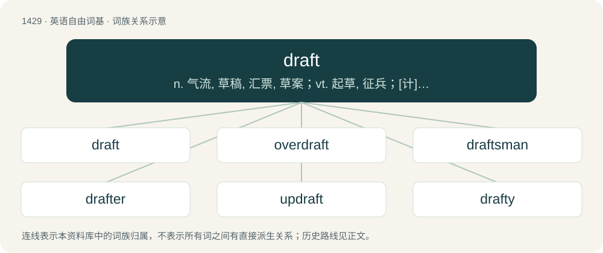

# 1511 · draft — n. 气流, 草稿, 汇票, 草案；vt. 起草, 征兵；\[计\] 草稿

[总目录](../00_总目录_按常用程度.md)

**类型**：英语自由词基　｜　**来源语言**：见词源记录

## 核心含义与来源

- 核心含义：n. 气流, 草稿, 汇票, 草案；vt. 起草, 征兵；\[计\] 草稿
- 英文含义：A current of air, usually coming into a room or vehicle.
- 词形：draft

**来源记录 1**（名词；A current of air, usually coming into a room or vehicle.）

A phonetic spelling of draught (compare laughter), from Middle English draught, draght (“that which is pulled; that which is drawn up, a design”), from Old English \*dreaht, \*dræht, from Proto-West Germanic \*drahti, \*drahtu, from Proto-Germanic \*drahtuz (“a pulling, drawing”). Cognate with Dutch dracht, German Tracht, Icelandic dráttur. By surface analysis, draw + -t.

## 词族图

## 单词速览（常用到不常用）

| 单词 | 音标 | 释义 |
|---|---|---|
| [draft](#w-1) | 英 /dɹɑːft/；美 /dɹæft/ | n. 气流, 草稿, 汇票, 草案；vt. 起草, 征兵；\[计\] 草稿 |
| [overdraft](#w-2) | 英 /ˈəʊvədɹɑːft/；美 /ˈoʊvɚdɹæft/ | n. 透支, 透支额, 气流, 过度通风；\[经\] 透支 |
| [draftsman](#w-3) | /ˈdræftsmən/ | n. 起草者, 制图员, 图案工；\[机\] 绘图员 |
| [drafter](#w-4) | /ˈdræftə/ | n. 起草者 |
| [updraft](#w-5) | /ˈʌpdrɑːft/ | a. 向上通风的 |
| [drafty](#w-6) | 英 /ˈdɹɑːfti/；美 /ˈdɹæfti/ | a. 通风良好的, 有穿堂风的 |
| [drafthouse](#w-7) |  | 【英文】A business establishment where alcoholic beverages such as beer, wine, ale, etc, are served, but not hard liquor. |
| [downdraft](#w-8) | /ˈdaundrɑːft/ | n. &lt;美&gt;=downdraught |

## 逐词详解

### 1. draft

**词性**：名词　｜　**音标**：英 /dɹɑːft/；美 /dɹæft/

**中文释义**：n. 气流, 草稿, 汇票, 草案；vt. 起草, 征兵；\[计\] 草稿

**英文义项**：A current of air, usually coming into a room or vehicle. / The draw through a flue of gasses or smoke resulting from a combustion process.

**构词拆分**：By surface analysis, draw + -t

**词源与演化**：

A phonetic spelling of draught (compare laughter), from Middle English draught, draght (“that which is pulled; that which is drawn up, a design”), from Old English \*dreaht, \*dræht, from Proto-West Germanic \*drahti, \*drahtu, from Proto-Germanic \*drahtuz (“a pulling, drawing”). Cognate with Dutch dracht, German Tracht, Icelandic dráttur. By surface analysis, draw + -t.

**例句**：

> His first drafts were better than most authors' final products.

该用例对应义项：A version of a written work (such as a book or paper) or drawing.

### 2. overdraft

**词性**：名词　｜　**音标**：英 /ˈəʊvədɹɑːft/；美 /ˈoʊvɚdɹæft/

**中文释义**：n. 透支, 透支额, 气流, 过度通风；\[经\] 透支

**英文义项**：The act of overdrawing a bank account. / The amount overdrawn.

**构词拆分**：over- + draft

**词源与演化**：

From over- + draft.

**例句**：

> The bank have given me an overdraft of $2000.

该用例对应义项：The maximum amount that may be overdrawn.

### 3. draftsman

**词性**：名词　｜　**音标**：/ˈdræftsmən/

**中文释义**：n. 起草者, 制图员, 图案工；\[机\] 绘图员

**英文义项**：A person who drafts legal documents.

**构词拆分**：draft + -s- + -man

**词源与演化**：

From draft + -s- + -man.

**例句**：

> We got a draftsman to design our house instead of an architect.

### 4. drafter

**词性**：名词　｜　**音标**：/ˈdræftə/

**中文释义**：n. 起草者

**英文义项**：A person who prepares technical drawings and plans. / A person who prepares drafts.

**构词拆分**：From draft + -er.

**词源与演化**：

From draft + -er.

### 5. updraft

**词性**：名词　｜　**音标**：/ˈʌpdrɑːft/

**中文释义**：a. 向上通风的

**英文义项**：an upward current of air, especially a strong one

**构词拆分**：From up- + draft.

**词源与演化**：

From up- + draft.

### 6. drafty

**词性**：形容词　｜　**音标**：英 /ˈdɹɑːfti/；美 /ˈdɹæfti/

**中文释义**：a. 通风良好的, 有穿堂风的

**英文义项**：Characterized by gusts of wind; windy. / Not properly sealed against drafts (draughts).

**构词拆分**：draft + -y

**词源与演化**：

From earlier draughty, equivalent to draft + -y.

**例句**：

> It's really drafty (draughty) in here.

该用例对应义项：Not properly sealed against drafts (draughts).

### 7. drafthouse

**词性**：名词

**英文义项**：A business establishment where alcoholic beverages such as beer, wine, ale, etc, are served, but not hard liquor.

**构词拆分**：draft + house

**词源与演化**：

From draft + house.

### 8. downdraft

**词性**：名词　｜　**音标**：/ˈdaundrɑːft/

**中文释义**：n. &lt;美&gt;=downdraught

**英文义项**：A strong, downward air current; an air pocket or air hole.

**构词拆分**：From down- + draft.

**词源与演化**：

From down- + draft.

**例句**：

> A powerful downdraft sent the plane plunging.
