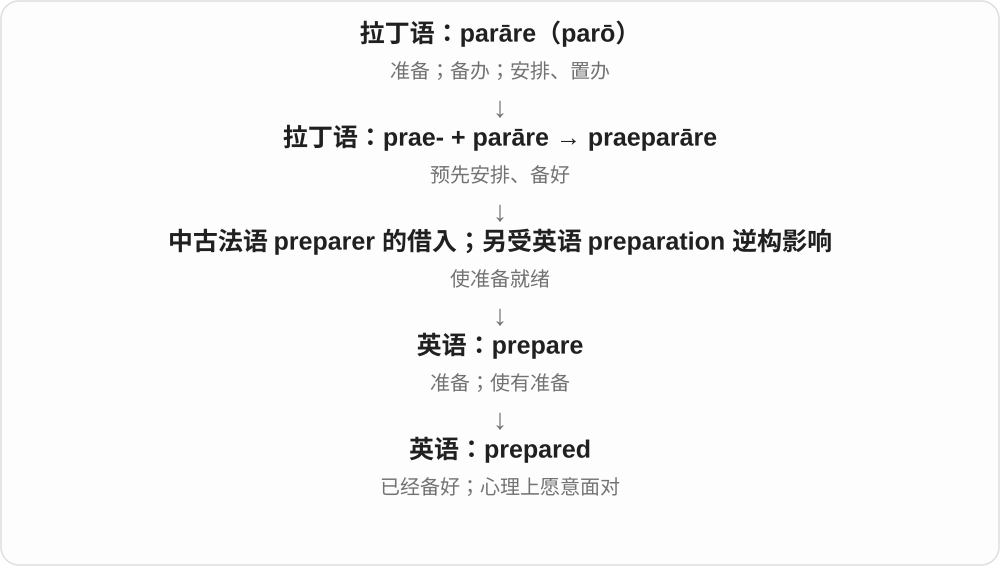
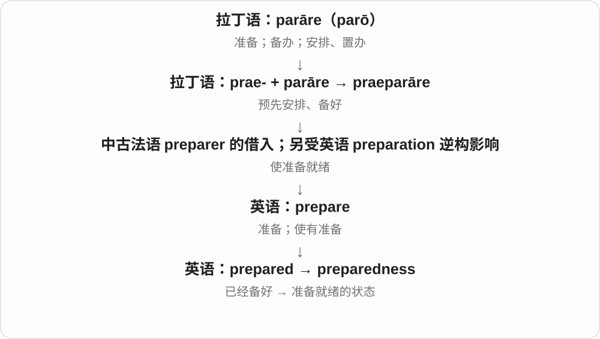
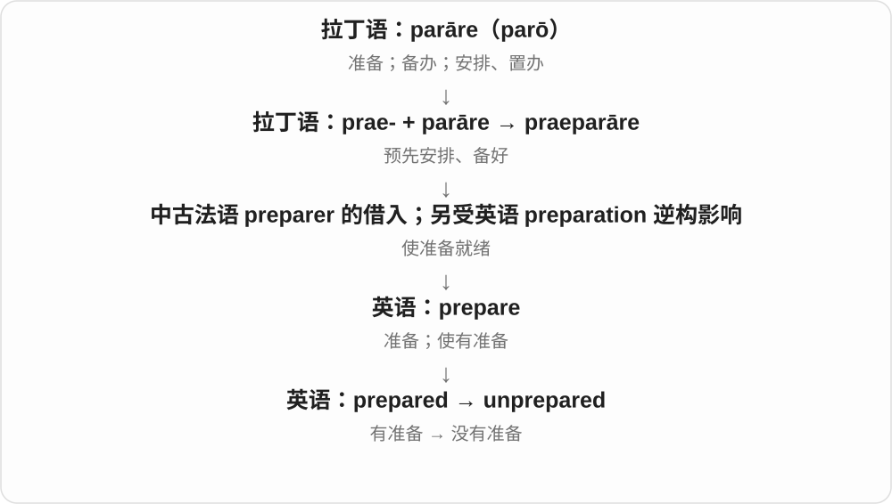

# 1511 · prepared — 准备好的；有准备的

[逐词精讲目录](../00_逐词精讲目录.md) · [总目录](../00_总目录_按常用程度.md)

## 核心词根与来源

prepared 来自 prepare 的过去分词，形容词化后表示准备好的。preparedness 强调准备状态，unprepared 是没有准备好的。

**PREPARED：事情发生前，相关准备已经做过**

资料带齐、方案想好，遇到情况就能开始。

- **状态与否定**：prepared · unprepared
- **准备程度**：preparedness

## 词形与演化规律

prepared for a task、prepared to do；prepared + -ness → preparedness；un- 表示否定。be prepared to 也可表示愿意承受或采取某种行动。

## 单词速览（按词族由简到繁）

同一基础词的相关扩展放在一起，先读基础形式，再读扩展；各组之间优先读常用的。具体词源关系见各词讲解。

| 单词 | 音标 | 核心意思 |
|---|---|---|
| [prepared](#w-1) | 英 /prɪˈpeəd/；美 /prɪˈperd/ | 准备好的；愿意并打算做的 |
| [preparedness](#w-2) | 英 /prɪˈpeərɪdnəs/；美 /prɪˈperdnəs/ | 准备就绪的状态；应变准备；愿意做的态度 |
| [unprepared](#w-3) | 英 /ˌʌnprɪˈpeəd/；美 /ˌʌnprɪˈperd/ | 没有准备好的；措手不及的 |

## 逐词讲解

### 1. prepared — 准备好的；愿意并打算做的

**音标**：英 /prɪˈpeəd/；美 /prɪˈperd/

**先抓住这个画面**

prepared 像出门前把该带的东西都放好；也可表示心里已接受将要面对的行动。

**怎么拆**

prepare + -ed，过去分词进一步作形容词。

**怎么变成今天的意思**

prepared for an exam 是备好考试；prepared to compromise 常是愿意作出妥协，不只指完成准备动作。

**常见搭配与例句**

be prepared for；be prepared to do；prepared food。

> She came prepared with a list of questions.

她带着问题清单，有备而来。

> We are prepared to change the date.

我们愿意更改日期。

**别混淆**

prepared 强调事先准备或意愿；ready 强调此刻已能开始，来源与用法不必完全相同。

### 2. preparedness — 准备就绪的状态；应变准备；愿意做的态度

**音标**：英 /prɪˈpeərɪdnəs/；美 /prɪˈperdnəs/

**先抓住这个画面**

preparedness 像把手电、计划、分工都放到位之后的那份底气：真有事情发生，知道该怎么应对。

**怎么拆**

prepared + -ness，是英语中从“备好的”形成表示状态的名词。

**怎么变成今天的意思**

常说 emergency preparedness，涉及面对突发事件时是否备好人员、物资和安排。preparedness to do 还可以表示愿意采取某种行动。英式读法常在 d 前保留一个 /ɪ/。

**常见搭配与例句**

emergency preparedness；a state of preparedness；preparedness to cooperate。

> The exercise tested the team’s emergency preparedness.

这次演练检验了团队的应急准备情况。

> Her preparedness to listen made the discussion easier.

她愿意倾听的态度让讨论顺畅了许多。

**别混淆**

preparation 偏向准备过程和具体工作；preparedness 偏向准备达到的状态、应对能力或意愿。

### 3. unprepared — 没有准备好的；措手不及的

**音标**：英 /ˌʌnprɪˈpeəd/；美 /ˌʌnprɪˈperd/

**先抓住这个画面**

unprepared 像突然被点名发言，脑中的材料还没排好，手里也没有要用的东西。

**怎么拆**

un-（不）+ prepared（备好的），是英语中的否定派生。

**怎么变成今天的意思**

既可说没做实际准备，也可说没想到事情会那么难、那么震撼。unprepared for the news 常指心理上毫无准备。

**常见搭配与例句**

unprepared for；unprepared to do；catch someone unprepared。

> I was unprepared for the sudden change in the weather.

我没有料到天气会突然变化。

> She admitted that she was unprepared to answer such a detailed question.

她承认自己还没准备好回答这么具体的问题。

**别混淆**

unwilling 是不愿意；unprepared 是没有做好准备，可能很愿意但条件还不够。

## 这一组要分清什么

prepared 是已准备好的状态，preparing 是正在准备；对某事有准备不等于保证不会出错。

## 串起来练习

Their preparedness helped them remain calm when others were unprepared.

他们的充分准备帮助他们在别人毫无准备时仍保持镇定。
