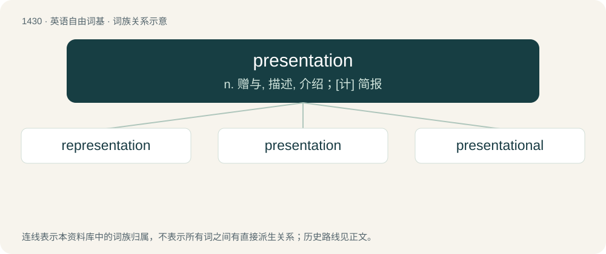

# 1513 · presentation — n. 赠与, 描述, 介绍；\[计\] 简报

[总目录](../00_总目录_按常用程度.md)

**类型**：英语自由词基　｜　**来源语言**：见词源记录

## 核心含义与来源

- 核心含义：n. 赠与, 描述, 介绍；\[计\] 简报
- 英文含义：The act of presenting, or something presented.
- 词形：presentation

**来源记录 1**（名词；The act of presenting, or something presented.）

From Old French presentation (French présentation), from Latin praesentātiōnem, accusative singular of praesentātiō (“representation, exhibition”). Morphologically present + -ation.

## 词族图

## 单词速览（常用到不常用）

| 单词 | 音标 | 释义 |
|---|---|---|
| [representation](#w-1) | /ˌɹiː.pɹə.zɛnˈteɪ.ʃən/ | 【英文】An act of representing, i.e. presenting again. |
| [presentation](#w-2) | 英 /ˌpɹɛzn̩ˈteɪʃn̩/ | n. 赠与, 描述, 介绍；\[计\] 简报 |
| [presentational](#w-3) | /,prezənˈteiʃənəl,,priː-/ | a. 表象的, 上演的, 演出的, 本身有意义的, 描述性的 |

## 逐词详解

### 1. representation

**词性**：名词　｜　**音标**：/ˌɹiː.pɹə.zɛnˈteɪ.ʃən/

**英文义项**：An act of representing, i.e. presenting again.

**构词拆分**：re- + presentation

**词源与演化**：

From re- + presentation.

**用法示例／搭配（非完整句）**：

> rates of representation to the emergency department

该用例对应义项：An act of representing, i.e. presenting again.

### 2. presentation

**词性**：名词　｜　**音标**：英 /ˌpɹɛzn̩ˈteɪʃn̩/

**中文释义**：n. 赠与, 描述, 介绍；\[计\] 简报

**英文义项**：The act of presenting, or something presented. / The outward appearance or representation of a person or thing to the human mind.

**构词拆分**：present + -ation

**词源与演化**：

From Old French presentation (French présentation), from Latin praesentātiōnem, accusative singular of praesentātiō (“representation, exhibition”). Morphologically present + -ation.

**例句**：

> The presentation of the thirty-four-year-old male in the emergency room was slight fever, dilated pupils, and marked disorientation.

该用例对应义项：The symptoms, signs, and other possible indications of disease, trauma, etc., that are exhibited by a patient who has sought, or has otherwise come to, the attention of a physician.

### 3. presentational

**词性**：形容词　｜　**音标**：/,prezənˈteiʃənəl,,priː-/

**中文释义**：a. 表象的, 上演的, 演出的, 本身有意义的, 描述性的

**英文义项**：Of, or pertaining to, presentation(s).

**构词拆分**：From presentation + -al.

**词源与演化**：

From presentation + -al.

**例句**：

> What Whitehead calls `perception in the presentational immediacy'.

该用例对应义项：of or relating to a presentation (especially in psychology or philosophy)
