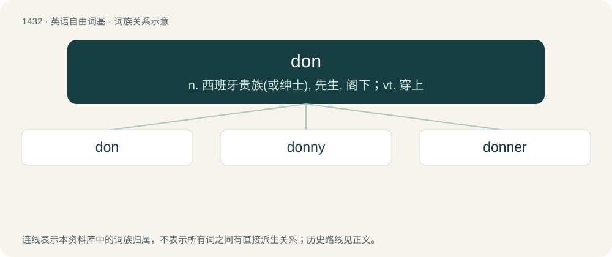

# 1515 · don — n. 西班牙贵族(或绅士), 先生, 阁下；vt. 穿上

[总目录](../00_总目录_按常用程度.md)

**类型**：英语自由词基　｜　**来源语言**：见词源记录

## 核心含义与来源

- 核心含义：n. 西班牙贵族(或绅士), 先生, 阁下；vt. 穿上
- 英文含义：A university professor, particularly one at Oxford or Cambridge.
- 词形：don

**多个词源／构词路径**：同一拼写可能有不同来源；以下按词性和含义分别列出。

**来源记录 1**（名词；A university professor, particularly one at Oxford or Cambridge.）

From Latin dominus (“lord, head of household”), akin to Italian don, Sicilian don, Spanish don; from domus (“house”). Doublet of dom, domine, dominie, and dominus.

**来源记录 2**（动词；To put on clothing; to dress (oneself) in an article of personal attire.）

From Middle English don (“to put on”), from Old English dōn on; equivalent to do + on. Compare also doff, dup, dout.

## 词族图

## 单词速览（常用到不常用）

| 单词 | 音标 | 释义 |
|---|---|---|
| [don](#w-1) | 英 /dɒn/；美 /dɑn/ | n. 西班牙贵族(或绅士), 先生, 阁下；vt. 穿上 |
| [donny](#w-2) | /ˈdɒni/ | 【英文】Don; bloke; dude; any man. |
| [donner](#w-3) |  | 【英文】One who dons (something). |

## 逐词详解

### 1. don

**词性**：名词　｜　**音标**：英 /dɒn/；美 /dɑn/

**中文释义**：n. 西班牙贵族(或绅士), 先生, 阁下；vt. 穿上

**英文义项**：A university professor, particularly one at Oxford or Cambridge. / An employee of a university residence who lives among the student residents.

**词源与演化**：

From Latin dominus (“lord, head of household”), akin to Italian don, Sicilian don, Spanish don; from domus (“house”). Doublet of dom, domine, dominie, and dominus.

**例句**：

> I don't want to spend the rest of my life regretting it.

### 2. donny

**词性**：名词　｜　**音标**：/ˈdɒni/

**英文义项**：Don; bloke; dude; any man.

**构词拆分**：don (“bloke, dude”) + -y

**词源与演化**：

From don (“bloke, dude”) + -y.

**例句**：

> Big up that donny for giving man a free meal.

该用例对应义项：Don; bloke; dude; any man.

### 3. donner

**词性**：名词

**英文义项**：One who dons (something).

**构词拆分**：don + -er

**词源与演化**：

From don + -er.
