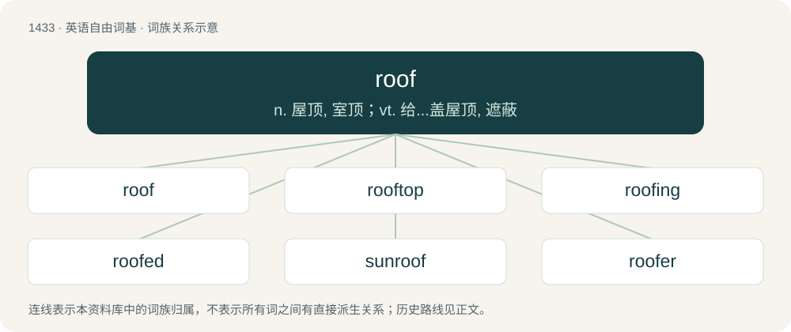

# 1516 · roof — n. 屋顶, 室顶；vt. 给...盖屋顶, 遮蔽

[总目录](../00_总目录_按常用程度.md)

**类型**：英语自由词基　｜　**来源语言**：见词源记录

## 核心含义与来源

- 核心含义：n. 屋顶, 室顶；vt. 给...盖屋顶, 遮蔽
- 英文含义：The external covering at the top of a building.
- 词形：roof

**多个词源／构词路径**：同一拼写可能有不同来源；以下按词性和含义分别列出。

**来源记录 1**（名词；The external covering at the top of a building.）

From Middle English rhof, rof, roof, rooff, rufe, ruffe, from Old English hrōf (“roof; heaven, sky”), from Proto-West Germanic \*hrōf, from Proto-Germanic \*hrōfą (“roof”), from Proto-Indo-European \*ḱrapo- (“roof”), from \*krāwə- (“to cover, heap”). Cognates Cognate with Dutch roef (“cabin on a boat”), Faroese rógv (“roof”); also Czech, Polish, and Slovene strop (“ceiling”), Russian строп (strop, “attic, loft, roof”), Serbo-Croatian стро̏п, strȍp (“ceiling”).

**来源记录 2**（动词；To cover or furnish with a roof.）

From Middle English rofen, roven (“to roof”), from the noun (see above).

## 词族图

## 单词速览（常用到不常用）

| 单词 | 音标 | 释义 |
|---|---|---|
| [roof](#w-1) | 英 /ɹuːf/；美 /ɹuːf/ | n. 屋顶, 室顶；vt. 给...盖屋顶, 遮蔽 |
| [rooftop](#w-2) | 英 /ˈɹuːfˌtɒp/；美 /ˈɹufˌtɑp/ | n. 屋顶 |
| [roofing](#w-3) | /ˈruːfiŋ/ | n. 盖屋顶 |
| [roofed](#w-4) | /ruːft/ | a. 有顶的, 有屋顶的 |
| [sunroof](#w-5) | 英 /ˈsʌnˌɹuːf/ | n. 汽车顶上可开启的遮阳篷顶 |
| [roofer](#w-6) | 英 /ˈɹuːfə(ɹ)/；美 /ˈɹufɚ/ | n. 盖屋顶的人, (客人致主人的)道谢函 |
| [roofline](#w-7) | /ˈruːflain,ˈrj-/ | n. 屋顶(或车顶等)轮廓线 |

## 逐词详解

### 1. roof

**词性**：名词　｜　**音标**：英 /ɹuːf/；美 /ɹuːf/

**中文释义**：n. 屋顶, 室顶；vt. 给...盖屋顶, 遮蔽

**英文义项**：The external covering at the top of a building. / The top external level of a building.

**词源与演化**：

From Middle English rhof, rof, roof, rooff, rufe, ruffe, from Old English hrōf (“roof; heaven, sky”), from Proto-West Germanic \*hrōf, from Proto-Germanic \*hrōfą (“roof”), from Proto-Indo-European \*ḱrapo- (“roof”), from \*krāwə- (“to cover, heap”). Cognates Cognate with Dutch roef (“cabin on a boat”), Faroese rógv (“roof”); also Czech, Polish, and Slovene strop (“ceiling”), Russian строп (strop, “attic, loft, roof”), Serbo-Croatian стро̏п, strȍp (“ceiling”).

**例句**：

> The roof was blown off by the tornado.

该用例对应义项：The external covering at the top of a building.

### 2. rooftop

**词性**：名词　｜　**音标**：英 /ˈɹuːfˌtɒp/；美 /ˈɹufˌtɑp/

**中文释义**：n. 屋顶

**英文义项**：The area atop a roof. / The top layer of a roof; the material covering or composing a roof.

**构词拆分**：From roof + top.

**词源与演化**：

From roof + top.

**例句**：

> The staircase leading to the rooftop is narrow, steep, and dark.

### 3. roofing

**词性**：名词　｜　**音标**：/ˈruːfiŋ/

**中文释义**：n. 盖屋顶

**英文义项**：Material used on the outside of a roof, such as shingles. / The process of constructing a roof or roofs.

**构词拆分**：From roof + -ing (“material, collection”).

**词源与演化**：

From roof + -ing (“material, collection”).

### 4. roofed

**词性**：形容词　｜　**音标**：/ruːft/

**中文释义**：a. 有顶的, 有屋顶的

**英文义项**：Having a roof, or a particular kind of roof.

**构词拆分**：roof + -ed

**词源与演化**：

From Middle English rofed derived from the noun, replaced earlier Old English hrēfed attested in unoferhrēfed (“unoverroofed”), equivalent to roof + -ed.

**例句**：

> Now and then we passed a moorland cottage, walled and roofed with stone.

### 5. sunroof

**词性**：名词　｜　**音标**：英 /ˈsʌnˌɹuːf/

**中文释义**：n. 汽车顶上可开启的遮阳篷顶

**英文义项**：A fixed or operable opening in a vehicle roof (car or truck) which allows fresh air and/or light to enter the passenger compartment. A sunroof may include a transparent or opaque panel and may be manually operated or power driven.

**构词拆分**：sun + roof

**词源与演化**：

From sun + roof.

**例句**：

> `sunshine-roof' is a British term for `sunroof'.

该用例对应义项：an automobile roof having a sliding or raisable panel

### 6. roofer

**词性**：名词　｜　**音标**：英 /ˈɹuːfə(ɹ)/；美 /ˈɹufɚ/

**中文释义**：n. 盖屋顶的人, (客人致主人的)道谢函

**英文义项**：A craftsman who lays, or repairs roofs. / A daredevil who performs stunts on tops of skyscrapers.

**构词拆分**：From roof + -er.

**词源与演化**：

From roof + -er.

**例句**：

> A roofer had to come to repair the storm damage to the roof.

### 7. roofline

**词性**：名词　｜　**音标**：/ˈruːflain,ˈrj-/

**中文释义**：n. 屋顶(或车顶等)轮廓线

**英文义项**：The profile of a roof or a series of roofs.

**构词拆分**：roof + line

**词源与演化**：

From roof + line.
