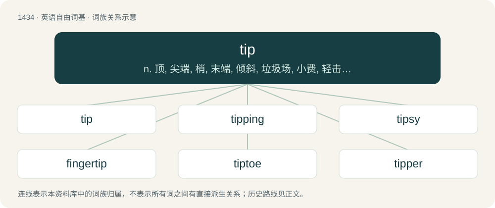

# 1517 · tip — n. 顶, 尖端, 梢, 末端, 倾斜, 垃圾场, 小费, 轻击, 指点, 秘密消息；vt. 装顶端, 使倾斜, 使翻倒, 泄露, 告诫, 暗示, 给...小费, 轻击；vi. 倾斜, 翻倒, 倾覆, 踮脚走, 给小费

[总目录](../00_总目录_按常用程度.md)

**类型**：英语自由词基　｜　**来源语言**：见词源记录

## 核心含义与来源

- 核心含义：n. 顶, 尖端, 梢, 末端, 倾斜, 垃圾场, 小费, 轻击, 指点, 秘密消息；vt. 装顶端, 使倾斜, 使翻倒, 泄露, 告诫, 暗示, 给...小费, 轻击；vi. 倾斜, 翻倒, 倾覆, 踮脚走, 给小费
- 英文含义：The extreme end of something, especially when pointed; e.g. the sharp end of a pencil.
- 词形：tip

**多个词源／构词路径**：同一拼写可能有不同来源；以下按词性和含义分别列出。

**来源记录 1**（名词；The extreme end of something, especially when pointed; e.g. the sharp end of a pencil.）

From Middle English tip, typ, tippe (“tip”), of obscure and uncertain origin. Perhaps distantly related to top. Related to Saterland Frisian Tip (“tip”), West Frisian tippe, tip (“tip”), Dutch tip (“tip”), German Low German Tip, Tippel (“tip”), dialectal German Zipf (“tip”) (diminutive Zipfel used in Standard German), Danish tip (“tip”), Swedish tipp (“tip”), Icelandic typpi (“knob, pin, penis”). Compare also Saterland Frisian Timpe (“tip”), West Frisian timpe (“tip”), Old English tæppa (“tap, spigot”), Middle High German züpfel (“pointed end, tip”).

**来源记录 2**（动词；(To cause) to become knocked over, fall down or overturn.）

From Late Middle English tippen, possibly from North Germanic/Scandinavian (compare Swedish tippa (“to topple over”)), or a special use of Etymology 1.

**来源记录 3**（动词；To give a small gratuity to, especially to an employee of someone who provides a service.）

Originally thieves' slang, of uncertain origin; according to the OED, probably related to sense 1.

**来源记录 4**（名词；A piece of private or secret information, especially imparted by someone with expert knowledge about sporting odds, business performance etc.）

Probably from tip (“to give, pass”) or tip (“to tap”), or a combination of the two.

## 词族图

## 单词速览（常用到不常用）

| 单词 | 音标 | 释义 |
|---|---|---|
| [tip](#w-1) | 英 /tɪp/ | n. 顶, 尖端, 梢, 末端, 倾斜, 垃圾场, 小费, 轻击, 指点, 秘密消息；vt. 装顶端, 使倾斜, 使翻倒, 泄露, 告诫, 暗示, 给...小费, 轻击；vi. 倾斜, 翻倒, 倾覆, 踮脚走, 给小费 |
| [tipping](#w-2) | /ˈtɪpɪŋ/ | n. 倾卸台 |
| [tipsy](#w-3) | /ˈtɪp.si/ | a. 喝醉的, 倾斜的 |
| [fingertip](#w-4) | 美 /ˈfɪŋɡɚˌtɪp/ | n. 指尖, 指套 |
| [tiptoe](#w-5) | 英 /ˈtɪpˌtəʊ/；美 /ˈtɪpˌtoʊ/ | n. 脚尖；vi. 用脚尖走；adv. 踮着脚 |
| [tipper](#w-6) | 英 /ˈtɪpə(ɹ)/；美 /ˈtɪpɚ/ | \[化\] 翻斗车 |
| [tippy](#w-7) | /ˈtɪpi/ | a. 头等的, 容易倾斜的, 多绒尖的 |
| [tipple](#w-8) | 英 /ˈtɪpəl/ | vt. (习惯性地)少量饮(酒)；vi. 饮酒；n. 酒, 含酒饮料 |
| [tipster](#w-9) | /ˈtipstə/ | n. 情报贩子；\[法\] 通报秘密消息者, 泄露内情者 |
| [wingtip](#w-10) | /ˈwiŋtip/ | n. 翼尖 |
| [tooltip](#w-11) | /ˈtu(ː)l.tɪp/ | 工具提示; 提示信息; 提示框; 提示文本 |

## 逐词详解

### 1. tip

**词性**：名词　｜　**音标**：英 /tɪp/

**中文释义**：n. 顶, 尖端, 梢, 末端, 倾斜, 垃圾场, 小费, 轻击, 指点, 秘密消息；vt. 装顶端, 使倾斜, 使翻倒, 泄露, 告诫, 暗示, 给...小费, 轻击；vi. 倾斜, 翻倒, 倾覆, 踮脚走, 给小费

**英文义项**：The extreme end of something, especially when pointed; e.g. the sharp end of a pencil. / A piece of metal, fabric or other material used to cover the top of something for protection, utility or decoration.

**词源与演化**：

From Middle English tip, typ, tippe (“tip”), of obscure and uncertain origin. Perhaps distantly related to top. Related to Saterland Frisian Tip (“tip”), West Frisian tippe, tip (“tip”), Dutch tip (“tip”), German Low German Tip, Tippel (“tip”), dialectal German Zipf (“tip”) (diminutive Zipfel used in Standard German), Danish tip (“tip”), Swedish tipp (“tip”), Icelandic typpi (“knob, pin, penis”). Compare also Saterland Frisian Timpe (“tip”), West Frisian timpe (“tip”), Old English tæppa (“tap, spigot”), Middle High German züpfel (“pointed end, tip”).

**例句**：

> a tip for an umbrella, a shoe, a gas burner, etc.

该用例对应义项：A piece of metal, fabric or other material used to cover the top of something for protection, utility or decoration.

### 2. tipping

**词性**：名词　｜　**音标**：/ˈtɪpɪŋ/

**中文释义**：n. 倾卸台

**英文义项**：The practice of leaving a tip (gratuity). / The act by which something is tipped or inclined.

**构词拆分**：From tip + -ing.

**词源与演化**：

From tip + -ing.

**例句**：

> Tom's grandfather told him stories about tipping over outhouses as a kid.

### 3. tipsy

**词性**：形容词　｜　**音标**：/ˈtɪp.si/

**中文释义**：a. 喝醉的, 倾斜的

**英文义项**：Slightly drunk, fuddled, staggering, foolish as a result of drinking alcoholic beverages. / Unsteady, askew.

**构词拆分**：tips + -y

**词源与演化**：

From tips + -y. Compare artsy, folksy, and sudsy.

**用法示例／搭配（非完整句）**：

> tipsy apple pie

该用例对应义项：Containing alcohol.

### 4. fingertip

**词性**：名词　｜　**音标**：美 /ˈfɪŋɡɚˌtɪp/

**中文释义**：n. 指尖, 指套

**英文义项**：The tip of the human finger.

**构词拆分**：finger + tip

**词源与演化**：

From finger + tip. Compare tiptoe and toetip.

**例句**：

> We want to take some blood from your fingertip for examinination.

### 5. tiptoe

**词性**：名词　｜　**音标**：英 /ˈtɪpˌtəʊ/；美 /ˈtɪpˌtoʊ/

**中文释义**：n. 脚尖；vi. 用脚尖走；adv. 踮着脚

**英文义项**：The tip of the toe.

**构词拆分**：tip + toe

**词源与演化**：

From Middle English tipto, typto; equivalent to tip + toe. Compare fingertip.

**例句**：

> He walks on tiptoe so as not to wake up the family.

### 6. tipper

**词性**：名词　｜　**音标**：英 /ˈtɪpə(ɹ)/；美 /ˈtɪpɚ/

**中文释义**：\[化\] 翻斗车

**英文义项**：Someone who tips; someone who gives a gratuity. / A small moustache.

**构词拆分**：tip + -er

**词源与演化**：

From tip + -er.

**例句**：

> The Americans are among the most generous tippers in the world.

该用例对应义项：Someone who tips; someone who gives a gratuity.

### 7. tippy

**词性**：形容词　｜　**音标**：/ˈtɪpi/

**中文释义**：a. 头等的, 容易倾斜的, 多绒尖的

**英文义项**：Clever, neat, smart. / Of tea, having a large amount of tips, or leaf buds.

**构词拆分**：tip (“apex”) + -y (diminutive)

**词源与演化**：

1790, tip (“apex”) + -y (diminutive). Sense of “clever” may be influenced by tip (“inside information”).

**例句**：

> Get up on your tippy toes.

### 8. tipple

**词性**：名词　｜　**音标**：英 /ˈtɪpəl/

**中文释义**：vt. (习惯性地)少量饮(酒)；vi. 饮酒；n. 酒, 含酒饮料

**英文义项**：An area near the entrance of mines which is used to load and unload coal. / An apparatus for unloading railroad freight cars by tipping them; the place where this is done.

**构词拆分**：tip + -le

**词源与演化**：

Unknown but possibly from a Scandinavian source (see Norwegian tipla), or from tip + -le.

### 9. tipster

**词性**：名词　｜　**音标**：/ˈtipstə/

**中文释义**：n. 情报贩子；\[法\] 通报秘密消息者, 泄露内情者

**英文义项**：A person who provides tips or advice to others, for example on the form of racehorses or the stock market. / One who provides tips or hints on how to succeed at a game.

**构词拆分**：tip (etymology 5) + -ster

**词源与演化**：

\* From tip (etymology 5) + -ster.

### 10. wingtip

**词性**：名词　｜　**音标**：/ˈwiŋtip/

**中文释义**：n. 翼尖

**英文义项**：The extreme tip of the wing of an aircraft, bird, flying insect, etc. / A part of a shoe, often with brogueing that extends backwards on both sides from the toe.

**构词拆分**：wing + tip

**词源与演化**：

From wing + tip.

### 11. tooltip

**词性**：名词　｜　**音标**：/ˈtu(ː)l.tɪp/

**中文释义**：工具提示; 提示信息; 提示框; 提示文本

**英文义项**：An element of a graphical user interface in the form of a box of text that appears when a cursor is made to hover over an item; normally used to explain the function of the item.

**构词拆分**：tool + tip

**词源与演化**：

From tool + tip, originally used with toolbars to provide a tip or hint as to what function each graphical icon represented. The term was introduced as ToolTip by Microsoft in the 1990s.
