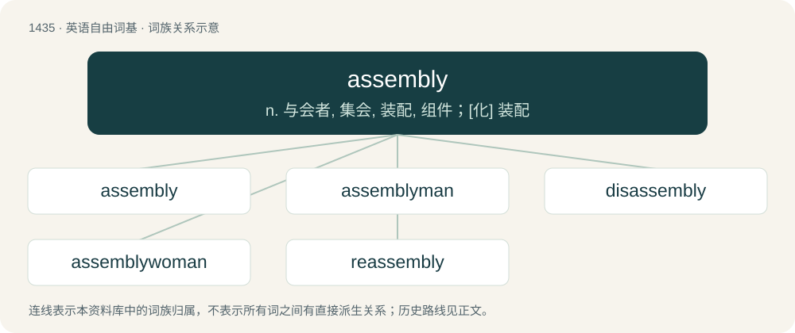

# 1518 · assembly — n. 与会者, 集会, 装配, 组件；\[化\] 装配

[总目录](../00_总目录_按常用程度.md)

**类型**：英语自由词基　｜　**来源语言**：见词源记录

## 核心含义与来源

- 核心含义：n. 与会者, 集会, 装配, 组件；\[化\] 装配
- 英文含义：A set of pieces that work together in unison as a mechanism or device.
- 词形：assembly

**来源记录 1**（名词；A set of pieces that work together in unison as a mechanism or device.）

From Middle English assemblee, from Anglo-Norman asemblee (Old French asemblee, French assemblée). By surface analysis, assemble + -y.

## 词族图

## 单词速览（常用到不常用）

| 单词 | 音标 | 释义 |
|---|---|---|
| [assembly](#w-1) | 英 /əˈsɛmb.lɪ/；美 /əˈsɛmb.li/ | n. 与会者, 集会, 装配, 组件；\[化\] 装配 |
| [assemblyman](#w-2) | /əˈsemblimən/ | n. 议员 |
| [disassembly](#w-3) | 英 /dɪsəˈsɛmbli/ | n. 拆卸, 分解；\[计\] 拆卸, 分解 |
| [assemblywoman](#w-4) | /əˈsembli,wjmən/ | n. 女议员 |
| [reassembly](#w-5) |  | \[计\] 重组 |

## 逐词详解

### 1. assembly

**词性**：名词　｜　**音标**：英 /əˈsɛmb.lɪ/；美 /əˈsɛmb.li/

**中文释义**：n. 与会者, 集会, 装配, 组件；\[化\] 装配

**英文义项**：A set of pieces that work together in unison as a mechanism or device. / The act or process of putting together a set of pieces, fragments, or elements.

**词源与演化**：

From Middle English assemblee, from Anglo-Norman asemblee (Old French asemblee, French assemblée). By surface analysis, assemble + -y.

**例句**：

> In order to change the bearing, you must first remove the gearbox assembly.

该用例对应义项：A set of pieces that work together in unison as a mechanism or device.

### 2. assemblyman

**词性**：名词　｜　**音标**：/əˈsemblimən/

**中文释义**：n. 议员

**英文义项**：A male member of an assembly. / A member of the lower house of certain US state legislatures.

**构词拆分**：From assembly + -man.

**词源与演化**：

From assembly + -man.

**例句**：

> The assemblyman spent most of the time hearing about potholes, bad landlords, and noise complaints.

### 3. disassembly

**词性**：名词　｜　**音标**：英 /dɪsəˈsɛmbli/

**中文释义**：n. 拆卸, 分解；\[计\] 拆卸, 分解

**英文义项**：The process of disassembling. / The code generated by a disassembler.

**构词拆分**：dis- + assembly

**词源与演化**：

From dis- + assembly.

### 4. assemblywoman

**词性**：名词　｜　**音标**：/əˈsembli,wjmən/

**中文释义**：n. 女议员

**英文义项**：A female member of an assembly. / A member of the lower house of certain US state legislatures.

**构词拆分**：assembly + -woman

**词源与演化**：

From assembly + -woman.

### 5. reassembly

**词性**：名词

**中文释义**：\[计\] 重组

**英文义项**：The process of assembling something again.

**构词拆分**：re- + assembly

**词源与演化**：

From re- + assembly.
