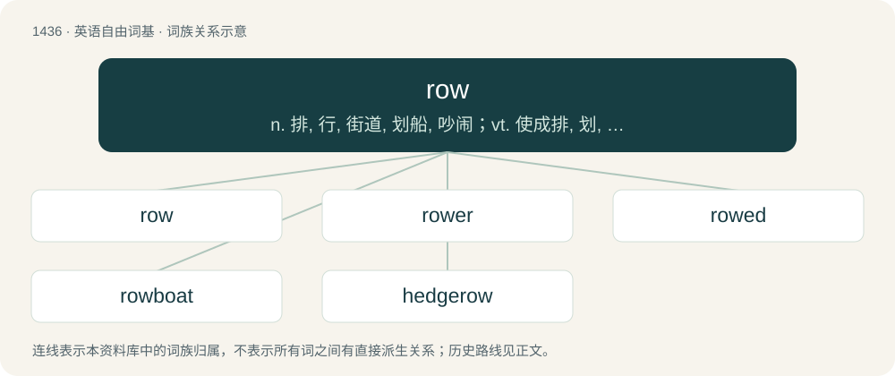

# 1519 · row — n. 排, 行, 街道, 划船, 吵闹；vt. 使成排, 划, 划船, 参加(赛船), 痛骂；vi. 划船, 划动, 争吵

[总目录](../00_总目录_按常用程度.md)

**类型**：英语自由词基　｜　**来源语言**：见词源记录

## 核心含义与来源

- 核心含义：n. 排, 行, 街道, 划船, 吵闹；vt. 使成排, 划, 划船, 参加(赛船), 痛骂；vi. 划船, 划动, 争吵
- 英文含义：A line of objects, often regularly spaced, such as seats in a theatre, vegetable plants in a garden, etc.
- 词形：row

**多个词源／构词路径**：同一拼写可能有不同来源；以下按词性和含义分别列出。

**来源记录 1**（名词；A line of objects, often regularly spaced, such as seats in a theatre, vegetable plants in a garden, etc.）

From Middle English rewe, rowe, rawe, from Old English rǣw, rāw, probably from Proto-Germanic \*raiwō, \*raigwō, \*rīgǭ (“row, streak, line”), from Proto-Indo-European \*Hreyk- (“to carve, scratch, etch”). Cognate with Scots raw (“row”), dialectal Norwegian rå (“boundary line”), Saterland Frisian Riege (“row”), West Frisian rige (“row”), Dutch rij (“row, line”), German Low German Reeg, Riege, Rieg (“row”), German Reihe (“row”), German Riege (“sports team”).

**来源记录 2**（动词；To propel (a boat or other craft) over water using oars.）

From Middle English rowen (“to row”), from Old English rōwan (“to row”), from Proto-Germanic \*rōaną (“to row”), from Proto-Indo-European \*h₁reh₁- (“to row”). Compare West Frisian roeie, Dutch roeien, Danish ro. More at rudder. Related to Russia.

**来源记录 3**（名词；A noisy argument.）

Unclear; some suggest it is a back-formation from rouse, verb.

## 词族图

## 单词速览（常用到不常用）

| 单词 | 音标 | 释义 |
|---|---|---|
| [row](#w-1) | 英 /ɹəʊ/；美 /ɹoʊ/ | n. 排, 行, 街道, 划船, 吵闹；vt. 使成排, 划, 划船, 参加(赛船), 痛骂；vi. 划船, 划动, 争吵 |
| [rower](#w-2) | 英 /ˈɹəʊ.ə(ɹ)/ | n. 桨手 |
| [rowed](#w-3) | /ɹəʊd/ | v. 划船( row的过去式和过去分词 ); （用船）划运; 用…支桨划; 充当划手 |
| [rowboat](#w-4) | /ˈɹəʊbəʊt/ | n. 划艇 |
| [hedgerow](#w-5) | /ˈhɛd͡ʒɹəʊ/ | n. 灌木篱墙 |

## 逐词详解

### 1. row

**词性**：名词　｜　**音标**：英 /ɹəʊ/；美 /ɹoʊ/

**中文释义**：n. 排, 行, 街道, 划船, 吵闹；vt. 使成排, 划, 划船, 参加(赛船), 痛骂；vi. 划船, 划动, 争吵

**英文义项**：A line of objects, often regularly spaced, such as seats in a theatre, vegetable plants in a garden, etc. / Specifically, a line of buildings on a street; also, the street itself (especially in street names)

**词源与演化**：

From Middle English rewe, rowe, rawe, from Old English rǣw, rāw, probably from Proto-Germanic \*raiwō, \*raigwō, \*rīgǭ (“row, streak, line”), from Proto-Indo-European \*Hreyk- (“to carve, scratch, etch”). Cognate with Scots raw (“row”), dialectal Norwegian rå (“boundary line”), Saterland Frisian Riege (“row”), West Frisian rige (“row”), Dutch rij (“row, line”), German Low German Reeg, Riege, Rieg (“row”), German Reihe (“row”), German Riege (“sports team”).

**例句**：

> A row of chairs.

该用例对应义项：an arrangement of objects or people side by side in a line

### 2. rower

**词性**：名词　｜　**音标**：英 /ˈɹəʊ.ə(ɹ)/

**中文释义**：n. 桨手

**英文义项**：One who rows. / A rowing machine.

**构词拆分**：row + -er

**词源与演化**：

From Middle English rower, rowere, roware, equivalent to row + -er. Cognate with Dutch roeier (“rower”), Danish roer (“rower”), Norwegian roer (“rower”). Compare also Old English rōwend (“rower”).

**例句**：

> Tom has the perfect physique for a world-class rower.

### 3. rowed

**词性**：形容词　｜　**音标**：/ɹəʊd/

**中文释义**：v. 划船( row的过去式和过去分词 ); （用船）划运; 用…支桨划; 充当划手

**英文义项**：Formed into a row, or rows; having a specified number of rows.

**构词拆分**：row + -ed

**词源与演化**：

From row (“line of objects or entries”) + -ed.

**用法示例／搭配（非完整句）**：

> a twelve-rowed ear of corn

该用例对应义项：Formed into a row, or rows; having a specified number of rows.

### 4. rowboat

**词性**：名词　｜　**音标**：/ˈɹəʊbəʊt/

**中文释义**：n. 划艇

**英文义项**：A small open boat propelled by oars (by rowing).

**构词拆分**：row + boat

**词源与演化**：

From row + boat.

**例句**：

> I need to buy a new a pair of oars for my rowboat.

### 5. hedgerow

**词性**：名词　｜　**音标**：/ˈhɛd͡ʒɹəʊ/

**中文释义**：n. 灌木篱墙

**英文义项**：A row of closely planted bushes or trees forming a hedge.

**构词拆分**：hedge + row

**词源与演化**：

From Middle English heggerowe, heggerewe, heggerawe, from Old English \*heċġrāw, \*heċġrǣw (attested only as Old English heġerǣwe, heġerēwe (“hedgerow”)), equivalent to hedge + row.

**例句**：

> We planted blackthorn and whitethorn to make a new hedgerow.
