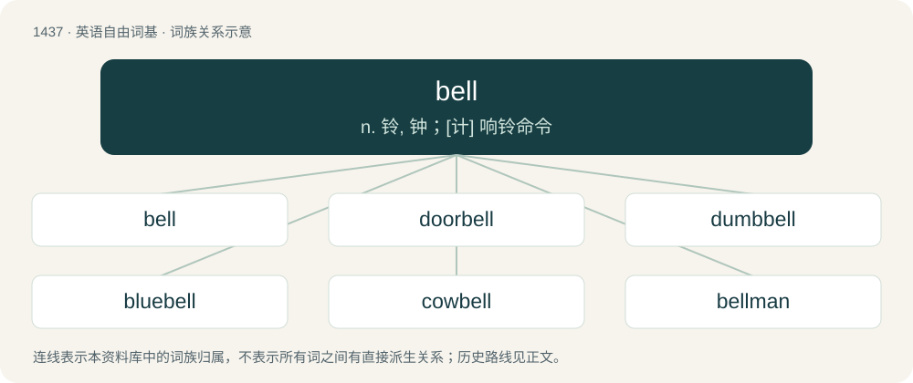

# 1520 · bell — n. 铃, 钟；\[计\] 响铃命令

[总目录](../00_总目录_按常用程度.md)

**类型**：英语自由词基　｜　**来源语言**：见词源记录

## 核心含义与来源

- 核心含义：n. 铃, 钟；\[计\] 响铃命令
- 英文含义：A percussive instrument made of metal or other hard material, typically but not always in the shape of an inverted cup with a flared rim, which resonates when struck.
- 词形：bell

**多个词源／构词路径**：同一拼写可能有不同来源；以下按词性和含义分别列出。

**来源记录 1**（名词；A percussive instrument made of metal or other hard material, typically but not always in the shape of an inverted cup with a flared rim, which resonates when struck.）

Inherited from Middle English belle, from Old English belle, from Proto-West Germanic \*bellā, from Proto-Germanic \*bellǭ, from Proto-Indo-European \*bʰel-. Cognate with West Frisian belle, bel (“bell”), Dutch bel (“bell”), Low German Belle, Bel (“bell”), Danish bjælde (“bell”), Faroese bjølla (“bell”), Icelandic bjalla (“bell”), Norwegian bjelle (“bell”), Swedish bjällra (“bell”).

**来源记录 2**（动词；To bellow or roar.）

From Middle English bellen, from Old English bellan (“to bellow; make a hollow noise; roar; bark; grunt”), from Proto-Germanic \*bellaną (“to sound; roar; bark”), from Proto-Indo-European \*bʰel- (“to sound; roar; bark”). Cognate with Scots bell (“to shout; speak loudly”), Dutch bellen (“to ring”), German Low German bellen (“to ring”), German bellen (“to bark”), Swedish böla (“to low; bellow; roar”).

## 词族图

## 单词速览（常用到不常用）

| 单词 | 音标 | 释义 |
|---|---|---|
| [bell](#w-1) | 英 /bɛl/ | n. 铃, 钟；\[计\] 响铃命令 |
| [doorbell](#w-2) | 英 /ˈdɔː.bɛl/；美 /ˈdɔɹ.bɛl/ | n. 门铃 |
| [dumbbell](#w-3) | /ˈdʌm.bɛl/ | n. 哑铃；\[医\] 哑铃 |
| [bluebell](#w-4) | 美 /ˈbluˌbɛl/ | n. 开蓝色铃状花的植物 |
| [cowbell](#w-5) | /ˈkaʊˌbɛl/ | n. 母牛的颈铃 |
| [bellman](#w-6) | /ˈbelmən/ | n. 敲钟者, 男听差, 更夫 |
| [kettlebell](#w-7) | 美 /ˈkɛtəlˌbɛl/ | 【英文】A weight consisting of a cast iron ball with a single handle for gripping the weight during exercise. |
| [bellwether](#w-8) | 英 /ˈbɛlwɛðə/；美 /ˈbɛlwɛðɚ/ | n. 系铃带头羊, 前导, 领导者 |
| [bellflower](#w-9) | /ˈbel.flauə/ | n. 风铃草 |
| [belling](#w-10) | /ˈbɛlɪŋ/ | 动物的吼叫, 扩成喇叭形的 |

## 逐词详解

### 1. bell

**词性**：名词　｜　**音标**：英 /bɛl/

**中文释义**：n. 铃, 钟；\[计\] 响铃命令

**英文义项**：A percussive instrument made of metal or other hard material, typically but not always in the shape of an inverted cup with a flared rim, which resonates when struck. / An instrument that emits a ringing sound, situated on a bicycle's handlebar and used by the cyclist to warn of their presence.

**词源与演化**：

Inherited from Middle English belle, from Old English belle, from Proto-West Germanic \*bellā, from Proto-Germanic \*bellǭ, from Proto-Indo-European \*bʰel-. Cognate with West Frisian belle, bel (“bell”), Dutch bel (“bell”), Low German Belle, Bel (“bell”), Danish bjælde (“bell”), Faroese bjølla (“bell”), Icelandic bjalla (“bell”), Norwegian bjelle (“bell”), Swedish bjällra (“bell”).

**例句**：

> I’ll give you a bell later.

该用例对应义项：A telephone call.

### 2. doorbell

**词性**：动词　｜　**音标**：英 /ˈdɔː.bɛl/；美 /ˈdɔɹ.bɛl/

**中文释义**：n. 门铃

**英文义项**：To ring many doorbells in an effort to contact people and thereby spread information or solicit. / To ring many doorbells of (target people or an area) in an effort to contact people and thereby spread information or solicit.

**构词拆分**：door + bell

**词源与演化**：

From door + bell.

**例句**：

> We doorbelled the whole district in an effort to get out the vote.

该用例对应义项：To ring many doorbells of (target people or an area) in an effort to contact people and thereby spread information or solicit.

### 3. dumbbell

**词性**：名词　｜　**音标**：/ˈdʌm.bɛl/

**中文释义**：n. 哑铃；\[医\] 哑铃

**英文义项**：A weight training implement consisting of a short bar with weight counterpoised on each end. / A stupid person.

**构词拆分**：dumb (“silent”) + bell (“a resonating instrument”)

**词源与演化**：

From dumb (“silent”) + bell (“a resonating instrument”). The term "dumbbell" originated in 16th-century England to describe silent exercise apparatus used in practicing the motions of ringing church bells noiselessly. To aid them in the practice of their physically demanding vocation, bellringers originally used weighted ropes on fixed pulleys to mimic the motion of ringing a church bell; since such apparatus made no noise while imitating the motion of ringing a swinging bell via a fixed pulley, they were called "dumb bells". Later, the rope-and-pulley weights evolved into simple hand-held weights used by ringers for strengthening the shoulder and back muscles heavily used in tower bellringing, and the term "'dumb bell'" evolved into the compound word "'dumbbell'".

**例句**：

> He was exercising with the dumbbells in gym class today.

该用例对应义项：A weight training implement consisting of a short bar with weight counterpoised on each end.

### 4. bluebell

**词性**：名词　｜　**音标**：美 /ˈbluˌbɛl/

**中文释义**：n. 开蓝色铃状花的植物

**英文义项**：common bluebell (Hyacinthoides non-scripta) / Spanish bluebell (Hyacinthoides hispanica)

**构词拆分**：blue + bell

**词源与演化**：

From blue + bell.

### 5. cowbell

**词性**：名词　｜　**音标**：/ˈkaʊˌbɛl/

**中文释义**：n. 母牛的颈铃

**英文义项**：A bell worn by cows; sometimes with an ornate strap. / A musical instrument, typically found without a clapper.

**构词拆分**：cow + bell

**词源与演化**：

From cow + bell.

**例句**：

> This song would sound better with the addition of a cowbell.

该用例对应义项：A musical instrument, typically found without a clapper.

### 6. bellman

**词性**：名词　｜　**音标**：/ˈbelmən/

**中文释义**：n. 敲钟者, 男听差, 更夫

**英文义项**：A town crier. / A bellhop or bellboy.

**构词拆分**：bell + man

**词源与演化**：

From Middle English belleman, equivalent to bell + man.

**例句**：

> Yanni was working hard as a bellman at an Algerian beach resort.

### 7. kettlebell

**词性**：名词　｜　**音标**：美 /ˈkɛtəlˌbɛl/

**英文义项**：A weight consisting of a cast iron ball with a single handle for gripping the weight during exercise.

**构词拆分**：kettle + bell

**词源与演化**：

From kettle + bell.

### 8. bellwether

**词性**：名词　｜　**音标**：英 /ˈbɛlwɛðə/；美 /ˈbɛlwɛðɚ/

**中文释义**：n. 系铃带头羊, 前导, 领导者

**英文义项**：The leading sheep of a flock, having a bell hung round its neck. / Anything that indicates future trends.

**构词拆分**：bell + wether (“castrated ram”)

**词源与演化**：

From Middle English belwether, belleweder, equivalent to bell + wether (“castrated ram”).

**例句**：

> Mortgage delinquencies often act as a bellwether for a forthcoming recession.

该用例对应义项：Anything that indicates future trends.

### 9. bellflower

**词性**：名词　｜　**音标**：/ˈbel.flauə/

**中文释义**：n. 风铃草

**英文义项**：Any flowering plants in the genus Campanula. / Flowering plants in the genera, Campanulastrum, Codonopsis, or Platycodon, in the family Campanulaceae.

**构词拆分**：bell + flower

**词源与演化**：

From bell + flower.

### 10. belling

**词性**：名词　｜　**音标**：/ˈbɛlɪŋ/

**中文释义**：动物的吼叫, 扩成喇叭形的

**英文义项**：Bellowing; the sound of a male deer during the rutting season / A shivaree.

**构词拆分**：bell + -ing

**词源与演化**：

From Middle English bellynge, equivalent to bell + -ing.

**例句**：

> Can stags be heard belling all year round?
