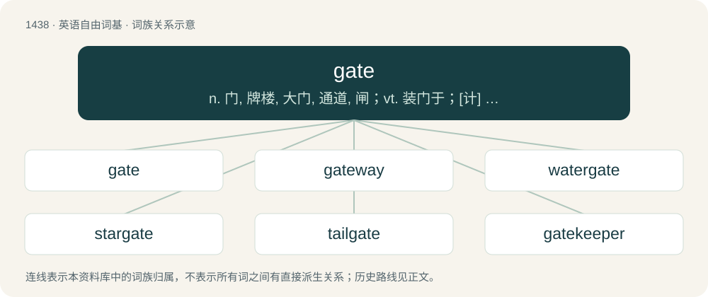

# 1521 · gate — n. 门, 牌楼, 大门, 通道, 闸；vt. 装门于；\[计\] 门; 栅

[总目录](../00_总目录_按常用程度.md)

**类型**：英语自由词基　｜　**来源语言**：见词源记录

## 核心含义与来源

- 核心含义：n. 门, 牌楼, 大门, 通道, 闸；vt. 装门于；\[计\] 门; 栅
- 英文含义：A doorlike structure outside a house.
- 词形：gate

**多个词源／构词路径**：同一拼写可能有不同来源；以下按词性和含义分别列出。

**来源记录 1**（名词；A doorlike structure outside a house.）

From Middle English gate (the forms ȝate and ȝeat yielded the dialectal doublet yate), from the plural of Old English ġeat (specifically gatu), from Proto-West Germanic \*gat, from Proto-Germanic \*gatą (“hole, opening”). See also Old Norse gat, Swedish and Dutch gat, Low German Gaat, Gööt.

**来源记录 2**（名词；A way, path.）

Borrowed from Old Norse gata, from Proto-Germanic \*gatwǭ. Cognate with Danish gade, Swedish gata, German Gasse (“lane”). Doublet of gait.

## 词族图

## 单词速览（常用到不常用）

| 单词 | 音标 | 释义 |
|---|---|---|
| [gate](#w-1) | 英 /ˈɡeɪ̯t/ | n. 门, 牌楼, 大门, 通道, 闸；vt. 装门于；\[计\] 门; 栅 |
| [gateway](#w-2) | /ˈɡeɪtˌweɪ/ | n. 门, 通路；\[计\] 网关 |
| [watergate](#w-3) | /ˈwɔːtəɡeit. ˈwɔ-/ | n. 水门, 水闸；水门事件 |
| [stargate](#w-4) | 美 /ˈstɑɹˌɡeɪt/ | n. 星际之门（电视剧名） |
| [tailgate](#w-5) | 英 /ˈteɪlˌɡeɪt/ | n. 后挡板 |
| [gatekeeper](#w-6) | 英 /ˈɡeɪtˌkiː.pə/；美 /ˈɡeɪtˌki.pəɹ/ | n. 看门人 |
| [gatehouse](#w-7) | /ˈgeithaus/ | n. 警卫室, 门房 |
| [highgate](#w-8) |  | 【英文】A highway. |
| [gatefold](#w-9) | /ˈgeitfəuld/ | n. 大张折叠插页 |
| [floodgate](#w-10) | /ˈflʌdˌɡeɪt/ | n. 水门, 水闸, 防潮水闸 |

## 逐词详解

### 1. gate

**词性**：名词　｜　**音标**：英 /ˈɡeɪ̯t/

**中文释义**：n. 门, 牌楼, 大门, 通道, 闸；vt. 装门于；\[计\] 门; 栅

**英文义项**：A doorlike structure outside a house. / A doorway, opening, or passage in a fence or wall.

**词源与演化**：

From Middle English gate (the forms ȝate and ȝeat yielded the dialectal doublet yate), from the plural of Old English ġeat (specifically gatu), from Proto-West Germanic \*gat, from Proto-Germanic \*gatą (“hole, opening”). See also Old Norse gat, Swedish and Dutch gat, Low German Gaat, Gööt.

**例句**：

> Singh was bowled through the gate, a very disappointing way for a world-class batsman to get out.

该用例对应义项：The gap between a batsman's bat and pad.

### 2. gateway

**词性**：名词　｜　**音标**：/ˈɡeɪtˌweɪ/

**中文释义**：n. 门, 通路；\[计\] 网关

**英文义项**：A passage that can be closed by use of a gate. / A place regarded as giving access to somewhere.

**构词拆分**：gate + way

**词源与演化**：

From gate + way.

**用法示例／搭配（非完整句）**：

> a gateway drug

该用例对应义项：Any thing or area of interest that tends to lead to deeper involvement.

### 3. watergate

**词性**：名词　｜　**音标**：/ˈwɔːtəɡeit. ˈwɔ-/

**中文释义**：n. 水门, 水闸；水门事件

**英文义项**：A gate opening onto water, or only or mainly accessible by water.

**构词拆分**：water + gate

**词源与演化**：

From Middle English watergate, wateregate, watur-ȝate, equivalent to water + gate.

**例句**：

> Nixon tried to stonewall through Watergate by ignoring it, but it didn't work.

### 4. stargate

**词性**：名词　｜　**音标**：美 /ˈstɑɹˌɡeɪt/

**中文释义**：n. 星际之门（电视剧名）

**英文义项**：A hypothetical device consisting of a traversable portal (typically a wormhole) that can send one to another location light years away nearly instantaneously.

**构词拆分**：star + gate

**词源与演化**：

From star + gate. A science-fiction film of this title, Stargate, was released in 1994.

### 5. tailgate

**词性**：名词　｜　**音标**：英 /ˈteɪlˌɡeɪt/

**中文释义**：n. 后挡板

**英文义项**：A hinged board or hatch at the rear of a vehicle that can be lowered for loading and unloading. / The hinged rear door of a hatchback.

**构词拆分**：tail + gate

**词源与演化**：

From tail + gate. Compare liftgate.

**例句**：

> The locktender closed the tailgate and the chamber started to fill.

该用例对应义项：The downstream gate in the lock on a canal or river, or in an irrigation system.

### 6. gatekeeper

**词性**：名词　｜　**音标**：英 /ˈɡeɪtˌkiː.pə/；美 /ˈɡeɪtˌki.pəɹ/

**中文释义**：n. 看门人

**英文义项**：A person who guards or monitors passage through a gate. / A person or group who controls access to something or somebody.

**构词拆分**：gate + keeper

**词源与演化**：

From gate + keeper.

**例句**：

> Julius goes to the door, which the gatekeeper opens.

### 7. gatehouse

**词性**：名词　｜　**音标**：/ˈgeithaus/

**中文释义**：n. 警卫室, 门房

**英文义项**：A lodge besides the entrance to an estate; often the residence of a gatekeeper; also a dwelling formerly used as such a residence. / A shelter for a gatekeeper.

**构词拆分**：gate + house

**词源与演化**：

From gate + house.

### 8. highgate

**词性**：名词

**英文义项**：A highway.

**构词拆分**：high + gate (“a way, a road, a path”)

**词源与演化**：

From Middle English hiȝe gate, heiȝe gate, heie gate, equivalent to high + gate (“a way, a road, a path”).

### 9. gatefold

**词性**：名词　｜　**音标**：/ˈgeitfəuld/

**中文释义**：n. 大张折叠插页

**英文义项**：A document folding method that uses two parallel folds to create six panels; the left and right panels are half the width of the center panels and fold inward to meet in the middle without overlapping.

**构词拆分**：gate + fold

**词源与演化**：

From gate + fold.

### 10. floodgate

**词性**：名词　｜　**音标**：/ˈflʌdˌɡeɪt/

**中文释义**：n. 水门, 水闸, 防潮水闸

**英文义项**：An adjustable gate or valve used to control the flow of water through a sluice. / Anything that controls or limits an outpouring of people, emotion, etc.

**构词拆分**：flood + gate

**词源与演化**：

From Middle English flodegate, flodgate, flodeyate, floodȝate, flodȝete, equivalent to flood + gate.
