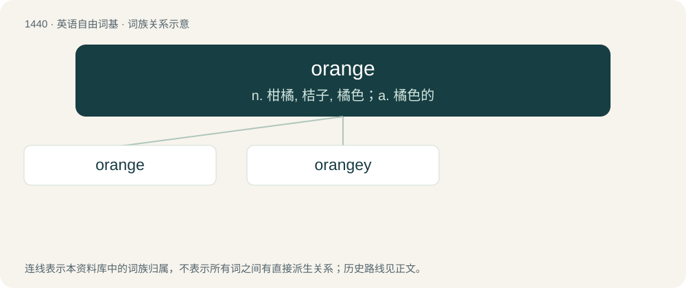

# 1522 · orange — n. 柑橘, 桔子, 橘色；a. 橘色的

[总目录](../00_总目录_按常用程度.md)

**类型**：英语自由词基　｜　**来源语言**：见词源记录

## 核心含义与来源

- 核心含义：n. 柑橘, 桔子, 橘色；a. 橘色的
- 英文含义：An evergreen tree of the genus Citrus such as Citrus sinensis which yields oranges (the fruit).
- 词形：orange

**来源记录 1**（名词；An evergreen tree of the genus Citrus such as Citrus sinensis which yields oranges (the fruit).）

Inherited from Middle English orenge, orange, from Old French pome orenge (“fruit orange”), influenced by the place name Orange (which is from Gaulish and unrelated to the word for the fruit and colour) and by Old Occitan auranja and calqued from Old Italian melarancio, melarancia, compound of mela (“apple”) and un'arancia (“an orange”), from Arabic نَارَنْج (nāranj), from Early Classical Persian نَارَنْگْ (nārang), from Sanskrit नारङ्ग (nāraṅga, “orange tree”), ultimately from Dravidian. Compare Tamil நாரங்காய் (nāraṅkāy), compound of நாரம் (nāram, “water”) and காய் (kāy, “fruit”); also Telugu నారంగము, నారింజ (nāraṅgamu, nāriñja), Malayalam നാരങ്ങ (nāraṅṅa), Kannada ನಾರಂಗಿ (nāraṅgi)). Doublet of aranzada. Originally borrowed as the surname (derived from the place name) in the 13th century, before the sense of the fruit was imported in the late 14th century and the colour in 1510. In the colour sense, largely displaced ġeolurēad, whence yellow-red.

## 词族图

## 单词速览（常用到不常用）

| 单词 | 音标 | 释义 |
|---|---|---|
| [orange](#w-1) | 英 /ˈɒɹɪnd͡ʒ/；美 /ˈɔɹənd͡ʒ/ | n. 柑橘, 桔子, 橘色；a. 橘色的 |
| [orangey](#w-2) | /ˈɔrindʒi;ˈɔː-/ | a. (尤指在颜色或滋味方面)似橙的 |

## 逐词详解

### 1. orange

**词性**：名词　｜　**音标**：英 /ˈɒɹɪnd͡ʒ/；美 /ˈɔɹənd͡ʒ/

**中文释义**：n. 柑橘, 桔子, 橘色；a. 橘色的

**英文义项**：An evergreen tree of the genus Citrus such as Citrus sinensis which yields oranges (the fruit). / Any round citrus fruit with a yellow-red colour when ripe and a sour-sweet taste; the fruit of the orange tree.

**词源与演化**：

Inherited from Middle English orenge, orange, from Old French pome orenge (“fruit orange”), influenced by the place name Orange (which is from Gaulish and unrelated to the word for the fruit and colour) and by Old Occitan auranja and calqued from Old Italian melarancio, melarancia, compound of mela (“apple”) and un'arancia (“an orange”), from Arabic نَارَنْج (nāranj), from Early Classical Persian نَارَنْگْ (nārang), from Sanskrit नारङ्ग (nāraṅga, “orange tree”), ultimately from Dravidian. Compare Tamil நாரங்காய் (nāraṅkāy), compound of நாரம் (nāram, “water”) and காய் (kāy, “fruit”); also Telugu నారంగము, నారింజ (nāraṅgamu, nāriñja), Malayalam നാരങ്ങ (nāraṅṅa), Kannada ನಾರಂಗಿ (nāraṅgi)). Doublet of aranzada. Originally borrowed as the surname (derived from the place name) in the 13th century, before the sense of the fruit was imported in the late 14th century and the colour in 1510. In the colour sense, largely displaced ġeolurēad, whence yellow-red.

**例句**：

> He gave me an orange in exchange for a piece of cake.

### 2. orangey

**词性**：形容词　｜　**音标**：/ˈɔrindʒi;ˈɔː-/

**中文释义**：a. (尤指在颜色或滋味方面)似橙的

**英文义项**：Somewhat orange in colour. / Resembling, or flavoured with, oranges (the fruit).

**构词拆分**：orange + -y

**词源与演化**：

From orange + -y.
