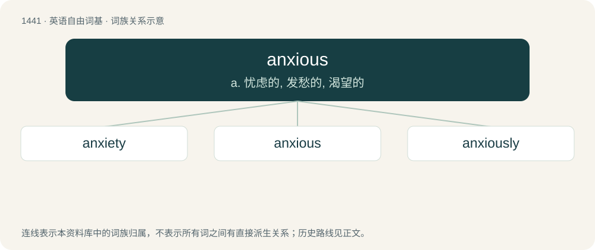

# 1523 · anxious — a. 忧虑的, 发愁的, 渴望的

[总目录](../00_总目录_按常用程度.md)

**类型**：英语自由词基　｜　**来源语言**：见词源记录

## 核心含义与来源

- 核心含义：a. 忧虑的, 发愁的, 渴望的
- 英文含义：Nervous and worried.
- 词形：anxious

**来源记录 1**（形容词；Nervous and worried.）

Borrowed from Latin anxius, from angō (“to cause pain, choke”); akin to Ancient Greek ἄγχω (ánkhō, “to choke”). See anger; angst.

## 词族图

## 单词速览（常用到不常用）

| 单词 | 音标 | 释义 |
|---|---|---|
| [anxiety](#w-1) | 英 /æŋˈzaɪ.əti/；美 /æŋˈzaɪ.əti/ | n. 焦虑, 忧虑, 令人焦虑的事；\[医\] 焦虑 |
| [anxious](#w-2) | 英 /ˈæŋkʃəs/；美 /ˈæŋkʃəs/ | a. 忧虑的, 发愁的, 渴望的 |
| [anxiously](#w-3) | 美 /ˈæŋ(k).ʃəs.li/ | adv. 忧虑地, 不安地 |

## 逐词详解

### 1. anxiety

**词性**：名词　｜　**音标**：英 /æŋˈzaɪ.əti/；美 /æŋˈzaɪ.əti/

**中文释义**：n. 焦虑, 忧虑, 令人焦虑的事；\[医\] 焦虑

**英文义项**：An unpleasant state of mental uneasiness, nervousness, apprehension and obsession or concern about some uncertain event. / An uneasy or distressing desire (for something). Endeavor (to please).

**构词拆分**：anxious + -ety

**词源与演化**：

Borrowed from Latin ānxietās, from ānxius (“anxious, solicitous, distressed, troubled”), from angō (“to distress, trouble”), akin to Ancient Greek ἄγχω (ánkhō, “to choke”). Equivalent to anxious + -ety. See anger; angst.

**例句**：

> She felt a wave of anxiety before the interview.

该用例对应义项：An unpleasant state of mental uneasiness, nervousness, apprehension and obsession or concern about some uncertain event.

### 2. anxious

**词性**：形容词　｜　**音标**：英 /ˈæŋkʃəs/；美 /ˈæŋkʃəs/

**中文释义**：a. 忧虑的, 发愁的, 渴望的

**英文义项**：Nervous and worried. / Having a feeling of anxiety or disquietude; extremely concerned, especially about something that will happen in the future or that is unknown.

**词源与演化**：

Borrowed from Latin anxius, from angō (“to cause pain, choke”); akin to Ancient Greek ἄγχω (ánkhō, “to choke”). See anger; angst.

**例句**：

> There was an anxious wait before the results were revealed.

该用例对应义项：Accompanied with, or causing, anxiety; worrying.

### 3. anxiously

**词性**：副词　｜　**音标**：美 /ˈæŋ(k).ʃəs.li/

**中文释义**：adv. 忧虑地, 不安地

**英文义项**：In an anxious manner; with painful uncertainty; solicitously.

**构词拆分**：anxious + -ly

**词源与演化**：

From anxious + -ly.

**例句**：

> He anxiously awaited the arrival of his child.

该用例对应义项：In an anxious manner; with painful uncertainty; solicitously.
