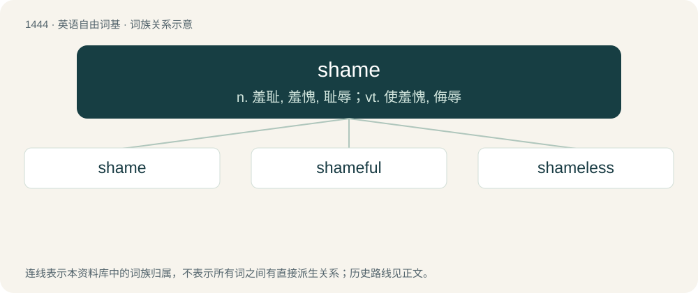

# 1527 · shame — n. 羞耻, 羞愧, 耻辱；vt. 使羞愧, 侮辱

[总目录](../00_总目录_按常用程度.md)

**类型**：英语自由词基　｜　**来源语言**：见词源记录

## 核心含义与来源

- 核心含义：n. 羞耻, 羞愧, 耻辱；vt. 使羞愧, 侮辱
- 英文含义：An uncomfortable or painful feeling due to recognition or consciousness of one's own impropriety or dishonor, or something being exposed that should have been kept private.
- 词形：shame

**多个词源／构词路径**：同一拼写可能有不同来源；以下按词性和含义分别列出。

**来源记录 1**（名词；An uncomfortable or painful feeling due to recognition or consciousness of one's own impropriety or dishonor, or something being exposed that should have been kept private.）

From Middle English schame, from Old English sċamu, from Proto-West Germanic \*skamu, from Proto-Germanic \*skamō. Cognates \*German Scham (“shame”) \*German Low German Schaam (“shame, shamefacedness”) \*Danish, Norwegian Bokmål, Norwegian Nynorsk, Swedish skam (“shame”) \*Faroese skomm (“shame, dishonour”) \*Icelandic skömm (“shame”) \*Gothic 𐍃𐌺𐌰𐌼𐌰 (skama, “shame”).

**来源记录 2**（动词；To cause to feel shame.）

From Middle English schamen, from Old English sċamian, from Proto-West Germanic \*skamēn, from Proto-Germanic \*skamāną. Cognates \*Dutch schamen (“to be ashamed”) \*German schämen (“to be ashamed or embarrassed, bashful”) \*Danish, Norwegian Bokmål skamme (“to be ashamed”) \*Icelandic skamma (“to scold”) \*Gothic 𐍃𐌺𐌰𐌼𐌰𐌽 (skaman, “to be ashamed”).

## 词族图

## 单词速览（常用到不常用）

| 单词 | 音标 | 释义 |
|---|---|---|
| [shame](#w-1) | /ˈʃeɪ̯m/ | n. 羞耻, 羞愧, 耻辱；vt. 使羞愧, 侮辱 |
| [shameful](#w-2) | /ˈʃeɪmfəl/ | a. 可耻的, 丢脸的, 不道德的, 淫猥的, 猥亵的, 不体面的 |
| [shameless](#w-3) | /ˈʃeɪ̯mlɪs/ | a. 不知羞耻的 |

## 逐词详解

### 1. shame

**词性**：名词　｜　**音标**：/ˈʃeɪ̯m/

**中文释义**：n. 羞耻, 羞愧, 耻辱；vt. 使羞愧, 侮辱

**英文义项**：An uncomfortable or painful feeling due to recognition or consciousness of one's own impropriety or dishonor, or something being exposed that should have been kept private. / Something to regret.

**词源与演化**：

From Middle English schame, from Old English sċamu, from Proto-West Germanic \*skamu, from Proto-Germanic \*skamō. Cognates \*German Scham (“shame”) \*German Low German Schaam (“shame, shamefacedness”) \*Danish, Norwegian Bokmål, Norwegian Nynorsk, Swedish skam (“shame”) \*Faroese skomm (“shame, dishonour”) \*Icelandic skömm (“shame”) \*Gothic 𐍃𐌺𐌰𐌼𐌰 (skama, “shame”).

**例句**：

> The teenager couldn’t bear the shame of introducing his parents.

该用例对应义项：An uncomfortable or painful feeling due to recognition or consciousness of one's own impropriety or dishonor, or something being exposed that should have been kept private.

### 2. shameful

**词性**：形容词　｜　**音标**：/ˈʃeɪmfəl/

**中文释义**：a. 可耻的, 丢脸的, 不道德的, 淫猥的, 猥亵的, 不体面的

**英文义项**：Causing or meriting shame or disgrace; disgraceful / Giving offense.

**构词拆分**：shame + -ful

**词源与演化**：

From Middle English schameful, schamfull, from Old English \*sċeamfull, sċeomfull, equivalent to shame + -ful. Cognate with Danish skamfuld (“shameful, shamefast, ashamed”).

**用法示例／搭配（非完整句）**：

> shameful publicity

该用例对应义项：Causing or meriting shame or disgrace; disgraceful

### 3. shameless

**词性**：形容词　｜　**音标**：/ˈʃeɪ̯mlɪs/

**中文释义**：a. 不知羞耻的

**英文义项**：Having no shame, no guilt nor remorse over something considered wrong; immodest, brazen; unable to feel disgrace.

**构词拆分**：shame + -less

**词源与演化**：

From Middle English schameles, shameles, from Old English sċamlēas, sċeamlēas (“without shame; shameless”), from Proto-Germanic \*skamalausaz (“shameless”), equivalent to shame + -less. Cognate with West Frisian skamteleas (“shameless”), Dutch schaamteloos (“shameless”), German schamlos (“shameless”), Danish skamløs (“shameless”), Swedish skamlös (“shameless”), Icelandic skammlaus (“shameless; unashamed”).

**例句**：

> He sits at a table, surrounded by false friends and shameless women.
