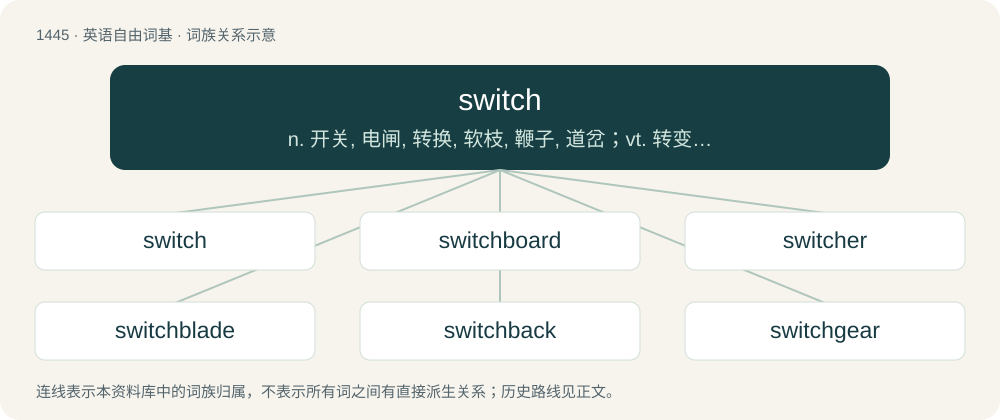

# 1528 · switch — n. 开关, 电闸, 转换, 软枝, 鞭子, 道岔；vt. 转变, 切换, 摆动, 转换, 使转轨；vi. 转换, 变换, 摆动

[总目录](../00_总目录_按常用程度.md)

**类型**：英语自由词基　｜　**来源语言**：见词源记录

## 核心含义与来源

- 核心含义：n. 开关, 电闸, 转换, 软枝, 鞭子, 道岔；vt. 转变, 切换, 摆动, 转换, 使转轨；vi. 转换, 变换, 摆动
- 英文含义：A device to turn electric current on and off or direct its flow.
- 词形：switch

**来源记录 1**（名词；A device to turn electric current on and off or direct its flow.）

Perhaps from Middle Dutch swijch (“twig”), first attested in c. 1592. The mechanical device for altering the direction of something sense is first attested in c. 1797, pertaining to pivoted rails on minecart railways, which were once wooden.

## 词族图

## 单词速览（常用到不常用）

| 单词 | 音标 | 释义 |
|---|---|---|
| [switch](#w-1) | /swɪt͡ʃ/ | n. 开关, 电闸, 转换, 软枝, 鞭子, 道岔；vt. 转变, 切换, 摆动, 转换, 使转轨；vi. 转换, 变换, 摆动 |
| [switchboard](#w-2) | 美 /ˈswɪt͡ʃˌbɔɹd/ | n. 配电盘, 接线总机；\[电\] 交换台 |
| [switcher](#w-3) | /ˈswitʃə/ | n. 交换机；转换开关；调车机车 |
| [switchblade](#w-4) | /ˈswɪt͡ʃˌbleɪd/ | n. 弹簧小折刀（按钮式弹簧开启的, 等于switchblade knife） |
| [switchback](#w-5) | 英 /ˈswɪt͡ʃbæk/；美 /ˈswɪt͡ʃˌbæk/ | n. Z形爬坡路线 |
| [switchgear](#w-6) | /ˈswitʃ^iə/ | n. 开关齿轮 |
| [switchover](#w-7) | /ˈswitʃəuvə/ | n. 替换, 转换；\[计\] 切换 |
| [switchable](#w-8) | /ˈswɪt͡ʃəbəl/ | 可有开关控制 |
| [switcheroo](#w-9) | /ˌswɪt͡ʃəˈɹuː/ | n. 骤变, 惊人的大变 |

## 逐词详解

### 1. switch

**词性**：名词　｜　**音标**：/swɪt͡ʃ/

**中文释义**：n. 开关, 电闸, 转换, 软枝, 鞭子, 道岔；vt. 转变, 切换, 摆动, 转换, 使转轨；vi. 转换, 变换, 摆动

**英文义项**：A device to turn electric current on and off or direct its flow. / A change or exchange.

**词源与演化**：

Perhaps from Middle Dutch swijch (“twig”), first attested in c. 1592. The mechanical device for altering the direction of something sense is first attested in c. 1797, pertaining to pivoted rails on minecart railways, which were once wooden.

**例句**：

> Switches only happen once every couple weeks for us, but they're quite sudden when they happen.

该用例对应义项：The process of the currently fronting headmate changing; an instance of this.

### 2. switchboard

**词性**：名词　｜　**音标**：美 /ˈswɪt͡ʃˌbɔɹd/

**中文释义**：n. 配电盘, 接线总机；\[电\] 交换台

**英文义项**：The electronic panel that is used to direct telephone calls to the desired recipient. / A large piece of power-distribution equipment that directs electricity to multiple loads.

**构词拆分**：switch + board

**词源与演化**：

From switch + board.

**例句**：

> Mary was a switchboard operator when she was younger.

### 3. switcher

**词性**：名词　｜　**音标**：/ˈswitʃə/

**中文释义**：n. 交换机；转换开关；调车机车

**英文义项**：One who or that which operates a switch. / One who or that which switches, that is, changes in some way.

**构词拆分**：From switch + -er.

**词源与演化**：

From switch + -er.

**例句**：

> Switch to Acme brand razors for a closer shave! For a limited time, we'll pay you to be a switcher!

该用例对应义项：One who or that which switches, that is, changes in some way.

### 4. switchblade

**词性**：名词　｜　**音标**：/ˈswɪt͡ʃˌbleɪd/

**中文释义**：n. 弹簧小折刀（按钮式弹簧开启的, 等于switchblade knife）

**英文义项**：A folding knife with a blade which opens automatically (under spring pressure) when a button is pressed.

**构词拆分**：switch + blade

**词源与演化**：

From switch + blade.

**例句**：

> Tom pulled a switchblade from his pocket and clicked it open.

### 5. switchback

**词性**：名词　｜　**音标**：英 /ˈswɪt͡ʃbæk/；美 /ˈswɪt͡ʃˌbæk/

**中文释义**：n. Z形爬坡路线

**英文义项**：A railway track on a steep slope in a zigzag formation, in which a train travels in a reverse direction at each switch. / A railway track on which there are steep ascents and descents, a train moving partially or fully by the force of gravity using the momentum generated when descending to travel up an ascending part of the track; especially (UK, dated), such a track built for fun rides at an amusement park; a type of rollercoaster.

**构词拆分**：switch (“to turn (a train) from one railway track to another using a switch”, verb) + back (“so as to reverse direction and return”, adverb)

**词源与演化**：

The noun is derived from switch (“to turn (a train) from one railway track to another using a switch”, verb) + back (“so as to reverse direction and return”, adverb). The verb is derived from the noun.

### 6. switchgear

**词性**：名词　｜　**音标**：/ˈswitʃ^iə/

**中文释义**：n. 开关齿轮

**英文义项**：A device used to control, meter, protect, and regulate electronics as part of electricity generation, transmission, and distribution.

**构词拆分**：switch + gear

**词源与演化**：

From switch + gear.

### 7. switchover

**词性**：名词　｜　**音标**：/ˈswitʃəuvə/

**中文释义**：n. 替换, 转换；\[计\] 切换

**英文义项**：A complete change or switch from one state, system or course of action to another.

**构词拆分**：switch + over

**词源与演化**：

From switch + over.

**例句**：

> After the digital switchover, analogue television broadcasts were no longer transmitted.

该用例对应义项：A complete change or switch from one state, system or course of action to another.

### 8. switchable

**词性**：形容词　｜　**音标**：/ˈswɪt͡ʃəbəl/

**中文释义**：可有开关控制

**英文义项**：Capable of being switched. / Being a switch; able to take either a dominant or a submissive role.

**构词拆分**：switch + -able

**词源与演化**：

From switch + -able.

### 9. switcheroo

**词性**：名词　｜　**音标**：/ˌswɪt͡ʃəˈɹuː/

**中文释义**：n. 骤变, 惊人的大变

**英文义项**：A sneaky, unexpected, or clever swap or exchange.

**构词拆分**：From switch + -eroo.

**词源与演化**：

From switch + -eroo.
