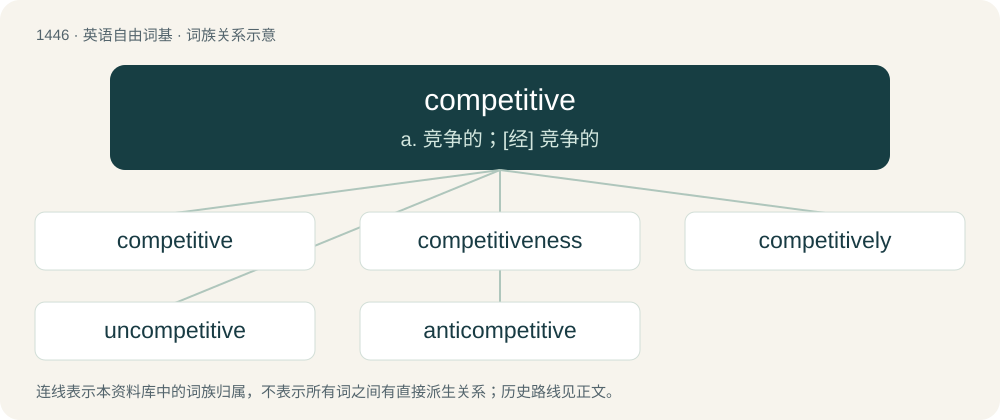

# 1529 · competitive — a. 竞争的；\[经\] 竞争的

[总目录](../00_总目录_按常用程度.md)

**类型**：英语自由词基　｜　**来源语言**：见词源记录

## 核心含义与来源

- 核心含义：a. 竞争的；\[经\] 竞争的
- 英文含义：Of or pertaining to competition.
- 词形：competitive

**来源记录 1**（形容词；Of or pertaining to competition.）

From Latin competītus (past participle of competere) + -ive.

## 词族图

## 单词速览（常用到不常用）

| 单词 | 音标 | 释义 |
|---|---|---|
| [competitive](#w-1) | 英 /kəmˈpɛt.ɪ.tɪv/；美 /kəmˈpɛt.ə.tɪv/ | a. 竞争的；\[经\] 竞争的 |
| [competitiveness](#w-2) | /kəmˈpɛtɪtɪvnəs/ | \[经\] 竞争 |
| [competitively](#w-3) | /kəmˈpɛtɪtɪvli/ | adv. 好竞争地；有竞争力地 |
| [uncompetitive](#w-4) | /ˌʌnkəmˈpetətɪv/ | a. 无竞争力的 |
| [anticompetitive](#w-5) | /,æntikəmˈpetətiv/ | a. 反竞争的 |

## 逐词详解

### 1. competitive

**词性**：形容词　｜　**音标**：英 /kəmˈpɛt.ɪ.tɪv/；美 /kəmˈpɛt.ə.tɪv/

**中文释义**：a. 竞争的；\[经\] 竞争的

**英文义项**：Of or pertaining to competition. / Inclined to compete.

**词源与演化**：

From Latin competītus (past participle of competere) + -ive.

**用法示例／搭配（非完整句）**：

> competitive antagonist

该用例对应义项：Relating to the inhibition of the effects of a chemical substance by another substance competing with it for binding or bonding.

### 2. competitiveness

**词性**：名词　｜　**音标**：/kəmˈpɛtɪtɪvnəs/

**中文释义**：\[经\] 竞争

**英文义项**：The state of being competitive.

**构词拆分**：competitive + -ness

**词源与演化**：

From competitive + -ness.

**例句**：

> Finland's competitiveness requires more people who can speak French and German than Swedish.

### 3. competitively

**词性**：副词　｜　**音标**：/kəmˈpɛtɪtɪvli/

**中文释义**：adv. 好竞争地；有竞争力地

**英文义项**：In a competitive manner.

**构词拆分**：competitive + -ly

**词源与演化**：

From competitive + -ly.

**例句**：

> Caffeine is a purinergic antagonist that competitively inhibits adenosine at the sites of P1 receptors.

### 4. uncompetitive

**词性**：形容词　｜　**音标**：/ˌʌnkəmˈpetətɪv/

**中文释义**：a. 无竞争力的

**英文义项**：That does not involve competition; not competitive

**构词拆分**：From un- + competitive.

**词源与演化**：

From un- + competitive.

### 5. anticompetitive

**词性**：形容词　｜　**音标**：/,æntikəmˈpetətiv/

**中文释义**：a. 反竞争的

**英文义项**：Acting to hinder or obstruct competition.

**构词拆分**：From anti- + competitive.

**词源与演化**：

From anti- + competitive.
