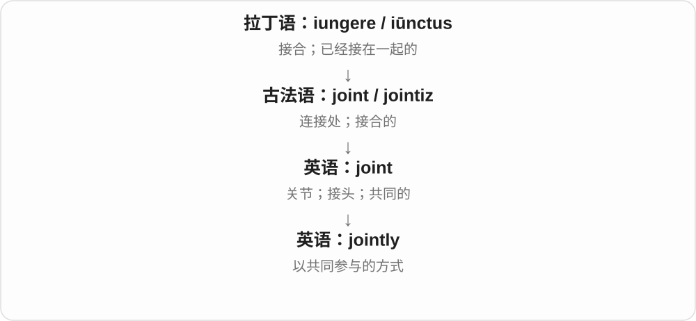

# 1529 · joint — 相接、共同与有关节的

[逐词精讲目录](../00_逐词精讲目录.md) · [总目录](../00_总目录_按常用程度.md)

## 核心词根与来源

关节、连接处是看得见的接合；共同账户是几个人连在同一件事上。jointed 则不是共同地的新副词。

**JOINT：连接点也能连接共同参与的人**

joint → jointly；jointed 单列为具有接点的形状、结构。

- **接点与共同参与**：joint · jointly
- **具有接点的结构**：jointed

## 词形与演化规律

拉丁 iunctus 经法语进入 joint；joint + -ly/-ed；不把 joint 末尾 t 当作现代英语过去式标记。

## 单词速览（按词族由简到繁）

同一基础词的相关扩展放在一起，先读基础形式，再读扩展；各组之间优先读常用的。具体词源关系见各词讲解。

| 单词 | 音标 | 核心意思 |
|---|---|---|
| [joint](#w-1) | /dʒɔɪnt/ | 关节；接头；共同的 |
| [jointly](#w-2) | /ˈdʒɔɪntli/ | 共同地；联合地 |
| [jointed](#w-3) | /ˈdʒɔɪntɪd/ | 有关节、接头的；接合的；〔肉等〕切开成块的 |

## 逐词讲解

### 1. joint — 关节；接头；共同的

**音标**：/dʒɔɪnt/

**先抓住这个画面**

想想膝盖：两段骨头在这里接起来。这个连接处是 joint；两个人合在一起承担的事，也可以叫 joint。

**怎么拆**

来自拉丁语 iūnctus“接合的”的法语后代。joint 与 join 同族，但并非现代英语随手给 join 加一个 t。

**怎么变成今天的意思**

“接合处”形成名词的关节、接头义；“连在一起的”形成形容词的共同义。a joint decision 就是双方一起作出的决定。

**常见搭配与例句**

a knee joint；a joint account；a joint decision；a joint effort。

> The two companies issued a joint statement.

两家公司发表了联合声明。

> Water was leaking from a joint in the pipe.

水正从水管的一个接头处漏出来。

**别混淆**

joint 强调共同参与或持有，未必人人贡献相等。口语中的 a pizza joint 是一家披萨店；这种俚语义别硬套成“关节”。

### 2. jointly — 共同地；联合地

**音标**：/ˈdʒɔɪntli/

**先抓住这个画面**

同一件事由几个人一起做、一起拥有或一起负责。jointly 关注这种共同关系。

**怎么拆**

joint（共同的）+ -ly（以这种方式）。

**怎么变成今天的意思**

joint 是“共同的决定”，jointly 是“共同作决定”。它能说明所有权和责任，不仅是几个人恰好同时行动。

**常见搭配与例句**

jointly owned；jointly funded；work jointly；jointly responsible。

> The house is jointly owned by the two sisters.

这栋房子由姐妹二人共同拥有。

> The report was jointly prepared by three universities.

这份报告由三所大学联合编写。

**别混淆**

simultaneously 是同时；jointly 是共同。两个互不相关的人同时工作，并不一定是 working jointly。

### 3. jointed — 有关节、接头的；接合的；〔肉等〕切开成块的

**音标**：/ˈdʒɔɪntɪd/

**先抓住这个画面**

不是从头到尾一整根死硬杆，而是一段段接起来，可有活动关节；玩偶、机械臂、动物肢体都可这样描述。

**怎么拆**

形容词 joint 接点 + -ed，表示具有这些接点；同形也可来自动词 joint 的过去式、过去分词，表示接合或按关节切分。

**怎么变成今天的意思**

**拉丁 iungere → iunctus → 法语 joint 等 → joint**  
连接 → 接合的、接合处

↓

**joint + -ed → jointed**  
带有关节、接点的；也可为动词分词

jointed limbs 分节肢体，a jointed doll 有活动关节的玩偶，a jointed arm 有关节的臂。

**常见搭配与例句**

jointed limbs；a jointed doll；a jointed arm。

> The doll has jointed arms and legs.

玩偶的手臂和腿都有关节。

> The lamp has a jointed arm that bends easily.

这盏灯有能灵活弯动的关节灯臂。

**别混淆**

jointed 有接点，joint 形容共同的、jointly 共同地；a jointed project 不能代替 a joint project 合作项目。

## 这一组要分清什么

joint account 共同账户，jointed arm 有接头的臂；jointly 是一起做，不是关节结构。

## 串起来练习

The engineers jointly designed a jointed arm.

工程师们共同设计了一只有关节的机械臂。
