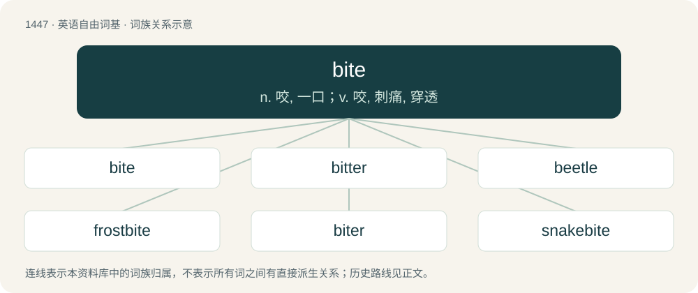

# 1530 · bite — n. 咬, 一口；v. 咬, 刺痛, 穿透

[总目录](../00_总目录_按常用程度.md)

**类型**：英语自由词基　｜　**来源语言**：见词源记录

## 核心含义与来源

- 核心含义：n. 咬, 一口；v. 咬, 刺痛, 穿透
- 英文含义：To cut into something by clamping the teeth.
- 词形：bite

**来源记录 1**（动词；To cut into something by clamping the teeth.）

From Middle English biten, from Old English bītan (“bite”), from Proto-West Germanic \*bītan, from Proto-Germanic \*bītaną (“bite”), from Proto-Indo-European \*bʰeyd- (“split”). Cognates include Saterland Frisian biete (“bite”), West Frisian bite (“bite”), Dutch bijten (“bite”), German Low German bieten (“bite”), German beißen, beissen (“bite”), Danish bide (“bite”), Swedish bita (“bite”), Norwegian Bokmål bite (“bite”), Norwegian Nynorsk bita (“bite”), Faroese and Icelandic bíta (“bite”), Gothic 𐌱𐌴𐌹𐍄𐌰𐌽 (beitan, “bite”), Latin findō (“split”), Ancient Greek φείδομαι (pheídomai), Sanskrit भिद् (bhid, “break”).

## 词族图

## 单词速览（常用到不常用）

| 单词 | 音标 | 释义 |
|---|---|---|
| [bite](#w-1) | /baɪt/ | n. 咬, 一口；v. 咬, 刺痛, 穿透 |
| [bitter](#w-2) | 英 /ˈbɪt.ə/；美 /ˈbɪ.tɚ/ | a. 苦的, 痛苦的, 怀恨的；adv. 刺骨；v. (使)变苦 |
| [beetle](#w-3) | /ˈbiːtəl/ | n. 甲虫, 大槌；vi. 快速移动；vt. 捶 |
| [frostbite](#w-4) | /ˈfrɒstbait/ | n. 冻伤, 冻疮；vt. 被霜伤害, 使冻伤 |
| [biter](#w-5) | 英 /ˈbaɪtə/；美 /ˈbaɪtɚ/ | n. 咬人的人(或动物), 骗子 |
| [snakebite](#w-6) | /ˈsneikbait/ | n. 蛇咬伤 |
| [overbite](#w-7) | /ˈəʊvə(ɹ)baɪt/ | \[医\] 覆Ж, 覆咬合 |

## 逐词详解

### 1. bite

**词性**：动词　｜　**音标**：/baɪt/

**中文释义**：n. 咬, 一口；v. 咬, 刺痛, 穿透

**英文义项**：To cut into something by clamping the teeth. / To hold something by clamping one's teeth.

**词源与演化**：

From Middle English biten, from Old English bītan (“bite”), from Proto-West Germanic \*bītan, from Proto-Germanic \*bītaną (“bite”), from Proto-Indo-European \*bʰeyd- (“split”). Cognates include Saterland Frisian biete (“bite”), West Frisian bite (“bite”), Dutch bijten (“bite”), German Low German bieten (“bite”), German beißen, beissen (“bite”), Danish bide (“bite”), Swedish bita (“bite”), Norwegian Bokmål bite (“bite”), Norwegian Nynorsk bita (“bite”), Faroese and Icelandic bíta (“bite”), Gothic 𐌱𐌴𐌹𐍄𐌰𐌽 (beitan, “bite”), Latin findō (“split”), Ancient Greek φείδομαι (pheídomai), Sanskrit भिद् (bhid, “break”).

**例句**：

> For homeowners with adjustable rate mortgages, rising interest will really bite.

该用例对应义项：To have significant effect, often negative.

### 2. bitter

**词性**：形容词　｜　**音标**：英 /ˈbɪt.ə/；美 /ˈbɪ.tɚ/

**中文释义**：a. 苦的, 痛苦的, 怀恨的；adv. 刺骨；v. (使)变苦

**英文义项**：Having an acrid taste (usually from a basic substance). / Harsh, piercing, acerbic or stinging.

**构词拆分**：bite + -er (agent noun suffix)

**词源与演化**：

From Middle English bitter, bittre, from Old English bitter, biter (“bitter”), from Proto-West Germanic \*bitr, from Proto-Germanic \*bitraz (“bitter”), equivalent to bite + -er (agent noun suffix) used attributively. Cognate with Saterland Frisian, West Frisian, Low German, Danish, Dutch, German, Norwegian Bokmål, Norwegian Nynorsk, and Swedish bitter, Icelandic bitur (all meaning “bitter”).

**例句**：

> I've been bitter ever since that defeat.

该用例对应义项：Cynical and resentful.

### 3. beetle

**词性**：动词　｜　**音标**：/ˈbiːtəl/

**中文释义**：n. 甲虫, 大槌；vi. 快速移动；vt. 捶

**英文义项**：To move (away) quickly, to scurry away.

**构词拆分**：bite + -le

**词源与演化**：

From Middle English bitle, bityl, bytylle, from Old English bitula, bitela, bītel (“beetle”), from Proto-West Germanic \*bitilō, \*bītil, from Proto-Germanic \*bitilô, \*bītilaz (“that which tends to bite, biter, beetle”), equivalent to bite + -le. Cognate with Old High German bicco (“beetle”), Danish bille (“beetle”), Icelandic bitil, bitul (“a bite, bit”), Faroese bitil (“small piece, bittock”).

**例句**：

> The big dung beetle stole the dung ball from the smaller one.

### 4. frostbite

**词性**：名词　｜　**音标**：/ˈfrɒstbait/

**中文释义**：n. 冻伤, 冻疮；vt. 被霜伤害, 使冻伤

**英文义项**：An injury suffered as a result of freezing of some part of the body, typically fingers, toes or the nose.

**构词拆分**：frost + bite

**词源与演化**：

From frost + bite.

**例句**：

> If you go out in weather like this, you risk frostbite.

### 5. biter

**词性**：名词　｜　**音标**：英 /ˈbaɪtə/；美 /ˈbaɪtɚ/

**中文释义**：n. 咬人的人(或动物), 骗子

**英文义项**：A fish that tends to take bait. / A person who takes up an offer or request.

**构词拆分**：bite + -er

**词源与演化**：

From Middle English biter, bitere, equivalent to bite + -er. Cognate with West Frisian biter (“biter”), Dutch bijter (“biter”), German Low German Bieter (“biter”), German Beißer (“biter”).

**用法示例／搭配（非完整句）**：

> I put up some fliers for the org but didn't get any biters

该用例对应义项：A person who takes up an offer or request.

### 6. snakebite

**词性**：名词　｜　**音标**：/ˈsneikbait/

**中文释义**：n. 蛇咬伤

**英文义项**：The bite of a snake. / A cocktail made with equal parts lager and hard cider.

**构词拆分**：snake + bite

**词源与演化**：

From snake + bite.

**例句**：

> Ellie recently got a navel piercing and snakebites.

该用例对应义项：A pair of lip piercings below the lower lip, resembling the fangs of a snake.

### 7. overbite

**词性**：名词　｜　**音标**：/ˈəʊvə(ɹ)baɪt/

**中文释义**：\[医\] 覆Ж, 覆咬合

**英文义项**：A malocclusion in which the upper teeth extend over the lower ones.

**构词拆分**：over- + bite

**词源与演化**：

From over- + bite.
