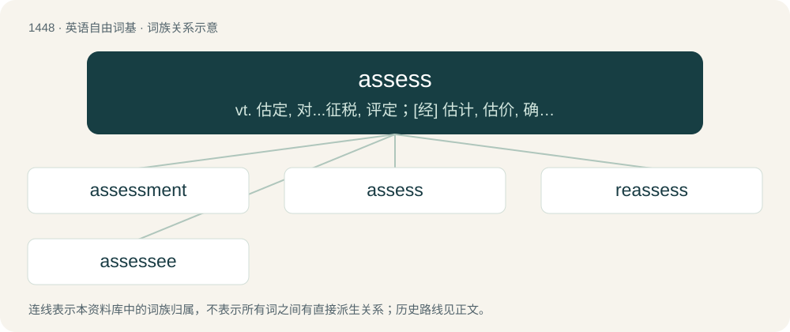

# 1531 · assess — vt. 估定, 对...征税, 评定；\[经\] 估计, 估价, 确定(税款罚款等)的金额

[总目录](../00_总目录_按常用程度.md)

**类型**：英语自由词基　｜　**来源语言**：见词源记录

## 核心含义与来源

- 核心含义：vt. 估定, 对...征税, 评定；\[经\] 估计, 估价, 确定(税款罚款等)的金额
- 英文含义：To determine, estimate or judge the value of; to evaluate; to estimate.
- 词形：assess

**来源记录 1**（动词；To determine, estimate or judge the value of; to evaluate; to estimate.）

From Middle English assessen, from Old French assesser, from Medieval Latin assessare, originally the frequentative of Latin assessus, past participle of assidēre, from ad (“to, towards, at”) + sedeō (“sit; settle down”). Cognate with Spanish asentar (“to settle”).

## 词族图

## 单词速览（常用到不常用）

| 单词 | 音标 | 释义 |
|---|---|---|
| [assessment](#w-1) | /əˈsɛsmənt/ | n. 评估, 估定, 评定的款额；\[化\] 评估 |
| [assess](#w-2) | 英 /əˈsɛs/ | vt. 估定, 对...征税, 评定；\[经\] 估计, 估价, 确定(税款罚款等)的金额 |
| [reassess](#w-3) | /ˌɹiː.əˈsɛs/ | vt. 再评价, 再摊派, 再课税 |
| [assessee](#w-4) | 美 /əsɛsˈi/ | n. 财产价值(或收入金额)已被估定之人 |

## 逐词详解

### 1. assessment

**词性**：名词　｜　**音标**：/əˈsɛsmənt/

**中文释义**：n. 评估, 估定, 评定的款额；\[化\] 评估

**英文义项**：The act of assessing or an amount (of tax, levy or duty etc) assessed. / An appraisal or evaluation.

**构词拆分**：assess + -ment

**词源与演化**：

From assess + -ment.

**例句**：

> The assessment for repairs outraged the club's membership.

该用例对应义项：an amount determined as payable

### 2. assess

**词性**：动词　｜　**音标**：英 /əˈsɛs/

**中文释义**：vt. 估定, 对...征税, 评定；\[经\] 估计, 估价, 确定(税款罚款等)的金额

**英文义项**：To determine, estimate or judge the value of; to evaluate; to estimate. / To impose or charge, especially as punishment for an infraction.

**词源与演化**：

From Middle English assessen, from Old French assesser, from Medieval Latin assessare, originally the frequentative of Latin assessus, past participle of assidēre, from ad (“to, towards, at”) + sedeō (“sit; settle down”). Cognate with Spanish asentar (“to settle”).

**例句**：

> Once you've submitted a tax return, the Tax Department will assess the amount of tax you still owe.

该用例对应义项：To calculate and demand (the tax money due) from a person or entity.

### 3. reassess

**词性**：动词　｜　**音标**：/ˌɹiː.əˈsɛs/

**中文释义**：vt. 再评价, 再摊派, 再课税

**英文义项**：To assess again; to revise an earlier assessment; to reevaluate.

**构词拆分**：re- + assess

**词源与演化**：

From re- + assess.

**例句**：

> Algeria should reassess its relations with Saudi Arabia, Qatar, and the United Arab Emirates.

### 4. assessee

**词性**：名词　｜　**音标**：美 /əsɛsˈi/

**中文释义**：n. 财产价值(或收入金额)已被估定之人

**英文义项**：Something or someone that is assessed.

**构词拆分**：assess + -ee

**词源与演化**：

From assess + -ee.
