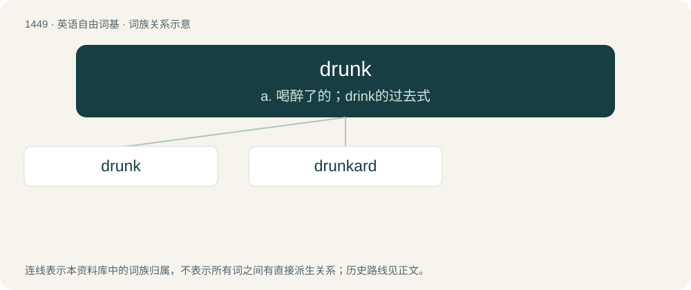

# 1532 · drunk — a. 喝醉了的；drink的过去式

[总目录](../00_总目录_按常用程度.md)

**类型**：英语自由词基　｜　**来源语言**：见词源记录

## 核心含义与来源

- 核心含义：a. 喝醉了的；drink的过去式
- 英文含义：Intoxicated as a result of excessive alcohol consumption, usually by drinking alcoholic beverages.
- 词形：drunk

**来源记录 1**（形容词；Intoxicated as a result of excessive alcohol consumption, usually by drinking alcoholic beverages.）

From Middle English drunke, drunken, ydrunke, ydrunken, from Old English druncen, ġedruncen (“drunk”), from Proto-Germanic \*drunkanaz, \*gadrunkanaz (“drunk; drunken”), past participle of Proto-Germanic \*drinkaną (“to drink”). Cognate with Saterland Frisian dronken, West Frisian dronken, Dutch dronken, gedronken, German Low German drunken, bedrunken, German trunken, getrunken, betrunken, Swedish drucken, Icelandic drukkinn.

## 词族图

## 单词速览（常用到不常用）

| 单词 | 音标 | 释义 |
|---|---|---|
| [drunk](#w-1) | /dɹʌŋk/ | a. 喝醉了的；drink的过去式 |
| [drunkard](#w-2) | 美 /ˈdɹʌŋkɚd/ | n. 酒鬼；\[医\] 嗜酒者 |

## 逐词详解

### 1. drunk

**词性**：形容词　｜　**音标**：/dɹʌŋk/

**中文释义**：a. 喝醉了的；drink的过去式

**英文义项**：Intoxicated as a result of excessive alcohol consumption, usually by drinking alcoholic beverages. / Habitually or frequently in a state of intoxication.

**词源与演化**：

From Middle English drunke, drunken, ydrunke, ydrunken, from Old English druncen, ġedruncen (“drunk”), from Proto-Germanic \*drunkanaz, \*gadrunkanaz (“drunk; drunken”), past participle of Proto-Germanic \*drinkaną (“to drink”). Cognate with Saterland Frisian dronken, West Frisian dronken, Dutch dronken, gedronken, German Low German drunken, bedrunken, German trunken, getrunken, betrunken, Swedish drucken, Icelandic drukkinn.

**例句**：

> Drunk with power, he immediately ordered a management reshuffle.

该用例对应义项：Elated or emboldened.

### 2. drunkard

**词性**：名词　｜　**音标**：美 /ˈdɹʌŋkɚd/

**中文释义**：n. 酒鬼；\[医\] 嗜酒者

**英文义项**：A person who is habitually drunk.

**构词拆分**：drunk + -ard (“pejorative agent suffix”)

**词源与演化**：

From earlier droncarde, from Middle English \*druncard (attested as a surname, Druncard), possibly from Middle Low German drunkert, equivalent to drunk + -ard (“pejorative agent suffix”). Compare German Trunkart. Compare braggart.

**例句**：

> How far is an Irishman from a drunkard? The breadth of the table.
