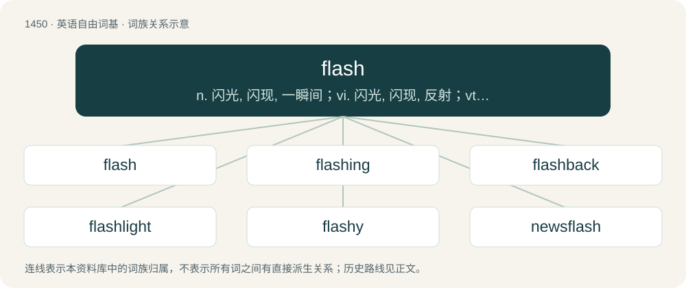

# 1533 · flash — n. 闪光, 闪现, 一瞬间；vi. 闪光, 闪现, 反射；vt. 使闪光, 反射

[总目录](../00_总目录_按常用程度.md)

**类型**：英语自由词基　｜　**来源语言**：见词源记录

## 核心含义与来源

- 核心含义：n. 闪光, 闪现, 一瞬间；vi. 闪光, 闪现, 反射；vt. 使闪光, 反射
- 英文含义：To cause to shine briefly or intermittently.
- 词形：flash

**多个词源／构词路径**：同一拼写可能有不同来源；以下按词性和含义分别列出。

**来源记录 1**（动词；To cause to shine briefly or intermittently.）

In some senses, from Middle English flasshen, a variant of flasken, flaskien (“to sprinkle, splash”), which was likely of imitative origin; in other senses probably of North Germanic origin akin to Swedish dialectal flasa (“to burn brightly, blaze”), related to flare. Compare also Icelandic flasa (“to rush, go hastily”).

**来源记录 2**（名词；A pool of water, in some areas especially one that is marshy, and/or one formed by subsidence of the ground due to mining. (Compare flush (“marsh; pool”).)）

From Middle English flashe, flaske, also found as flosche and flushe (whence modern English flosh and flush), used in Middle and modern English for bodies of water with varying emphasis on them being "pools" or "marshes". It is not entirely clear whether these constitute a single term with varied spellings, or have distinct etymologies. The form flash, flashe is often suggested to be from Old French flache, French flaque, which is of Germanic origin, akin to Middle Dutch vlacke (“an estuary, flats with stagnant pools”). See flush for more on that form.

## 词族图

## 单词速览（常用到不常用）

| 单词 | 音标 | 释义 |
|---|---|---|
| [flash](#w-1) | /flæʃ/ | n. 闪光, 闪现, 一瞬间；vi. 闪光, 闪现, 反射；vt. 使闪光, 反射 |
| [flashing](#w-2) | /ˈflæʃɪŋ/ | n. 闪光, 遮雨板, 防水板；\[电\] 闪光 |
| [flashback](#w-3) | /ˈflæʃ.bæk/ | n. 倒叙, 火舌回闪；\[机\] 回闪 |
| [flashlight](#w-4) | 英 /ˈflæʃˌlaɪt/ | n. 手电筒, 闪光信号灯 |
| [flashy](#w-5) | /ˈflæʃi/ | a. 闪光的, 一瞬间的, 浮华的 |
| [newsflash](#w-6) | 美 /ˈnuzˌflæʃ/ | n. 简明新闻 |
| [flasher](#w-7) | 美 /ˈflæʃɚ/ | n. 发出闪光之物, 闪光灯, 闪光信号；\[电\] 闪燃器 |
| [flashcard](#w-8) | 美 /ˈflæʃˌkɑɹd/ | n. 教学用的抽认卡 |

## 逐词详解

### 1. flash

**词性**：动词　｜　**音标**：/flæʃ/

**中文释义**：n. 闪光, 闪现, 一瞬间；vi. 闪光, 闪现, 反射；vt. 使闪光, 反射

**英文义项**：To cause to shine briefly or intermittently. / To blink; to shine or illuminate intermittently.

**词源与演化**：

In some senses, from Middle English flasshen, a variant of flasken, flaskien (“to sprinkle, splash”), which was likely of imitative origin; in other senses probably of North Germanic origin akin to Swedish dialectal flasa (“to burn brightly, blaze”), related to flare. Compare also Icelandic flasa (“to rush, go hastily”).

**例句**：

> Her skirt was so short that she flashed her underpants as she was getting out of her car.

该用例对应义项：To expose one's intimate body part or undergarment, often momentarily and unintentionally. (Contrast streak.)

### 2. flashing

**词性**：名词　｜　**音标**：/ˈflæʃɪŋ/

**中文释义**：n. 闪光, 遮雨板, 防水板；\[电\] 闪光

**英文义项**：A sudden blazing or bursting, as of fire or water. / Components used to weatherproof or seal roof system edges at perimeters, penetrations, walls, expansion joints, valleys, drains and other places where the roof covering is interrupted or terminated.

**构词拆分**：flash + -ing

**词源与演化**：

From flash + -ing. \* (weatherproofing): From original flashing material of copper or aluminum that reflects flashes of sunlight.

**例句**：

> The incessant flashing of the neon sign kept the neighborhood awake.

该用例对应义项：The blinking of a light source, such as a light bulb or computer's cursor.

### 3. flashback

**词性**：名词　｜　**音标**：/ˈflæʃ.bæk/

**中文释义**：n. 倒叙, 火舌回闪；\[机\] 回闪

**英文义项**：A dramatic device in which an earlier event is inserted into the normal chronological flow of a narrative. / A vivid mental image of a past trauma or other sensation that the trauma is happening in the present, especially one that recurs.

**构词拆分**：flash + back

**词源与演化**：

From flash + back.

**例句**：

> This movie has way too many flashback scenes.

### 4. flashlight

**词性**：名词　｜　**音标**：英 /ˈflæʃˌlaɪt/

**中文释义**：n. 手电筒, 闪光信号灯

**英文义项**：A battery-powered hand-held light source. / A flashgun (device used to create flashes of light for photography).

**构词拆分**：flash + light

**词源与演化**：

From flash + light.

**例句**：

> I shone my flashlight on the strange inscription.

该用例对应义项：A battery-powered hand-held light source.

### 5. flashy

**词性**：形容词　｜　**音标**：/ˈflæʃi/

**中文释义**：a. 闪光的, 一瞬间的, 浮华的

**英文义项**：Showy; visually impressive, attention-getting, or appealing. / Marked by frequent variations in water amount (compare flash flood).

**构词拆分**：flash + -y

**词源与演化**：

From flash + -y.

**例句**：

> The dancers wore flashy costumes featuring shiny sequins in many vibrant colors.

该用例对应义项：Showy; visually impressive, attention-getting, or appealing.

### 6. newsflash

**词性**：名词　｜　**音标**：美 /ˈnuzˌflæʃ/

**中文释义**：n. 简明新闻

**英文义项**：A brief media report of something that has recently taken place.

**构词拆分**：news + flash

**词源与演化**：

From news + flash.

**例句**：

> Television programmes were interrupted by a newsflash announcing that the Prime Minister had resigned.

该用例对应义项：A brief media report of something that has recently taken place.

### 7. flasher

**词性**：名词　｜　**音标**：美 /ˈflæʃɚ/

**中文释义**：n. 发出闪光之物, 闪光灯, 闪光信号；\[电\] 闪燃器

**英文义项**：Anything that flashes, especially a device that switches a light on and off. / An indicator or turn signal.

**构词拆分**：flash + -er

**词源与演化**：

From flash + -er.

**例句**：

> The flasher was arrested for indecent exposure and sexual harassment.

### 8. flashcard

**词性**：名词　｜　**音标**：美 /ˈflæʃˌkɑɹd/

**中文释义**：n. 教学用的抽认卡

**英文义项**：A card used to aid rote memorization. One side of the card contains data of one kind, or a question, and the other side contains the associated response which one wants to memorize. For example, one side could contain an English word, and the other side the Spanish translation. / A solid-state digital memory storage format, commonly found on computers, digital cameras and cellphones.

**构词拆分**：flash + card

**词源与演化**：

From flash + card.

**例句**：

> Many people use flashcards to learn languages.

该用例对应义项：A card used to aid rote memorization. One side of the card contains data of one kind, or a question, and the other side contains the associated response which one wants to memorize. For example, one side could contain an English word, and the other side the Spanish translation.
