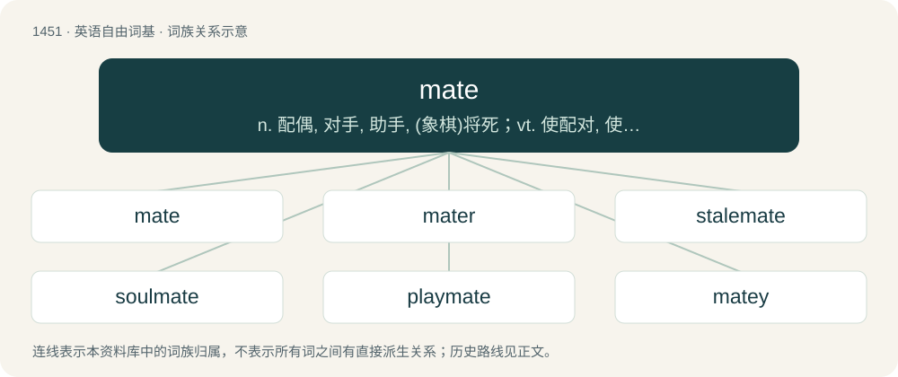

# 1535 · mate — n. 配偶, 对手, 助手, (象棋)将死；vt. 使配对, 使一致, 结伴, (象棋)将死；vi. 成配偶, 紧密配合

[总目录](../00_总目录_按常用程度.md)

**类型**：英语自由词基　｜　**来源语言**：见词源记录

## 核心含义与来源

- 核心含义：n. 配偶, 对手, 助手, (象棋)将死；vt. 使配对, 使一致, 结伴, (象棋)将死；vi. 成配偶, 紧密配合
- 英文含义：A fellow, comrade, colleague, partner or someone with whom something is shared, e.g. shipmate, classmate.
- 词形：mate

**多个词源／构词路径**：同一拼写可能有不同来源；以下按词性和含义分别列出。

**来源记录 1**（名词；A fellow, comrade, colleague, partner or someone with whom something is shared, e.g. shipmate, classmate.）

From Middle English mate, a borrowing from Middle Low German mate (“messmate”) (replacing Middle English mett, mette (“table companion, mate, partner”), from Old English ġemetta (“sharer of food, table-guest”)), from Old Saxon gimato, derived from Proto-Germanic \*gamatjô, itself from \*ga- (“together”) (related to German and Dutch ge-) + \*matjô (from \*matiz (“food”)), related to Old English mete (“food”)). From the same Middle Low German source stems German Low German Maat (“journeyman, companion”), German Maat (“naval non-commissioned officer”). Cognates include Saterland Frisian Moat (“friend, buddy, comrade, mate”), Dutch maat (“mate, partner, colleague, friend”). More at Old English ġe-, English co-, English meat. Doublet of maat. Compare typologically Latin compāniō (whence companion) (&lt; con- + panis + -ō), Russian однока́шник (odnokášnik) (&lt; одно- (odno-) + ка́ша (káša) + -ник (-nik)).

**来源记录 2**（名词；The abovementioned plant; the leaves and shoots used for the tea）

See maté.

## 词族图

## 单词速览（常用到不常用）

| 单词 | 音标 | 释义 |
|---|---|---|
| [mate](#w-1) | /meɪt/ | n. 配偶, 对手, 助手, (象棋)将死；vt. 使配对, 使一致, 结伴, (象棋)将死；vi. 成配偶, 紧密配合 |
| [mater](#w-2) | 英 /ˈmeɪtə/；美 /ˈmeɪtɚ/ | 【英文】Someone or something that mates. |
| [stalemate](#w-3) | /ˈsteɪlmeɪt/ | n. 僵持状态, 僵局, 陷于困境, 胶着状况；vt. 将...逼和, 使僵持, 使陷入困境 |
| [soulmate](#w-4) | /ˈsəʊlmeɪt/ | n. 心灵伴侣, 知音, 梦中情人 |
| [playmate](#w-5) | /ˈpleɪˌmeɪt/ | n. 玩伴, 游伴 |
| [matey](#w-6) | /ˈmeiti/ | a. 易为人亲近的, 融洽的；n. 伙伴, 朋友 |

## 逐词详解

### 1. mate

**词性**：名词　｜　**音标**：/meɪt/

**中文释义**：n. 配偶, 对手, 助手, (象棋)将死；vt. 使配对, 使一致, 结伴, (象棋)将死；vi. 成配偶, 紧密配合

**英文义项**：A fellow, comrade, colleague, partner or someone with whom something is shared, e.g. shipmate, classmate. / A breeding partner.

**词源与演化**：

From Middle English mate, a borrowing from Middle Low German mate (“messmate”) (replacing Middle English mett, mette (“table companion, mate, partner”), from Old English ġemetta (“sharer of food, table-guest”)), from Old Saxon gimato, derived from Proto-Germanic \*gamatjô, itself from \*ga- (“together”) (related to German and Dutch ge-) + \*matjô (from \*matiz (“food”)), related to Old English mete (“food”)). From the same Middle Low German source stems German Low German Maat (“journeyman, companion”), German Maat (“naval non-commissioned officer”). Cognates include Saterland Frisian Moat (“friend, buddy, comrade, mate”), Dutch maat (“mate, partner, colleague, friend”). More at Old English ġe-, English co-, English meat. Doublet of maat. Compare typologically Latin compāniō (whence companion) (&lt; con- + panis + -ō), Russian однока́шник (odnokášnik) (&lt; одно- (odno-) + ка́ша (káša) + -ник (-nik)).

**例句**：

> I found one of the socks I wanted to wear, but I couldn't find its mate.

该用例对应义项：The other member of a matched pair of objects.

### 2. mater

**词性**：名词　｜　**音标**：英 /ˈmeɪtə/；美 /ˈmeɪtɚ/

**英文义项**：Someone or something that mates.

**构词拆分**：mate + -er

**词源与演化**：

From mate + -er.

### 3. stalemate

**词性**：名词　｜　**音标**：/ˈsteɪlmeɪt/

**中文释义**：n. 僵持状态, 僵局, 陷于困境, 胶着状况；vt. 将...逼和, 使僵持, 使陷入困境

**英文义项**：The state in which the player to move is not in check but has no legal moves, resulting in a draw. / Any situation that has no obvious possible movement, but involves no personal loss.

**构词拆分**：stale + mate

**词源与演化**：

From stale + mate.

**例句**：

> After a two-year political stalemate, Lebanon has a new president.

### 4. soulmate

**词性**：名词　｜　**音标**：/ˈsəʊlmeɪt/

**中文释义**：n. 心灵伴侣, 知音, 梦中情人

**英文义项**：Someone, especially a romantic partner, with whom one is exceptionally or uniquely compatible or has a special, almost spiritual connection.

**构词拆分**：soul + mate

**词源与演化**：

From soul + mate. First attested as soul-mate in an 1822 letter by Samuel Taylor Coleridge. Not in common usage before the 1980s.

**例句**：

> Tom has a sham marriage with Mary, but John is his real soulmate.

### 5. playmate

**词性**：名词　｜　**音标**：/ˈpleɪˌmeɪt/

**中文释义**：n. 玩伴, 游伴

**英文义项**：A companion for someone (especially a child) to play with. / A person's lover.

**构词拆分**：play + mate

**词源与演化**：

From play + mate. Compare earlier playfeer (“playmate”) of similar construction.

### 6. matey

**词性**：形容词　｜　**音标**：/ˈmeiti/

**中文释义**：a. 易为人亲近的, 融洽的；n. 伙伴, 朋友

**英文义项**：Sociable or friendly.

**构词拆分**：mate + -y

**词源与演化**：

From mate + -y.

**例句**：

> You've been very matey with that new bird.

该用例对应义项：Sociable or friendly.
