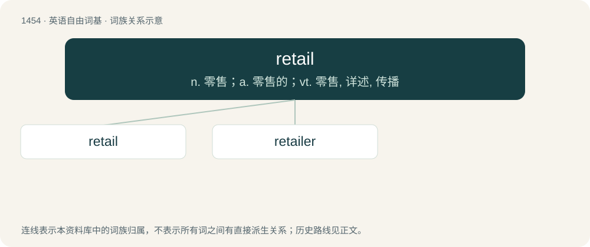

# 1538 · retail — n. 零售；a. 零售的；vt. 零售, 详述, 传播

[总目录](../00_总目录_按常用程度.md)

**类型**：英语自由词基　｜　**来源语言**：见词源记录

## 核心含义与来源

- 核心含义：n. 零售；a. 零售的；vt. 零售, 详述, 传播
- 英文含义：The sale of goods directly to the consumer, encompassing the storefronts, mail-order, websites, etc., and the corporate mechanisms, branding, advertising, etc. that support them.
- 词形：retail

**来源记录 1**（名词；The sale of goods directly to the consumer, encompassing the storefronts, mail-order, websites, etc., and the corporate mechanisms, branding, advertising, etc. that support them.）

From the Old French verb retaillier.

## 词族图

## 单词速览（常用到不常用）

| 单词 | 音标 | 释义 |
|---|---|---|
| [retail](#w-1) | 美 /ˈɹiˌteɪl/ | n. 零售；a. 零售的；vt. 零售, 详述, 传播 |
| [retailer](#w-2) | 美 /ˈɹiteɪlɚ/ | n. 零售商人, 传播的人；\[经\] 零售商 |

## 逐词详解

### 1. retail

**词性**：名词　｜　**音标**：美 /ˈɹiˌteɪl/

**中文释义**：n. 零售；a. 零售的；vt. 零售, 详述, 传播

**英文义项**：The sale of goods directly to the consumer, encompassing the storefronts, mail-order, websites, etc., and the corporate mechanisms, branding, advertising, etc. that support them. / The sale of securities or other financial instruments to private investors, as opposed to large institutions.

**词源与演化**：

From the Old French verb retaillier.

**例句**：

> I never pay retail for clothes.

该用例对应义项：Retail price; full price; an abbreviated expression, meaning the full suggested price of a particular good or service, before any sale, discount, or other deal.

### 2. retailer

**词性**：名词　｜　**音标**：美 /ˈɹiteɪlɚ/

**中文释义**：n. 零售商人, 传播的人；\[经\] 零售商

**英文义项**：A retail sales company or salesman.

**构词拆分**：retail + -er

**词源与演化**：

From retail + -er.

**例句**：

> Walmart is a dominant retailer in the United States.
