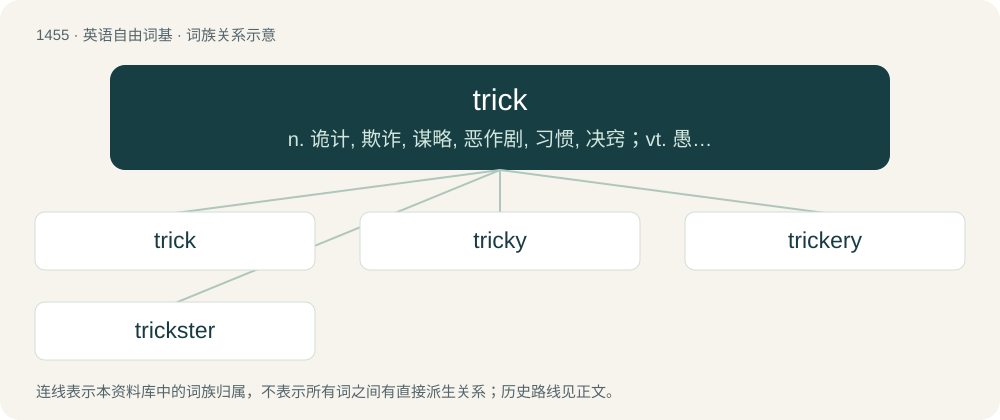

# 1539 · trick — n. 诡计, 欺诈, 谋略, 恶作剧, 习惯, 决窍；vt. 愚弄, 欺骗, 装饰；vi. 哄骗, 戏弄

[总目录](../00_总目录_按常用程度.md)

**类型**：英语自由词基　｜　**来源语言**：见词源记录

## 核心含义与来源

- 核心含义：n. 诡计, 欺诈, 谋略, 恶作剧, 习惯, 决窍；vt. 愚弄, 欺骗, 装饰；vi. 哄骗, 戏弄
- 英文含义：Something designed to fool, dupe, outsmart, mislead or swindle.
- 词形：trick

**来源记录 1**（名词；Something designed to fool, dupe, outsmart, mislead or swindle.）

From Middle English trikke, from Old Northern French trique (related to Old French trichier (“to defraud, act dishonestly, conceal, deceive, cheat”); &gt; modern French tricher), itself possibly from Middle High German trechen (“to launch a shot at, play a trick on”), or one of its derivatives (e.g. Middle High German ūftrechen (“to do something to someone, hurt someone”), vertrechen (“to conceal, get over on someone”), zuotrechen (“to obtain falsely or deceitfully, wangle, finagle”), etc.); yet the Old French verb is equally likely to be derived from Vulgar Latin \*triccāre, from Late Latin tricāre, from Latin trīcor, trīcārī (“dodge, search for detours; haggle, quibble”). The term has been connected to Middle Dutch treck, trec (“draw, line, desire, game move, cord, stratagem, ruse, trick”), from Middle Dutch trekken, trēken (“to pull, place, put, move”), from Old Dutch \*trekken, \*trekan (“to move, drag”), from Proto-Germanic \*trakjaną, \*trekaną (“to drag, scrape, pull”), from Proto-Indo-European \*dreg- (“to drag, scrape”). If they are related, trick would be cognate with Low German trekken, Middle High German trecken, trechen, Danish trække, and Old Frisian trekka, Romanian truc and other Romance languages. Compare track, treachery, trig, and trigger.

## 词族图

## 单词速览（常用到不常用）

| 单词 | 音标 | 释义 |
|---|---|---|
| [trick](#w-1) | /ˈtɹɪk/ | n. 诡计, 欺诈, 谋略, 恶作剧, 习惯, 决窍；vt. 愚弄, 欺骗, 装饰；vi. 哄骗, 戏弄 |
| [tricky](#w-2) | /ˈtɹɪk.i/ | a. 狡猾的, 机敏的 |
| [trickery](#w-3) | 美 /ˈtɹɪ.kə.ɹi/ | n. 欺骗, 欺诈, 诡计；\[法\] 诡计, 奸计, 诈骗 |
| [trickster](#w-4) | 英 /ˈtɹɪk.stə/；美 /ˈtɹɪk.stɚ/ | n. 骗子, 魔术师；\[法\] 骗子, 欺骗者 |

## 逐词详解

### 1. trick

**词性**：名词　｜　**音标**：/ˈtɹɪk/

**中文释义**：n. 诡计, 欺诈, 谋略, 恶作剧, 习惯, 决窍；vt. 愚弄, 欺骗, 装饰；vi. 哄骗, 戏弄

**英文义项**：Something designed to fool, dupe, outsmart, mislead or swindle. / A single element of a magician's (or any variety entertainer's) act; a magic trick.

**词源与演化**：

From Middle English trikke, from Old Northern French trique (related to Old French trichier (“to defraud, act dishonestly, conceal, deceive, cheat”); &gt; modern French tricher), itself possibly from Middle High German trechen (“to launch a shot at, play a trick on”), or one of its derivatives (e.g. Middle High German ūftrechen (“to do something to someone, hurt someone”), vertrechen (“to conceal, get over on someone”), zuotrechen (“to obtain falsely or deceitfully, wangle, finagle”), etc.); yet the Old French verb is equally likely to be derived from Vulgar Latin \*triccāre, from Late Latin tricāre, from Latin trīcor, trīcārī (“dodge, search for detours; haggle, quibble”). The term has been connected to Middle Dutch treck, trec (“draw, line, desire, game move, cord, stratagem, ruse, trick”), from Middle Dutch trekken, trēken (“to pull, place, put, move”), from Old Dutch \*trekken, \*trekan (“to move, drag”), from Proto-Germanic \*trakjaną, \*trekaną (“to drag, scrape, pull”), from Proto-Indo-European \*dreg- (“to drag, scrape”). If they are related, trick would be cognate with Low German trekken, Middle High German trecken, trechen, Danish trække, and Old Frisian trekka, Romanian truc and other Romance languages. Compare track, treachery, trig, and trigger.

**例句**：

> As the businessman rounded the corner, she thought, "Here comes another trick."

该用例对应义项：A customer or client of a prostitute.

### 2. tricky

**词性**：形容词　｜　**音标**：/ˈtɹɪk.i/

**中文释义**：a. 狡猾的, 机敏的

**英文义项**：Hard to deal with, complicated. / Adept at using deception.

**构词拆分**：trick + -y

**词源与演化**：

From trick + -y.

**例句**：

> I don't want any of your tricky money, thank you!

该用例对应义项：Relating to or associated with a prostitution trick.

### 3. trickery

**词性**：名词　｜　**音标**：美 /ˈtɹɪ.kə.ɹi/

**中文释义**：n. 欺骗, 欺诈, 诡计；\[法\] 诡计, 奸计, 诈骗

**英文义项**：Deception, deceit or underhanded behavior. / The art of dressing up; imposture, pretense.

**构词拆分**：trick + -ery

**词源与演化**：

From trick + -ery, first recorded in 1719.

**例句**：

> Exercise caution in your business affairs, for the world is full of trickery.

### 4. trickster

**词性**：名词　｜　**音标**：英 /ˈtɹɪk.stə/；美 /ˈtɹɪk.stɚ/

**中文释义**：n. 骗子, 魔术师；\[法\] 骗子, 欺骗者

**英文义项**：Any of numerous figures featuring in various mythologies and folk traditions, who use guile and secret knowledge to challenge authority and play tricks and pranks on others with their acts of trickery; any similar figure in literature. / One who plays tricks or pranks on others.

**构词拆分**：trick + -ster

**词源与演化**：

From trick + -ster.

**例句**：

> That shady trickster faked being a psychic advisor to spread misinformation and gain profit.

该用例对应义项：A fraud or cheat (person who performs a trick or hoax full of falsehoods for the purpose of unlawful gain).
