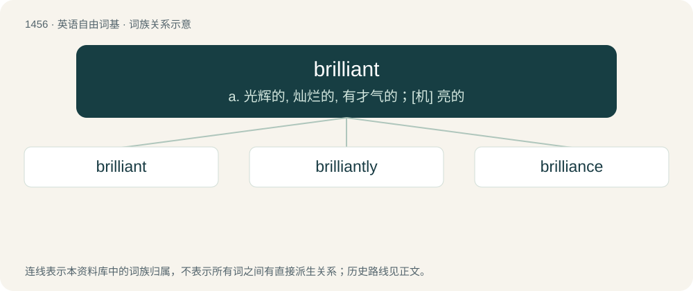

# 1540 · brilliant — a. 光辉的, 灿烂的, 有才气的；\[机\] 亮的

[总目录](../00_总目录_按常用程度.md)

**类型**：英语自由词基　｜　**来源语言**：见词源记录

## 核心含义与来源

- 核心含义：a. 光辉的, 灿烂的, 有才气的；\[机\] 亮的
- 英文含义：Shining brightly.
- 词形：brilliant

**来源记录 1**（形容词；Shining brightly.）

Borrowed from French brillant (late 17th century), present participle of the verb briller, from Italian brillare, possibly from Latin berillus, beryllus (“a beryl, gem, eyeglass”), from Ancient Greek βήρυλλος (bḗrullos, “beryl”). By surface analysis, French brill(er) + -i- + -ant.

## 词族图

## 单词速览（常用到不常用）

| 单词 | 音标 | 释义 |
|---|---|---|
| [brilliant](#w-1) | /ˈbɹɪl.jənt/ | a. 光辉的, 灿烂的, 有才气的；\[机\] 亮的 |
| [brilliantly](#w-2) | /ˈbrijəntli/ | adv. 辉煌地, 光亮地, 灿烂地 |
| [brilliance](#w-3) | /ˈbɹɪljən(t)s/ | n. 卓越, 光辉；\[电\] 辉度 |

## 逐词详解

### 1. brilliant

**词性**：形容词　｜　**音标**：/ˈbɹɪl.jənt/

**中文释义**：a. 光辉的, 灿烂的, 有才气的；\[机\] 亮的

**英文义项**：Shining brightly. / Both bright and saturated.

**词源与演化**：

Borrowed from French brillant (late 17th century), present participle of the verb briller, from Italian brillare, possibly from Latin berillus, beryllus (“a beryl, gem, eyeglass”), from Ancient Greek βήρυλλος (bḗrullos, “beryl”). By surface analysis, French brill(er) + -i- + -ant.

**例句**：

> The actor's performance in the play was simply brilliant.

该用例对应义项：Of surpassing excellence; magnificent.

### 2. brilliantly

**词性**：副词　｜　**音标**：/ˈbrijəntli/

**中文释义**：adv. 辉煌地, 光亮地, 灿烂地

**英文义项**：In a brilliant manner; with brilliance.

**构词拆分**：brilliant + -ly

**词源与演化**：

From brilliant + -ly.

**例句**：

> Quasars are brilliantly shining heavenly bodies that are extremely far away.

### 3. brilliance

**词性**：名词　｜　**音标**：/ˈbɹɪljən(t)s/

**中文释义**：n. 卓越, 光辉；\[电\] 辉度

**英文义项**：The quality of being exceptionally effulgent (giving off light). / The quality of having extraordinary mental capacity.

**构词拆分**：brilliant + -ance

**词源与演化**：

From brilliant + -ance. Compare French brillance.

**例句**：

> What brilliance it took from Harry Kane to control the cross and place the ball into the top corner.

该用例对应义项：Magnificence; resplendence.
