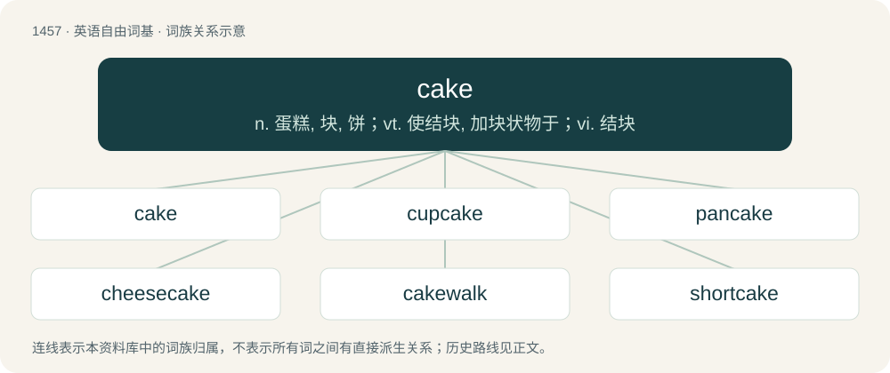

# 1542 · cake — n. 蛋糕, 块, 饼；vt. 使结块, 加块状物于；vi. 结块

[总目录](../00_总目录_按常用程度.md)

**类型**：英语自由词基　｜　**来源语言**：见词源记录

## 核心含义与来源

- 核心含义：n. 蛋糕, 块, 饼；vt. 使结块, 加块状物于；vi. 结块
- 英文含义：A rich, sweet dessert food, typically made of flour, sugar, and eggs and baked in an oven, and often covered in icing.
- 词形：cake

**来源记录 1**（名词；A rich, sweet dessert food, typically made of flour, sugar, and eggs and baked in an oven, and often covered in icing.）

From Middle English cake, from Old Norse kaka (“cake”) (compare Norwegian kake, Icelandic/Swedish kaka, Danish kage), from Proto-Germanic \*kakǭ, of disputed origin. Likely a distant cognate with kaak. Perhaps related to cookie, kuchen, and quiche. Doublet of coca (pastry).

## 词族图

## 单词速览（常用到不常用）

| 单词 | 音标 | 释义 |
|---|---|---|
| [cake](#w-1) | /keɪk/ | n. 蛋糕, 块, 饼；vt. 使结块, 加块状物于；vi. 结块 |
| [cupcake](#w-2) | /ˈkʌpkeɪk/ | n. 杯形蛋糕 |
| [pancake](#w-3) | /ˈpæn.keɪk/ | n. 薄烤饼, 薄煎饼, 烙饼 |
| [cheesecake](#w-4) | 英 /ˈt͡ʃiːzˌkeɪk/；美 /ˈt͡ʃizˌkeɪk/ | n. 干酪饼, 半裸体的女人照片 |
| [cakewalk](#w-5) | 美 /ˈkeɪk.wɔk/ | n. 步态竞赛, 阔步舞；vi. 举行步态竞赛 |
| [shortcake](#w-6) |  | n. (英)厚的奶油酥饼, (美)脆饼, 水果松糕, 松饼 |
| [beefcake](#w-7) | /ˈbiːfˌkeɪk/ | n. 男子健美照片 |

## 逐词详解

### 1. cake

**词性**：名词　｜　**音标**：/keɪk/

**中文释义**：n. 蛋糕, 块, 饼；vt. 使结块, 加块状物于；vi. 结块

**英文义项**：A rich, sweet dessert food, typically made of flour, sugar, and eggs and baked in an oven, and often covered in icing. / A small mass of baked dough, especially a thin loaf from unleavened dough.

**词源与演化**：

From Middle English cake, from Old Norse kaka (“cake”) (compare Norwegian kake, Icelandic/Swedish kaka, Danish kage), from Proto-Germanic \*kakǭ, of disputed origin. Likely a distant cognate with kaak. Perhaps related to cookie, kuchen, and quiche. Doublet of coca (pastry).

**例句**：

> Since I started doing squats, I've built up some serious cake.

该用例对应义项：Synonym of buttocks, especially a pair that are exceptionally plump or full.

### 2. cupcake

**词性**：名词　｜　**音标**：/ˈkʌpkeɪk/

**中文释义**：n. 杯形蛋糕

**英文义项**：A small cake baked in a usually paper container shaped like a cup, often with icing on top. / An attractive young woman.

**构词拆分**：cup + cake

**词源与演化**：

From cup + cake.

**例句**：

> Australia need a win to progress, but they have a cupcake in Italy for their last, so they're not likely to miss out.

该用例对应义项：An unskilled player or team, especially one expected to be easily defeated by a stronger opponent.

### 3. pancake

**词性**：名词　｜　**音标**：/ˈpæn.keɪk/

**中文释义**：n. 薄烤饼, 薄煎饼, 烙饼

**英文义项**：An thin batter cake similar to a crepe, typically unleavened. / A leavened, thicker, fluffier cake.

**构词拆分**：By surface analysis, pan + cake

**词源与演化**：

Inherited from Middle English pancake, panne cake, pankake, ponkake. By surface analysis, pan + cake. Perhaps adapted from Middle Low German pankôke, pannekôke, from Old Saxon \*pannakōko (suggested by derivatives Old Saxon pannakōkilo and pannakōkilīn), where the compound is much older; compare Old High German phankuohho (8th century), whence Middle High German phankuoche, German Pfannkuchen (“pancake”); further Saterland Frisian Ponkouke, Ponkuuke (“pancake”), West Frisian pankoek (“pancake”), Dutch pannenkoek (“pancake”), German Low German Pannkook (“pancake”). The juggling sense is by analogy with a pancake being tossed in a pan.

**用法示例／搭配（非完整句）**：

> pancake lens

该用例对应义项：Anything very thin and flat.

### 4. cheesecake

**词性**：名词　｜　**音标**：英 /ˈt͡ʃiːzˌkeɪk/；美 /ˈt͡ʃizˌkeɪk/

**中文释义**：n. 干酪饼, 半裸体的女人照片

**英文义项**：A pie made of sweetened and flavoured cottage cheese or cream cheese, eggs and milk on a crunchy base. / Imagery of scantily clad, sexually attractive young women; pin-ups.

**构词拆分**：cheese + cake

**词源与演化**：

From Middle English chesekake; equivalent to cheese + cake. Compare chess cake.

**例句**：

> Company policy forbids displaying cheesecake in the locker rooms.

该用例对应义项：Imagery of scantily clad, sexually attractive young women; pin-ups.

### 5. cakewalk

**词性**：名词　｜　**音标**：美 /ˈkeɪk.wɔk/

**中文释义**：n. 步态竞赛, 阔步舞；vi. 举行步态竞赛

**英文义项**：The style of music associated with such a contest. / The dance, or strutting style of dance, associated with such a contest.

**构词拆分**：cake + walk

**词源与演化**：

From cake + walk. Originally an African-American form of dance and music that developed after the Civil War, later popularised by minstrel shows. It was danced at social events, with the best dancers often receiving cake as a prize. It derives from dance competitions by plantation slaves in which the style of dance lampooned the ballroom dances of the slaveowners. Slaveowners seem to have found the competitions entertaining and the habit of offering cake may originate from this period. The name is sometimes also applied to the dance's precursor on the plantations. Doing the cakewalk well required virtuosity, and a major aesthetic aspect of that virtuosity was the apparent ease with which the dance was performed. This gave rise to the idiom as easy as a cakewalk, which in turn led to the sense of cakewalk as something that is easy. See the linked Wikipedia article for more.

**例句**：

> Winning the tournament was a cakewalk for him.

该用例对应义项：an easy accomplishment

### 6. shortcake

**词性**：名词

**中文释义**：n. (英)厚的奶油酥饼, (美)脆饼, 水果松糕, 松饼

**英文义项**：A sweet cake or biscuit (crumbly leavened bread) typically made with flour, sugar, salt, butter, milk or cream, and sometimes eggs, and leavened with baking powder or baking soda. / A dessert made with such a cake, typically having layers of cream and fruit.

**构词拆分**：short + cake

**词源与演化**：

From short + cake.

**例句**：

> When I speak of strawberries I associate them with shortcake.

### 7. beefcake

**词性**：名词　｜　**音标**：/ˈbiːfˌkeɪk/

**中文释义**：n. 男子健美照片

**英文义项**：Imagery of one or more muscular, well-built men. / Such a male, especially as seen as physically desirable.

**构词拆分**：beef + cake

**词源与演化**：

From beef + cake. In sense 1, by analogy with cheesecake (“an image of a sexy young woman”).

**例句**：

> When it came to boyfriends, she was more interested in beefcake than brains.
