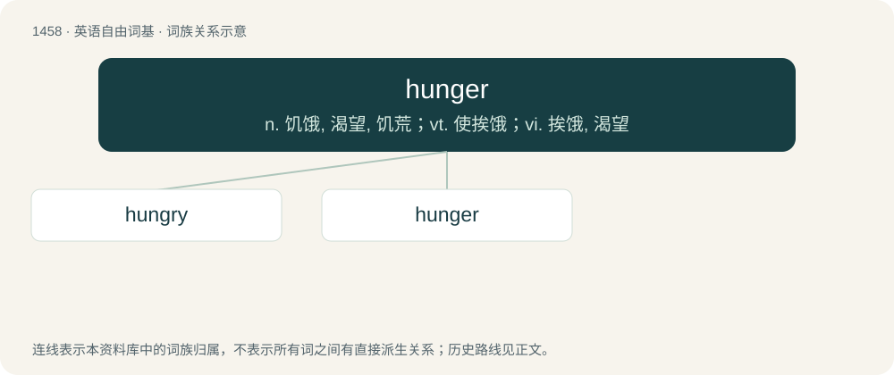

# 1543 · hunger — n. 饥饿, 渴望, 饥荒；vt. 使挨饿；vi. 挨饿, 渴望

[总目录](../00_总目录_按常用程度.md)

**类型**：英语自由词基　｜　**来源语言**：见词源记录

## 核心含义与来源

- 核心含义：n. 饥饿, 渴望, 饥荒；vt. 使挨饿；vi. 挨饿, 渴望
- 英文含义：A need or compelling desire for food.
- 词形：hunger

**多个词源／构词路径**：同一拼写可能有不同来源；以下按词性和含义分别列出。

**来源记录 1**（名词；A need or compelling desire for food.）

From Middle English hunger, from Old English hungor (“hunger, desire; famine”), from Proto-West Germanic \*hungr, from Proto-Germanic \*hungruz, \*hunhruz (“hunger”), from Proto-Indo-European \*kenk- (“to burn, smart, desire, hunger, thirst”). Cognate with West Frisian honger, hûnger (“hunger”), Dutch honger (“hunger”), German Low German Hunger (“hunger”), German Hunger (“hunger”), Danish, Norwegian Bokmål, Norwegian Nynorsk, and Swedish hunger (“hunger”), Faroese and Icelandic hungur (“hunger”).

**来源记录 2**（动词；To be in need of food.）

From Middle English hungren, from Old English hyngran, hyngrian, ġehyngrian (“to be hungry”), from Proto-West Germanic \*hungrijan, from Proto-Germanic \*hungrijaną.

## 词族图

## 单词速览（常用到不常用）

| 单词 | 音标 | 释义 |
|---|---|---|
| [hungry](#w-1) | 英 /ˈhʌŋ.ɡɹi/ | a. 饥饿的, 荒年的, 渴望的, 不毛的；\[化\] 欠鞣皮 |
| [hunger](#w-2) | 英 /ˈhʌŋɡə/；美 /ˈhʌŋɡɚ/ | n. 饥饿, 渴望, 饥荒；vt. 使挨饿；vi. 挨饿, 渴望 |

## 逐词详解

### 1. hungry

**词性**：形容词　｜　**音标**：英 /ˈhʌŋ.ɡɹi/

**中文释义**：a. 饥饿的, 荒年的, 渴望的, 不毛的；\[化\] 欠鞣皮

**英文义项**：Affected by hunger; having the physical need for food. / Causing hunger.

**构词拆分**：hunger + -y

**词源与演化**：

From Middle English hungry, from Old English hungriġ, from Proto-West Germanic \*hungrug, from Proto-Germanic \*hungrugaz (“hungry”); equivalent to hunger + -y. Cognate with West Frisian hongerich (“hungry”), Dutch hongerig (“hungry”), German hungrig (“hungry”), Swedish hungrig (“hungry”), Icelandic hungraður (“hungry”).

**例句**：

> My kids go to bed hungry every night because I haven’t got much money for food.

该用例对应义项：Affected by hunger; having the physical need for food.

### 2. hunger

**词性**：名词　｜　**音标**：英 /ˈhʌŋɡə/；美 /ˈhʌŋɡɚ/

**中文释义**：n. 饥饿, 渴望, 饥荒；vt. 使挨饿；vi. 挨饿, 渴望

**英文义项**：A need or compelling desire for food. / Any strong desire or need.

**词源与演化**：

From Middle English hunger, from Old English hungor (“hunger, desire; famine”), from Proto-West Germanic \*hungr, from Proto-Germanic \*hungruz, \*hunhruz (“hunger”), from Proto-Indo-European \*kenk- (“to burn, smart, desire, hunger, thirst”). Cognate with West Frisian honger, hûnger (“hunger”), Dutch honger (“hunger”), German Low German Hunger (“hunger”), German Hunger (“hunger”), Danish, Norwegian Bokmål, Norwegian Nynorsk, and Swedish hunger (“hunger”), Faroese and Icelandic hungur (“hunger”).

**例句**：

> I have a hunger to win.

该用例对应义项：Any strong desire or need.
