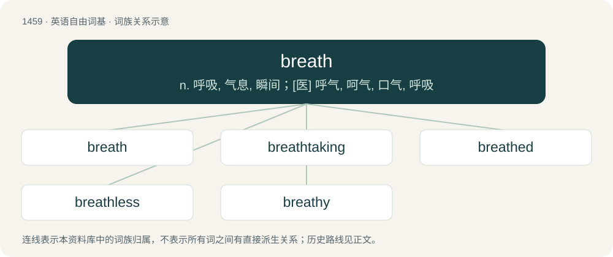

# 1544 · breath — n. 呼吸, 气息, 瞬间；\[医\] 呼气, 呵气, 口气, 呼吸

[总目录](../00_总目录_按常用程度.md)

**类型**：英语自由词基　｜　**来源语言**：见词源记录

## 核心含义与来源

- 核心含义：n. 呼吸, 气息, 瞬间；\[医\] 呼气, 呵气, 口气, 呼吸
- 英文含义：The act or process of breathing.
- 词形：breath

**来源记录 1**（名词；The act or process of breathing.）

From Middle English breeth, breth, from Old English brǣþ (“odor, scent, stink, exhalation, vapor”), from Proto-West Germanic \*brāþi (“vapour, waft, exhalation, breath”) (compare German Brodem (“haze, vapor; breath”), of a different but related formation).

## 词族图

## 单词速览（常用到不常用）

| 单词 | 音标 | 释义 |
|---|---|---|
| [breath](#w-1) | 英 /bɹɛθ/ | n. 呼吸, 气息, 瞬间；\[医\] 呼气, 呵气, 口气, 呼吸 |
| [breathtaking](#w-2) | 美 /ˈbɹɛθˌteɪ.kɪŋ/ | a. 惊人的, 惊险的 |
| [breathed](#w-3) | /bɹɛθt/ | a. 清音的, 有气的 |
| [breathless](#w-4) | /ˈbɹɛθləs/ | a. 喘不过气来的, 屏气的, 气喘吁吁的, 无风的, 死的 |
| [breathy](#w-5) | /ˈbɹɛθi/ | a. 带呼吸声的 |

## 逐词详解

### 1. breath

**词性**：名词　｜　**音标**：英 /bɹɛθ/

**中文释义**：n. 呼吸, 气息, 瞬间；\[医\] 呼气, 呵气, 口气, 呼吸

**英文义项**：The act or process of breathing. / A single act of breathing in or out; a breathing of air.

**词源与演化**：

From Middle English breeth, breth, from Old English brǣþ (“odor, scent, stink, exhalation, vapor”), from Proto-West Germanic \*brāþi (“vapour, waft, exhalation, breath”) (compare German Brodem (“haze, vapor; breath”), of a different but related formation).

**例句**：

> If she had a breath of common sense, she would never have spoken to the man in the first place.

该用例对应义项：A small amount of something, such as wind, or common sense.

### 2. breathtaking

**词性**：形容词　｜　**音标**：美 /ˈbɹɛθˌteɪ.kɪŋ/

**中文释义**：a. 惊人的, 惊险的

**英文义项**：stunningly beautiful; amazing / Very surprising or shocking; to such a degree as to cause astonishment.

**构词拆分**：breath + taking

**词源与演化**：

From breath + taking.

**例句**：

> He went to the Grand Canyon and spent a week taking in the breathtaking scenery all around him.

该用例对应义项：stunningly beautiful; amazing

### 3. breathed

**词性**：形容词　｜　**音标**：/bɹɛθt/

**中文释义**：a. 清音的, 有气的

**英文义项**：Having a specified kind of breath. / voiceless, contrasting with voiced

**构词拆分**：From breath + -ed.

**词源与演化**：

From breath + -ed.

**例句**：

> He breathed deep of fresh morning air and stretched his arms high.

### 4. breathless

**词性**：形容词　｜　**音标**：/ˈbɹɛθləs/

**中文释义**：a. 喘不过气来的, 屏气的, 气喘吁吁的, 无风的, 死的

**英文义项**：Having difficulty breathing; gasping. / That makes one hold one's breath (with excitement etc.).

**构词拆分**：breath + -less

**词源与演化**：

From breath + -less.

**例句**：

> Breathless at thought of what I had done.

该用例对应义项：not breathing or able to breathe except with difficulty

### 5. breathy

**词性**：形容词　｜　**音标**：/ˈbɹɛθi/

**中文释义**：a. 带呼吸声的

**英文义项**：Accompanied by audible breathing.

**构词拆分**：breath + -y

**词源与演化**：

From breath + -y.
