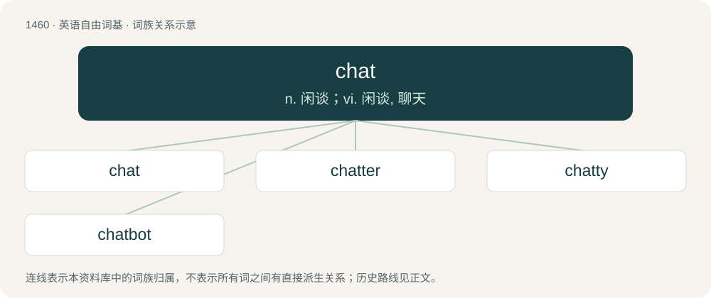

# 1545 · chat — n. 闲谈；vi. 闲谈, 聊天

[总目录](../00_总目录_按常用程度.md)

**类型**：英语自由词基　｜　**来源语言**：见词源记录

## 核心含义与来源

- 核心含义：n. 闲谈；vi. 闲谈, 聊天
- 英文含义：To be engaged in informal conversation.
- 词形：chat

**多个词源／构词路径**：同一拼写可能有不同来源；以下按词性和含义分别列出。

**来源记录 1**（动词；To be engaged in informal conversation.）

Clipping of chatter. The bird sense refers to the sound of its call.

**来源记录 2**（名词；A small potato, such as is given to swine.）

Compare chit (“small piece of paper”), and chad.

**来源记录 3**（名词；Mining waste from lead and zinc mines.）

Unknown.

**来源记录 4**（名词；A louse (small, parasitic insect).）

From thieves' cant.

## 词族图

## 单词速览（常用到不常用）

| 单词 | 音标 | 释义 |
|---|---|---|
| [chat](#w-1) | 英 /ˈt͡ʃæt/ | n. 闲谈；vi. 闲谈, 聊天 |
| [chatter](#w-2) | 英 /ˈtʃætə/；美 /ˈt͡ʃætɚ/ | 【英文】One who chats. |
| [chatty](#w-3) | 美 /ˈt͡ʃæti/ | a. 饶舌的, 爱讲闲话的 |
| [chatbot](#w-4) | Canada /ˈtʃætbɑt/ | 【英文】A computer program that holds conversations through a chat room. |

## 逐词详解

### 1. chat

**词性**：动词　｜　**音标**：英 /ˈt͡ʃæt/

**中文释义**：n. 闲谈；vi. 闲谈, 聊天

**英文义项**：To be engaged in informal conversation. / To talk a while in a friendly manner.

**词源与演化**：

Clipping of chatter. The bird sense refers to the sound of its call.

**例句**：

> I like to chat over a coffee with a friend.

该用例对应义项：To be engaged in informal conversation.

### 2. chatter

**词性**：名词　｜　**音标**：英 /ˈtʃætə/；美 /ˈt͡ʃætɚ/

**英文义项**：One who chats. / A user of livestream chat.

**构词拆分**：chat + -er

**词源与演化**：

From chat + -er.

### 3. chatty

**词性**：形容词　｜　**音标**：美 /ˈt͡ʃæti/

**中文释义**：a. 饶舌的, 爱讲闲话的

**英文义项**：Of a person, chatting a lot or fond of chatting. / Of a text or speech, expressed in a conversational style.

**构词拆分**：chat + -y

**词源与演化**：

From chat (“informal conversation”) + -y.

**例句**：

> Chatty error messages may help attackers to compromise your server.

该用例对应义项：Supplying more information than necessary; verbose.

### 4. chatbot

**词性**：名词　｜　**音标**：Canada /ˈtʃætbɑt/

**英文义项**：A computer program that holds conversations through a chat room.

**构词拆分**：chat + -bot

**词源与演化**：

From chat + -bot, from earlier chatterbot.

**例句**：

> The chatbot was quite simple yet informative.

该用例对应义项：A computer program that holds conversations through a chat room.
