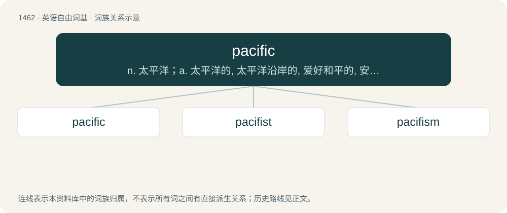

# 1547 · pacific — n. 太平洋；a. 太平洋的, 太平洋沿岸的, 爱好和平的, 安静的, 平息的

[总目录](../00_总目录_按常用程度.md)

**类型**：英语自由词基　｜　**来源语言**：见词源记录

## 核心含义与来源

- 核心含义：n. 太平洋；a. 太平洋的, 太平洋沿岸的, 爱好和平的, 安静的, 平息的
- 英文含义：Calm, peaceful.
- 词形：pacific

**来源记录 1**（形容词；Calm, peaceful.）

From Middle French pacifique.

## 词族图

## 单词速览（常用到不常用）

| 单词 | 音标 | 释义 |
|---|---|---|
| [pacific](#w-1) | /pəˈsɪfɪk/ | n. 太平洋；a. 太平洋的, 太平洋沿岸的, 爱好和平的, 安静的, 平息的 |
| [pacifist](#w-2) | /ˈpæsɪfɪst/ | n. 和平主义者, 反战论者, 不抵抗主义者 |
| [pacifism](#w-3) | /ˈpæsɪfɪzəm/ | n. 和平主义, 反战论, 不抵抗主义；\[法\] 和平主义, 非战主义, 不抵抗主义者 |

## 逐词详解

### 1. pacific

**词性**：形容词　｜　**音标**：/pəˈsɪfɪk/

**中文释义**：n. 太平洋；a. 太平洋的, 太平洋沿岸的, 爱好和平的, 安静的, 平息的

**英文义项**：Calm, peaceful. / Preferring peace by nature; avoiding violence.

**词源与演化**：

From Middle French pacifique.

**例句**：

> The pacific temper seeks to settle disputes on grounds of justice rather than by force.

该用例对应义项：disposed to peace or of a peaceful nature

### 2. pacifist

**词性**：名词　｜　**音标**：/ˈpæsɪfɪst/

**中文释义**：n. 和平主义者, 反战论者, 不抵抗主义者

**英文义项**：One who loves, supports, or favours peace. / One who prefers to avoid violence in daily life.

**构词拆分**：pacific + -ist

**词源与演化**：

From French pacifiste, equivalent to pacific + -ist.

**例句**：

> Mahatma Gandhi was one of the world's most famous pacifists.

该用例对应义项：One who loves, supports, or favours peace.

### 3. pacifism

**词性**：名词　｜　**音标**：/ˈpæsɪfɪzəm/

**中文释义**：n. 和平主义, 反战论, 不抵抗主义；\[法\] 和平主义, 非战主义, 不抵抗主义者

**英文义项**：The conviction that it is morally wrong to settle disputes (especially between countries) by war or other violent means. / The ethical avoidance of inflicting harm on others in one's daily life.

**构词拆分**：pacific + -ism

**词源与演化**：

From French pacifisme, from pacifique; pacific + -ism.

**例句**：

> Pacifism is the only rational position to take in this situation.
