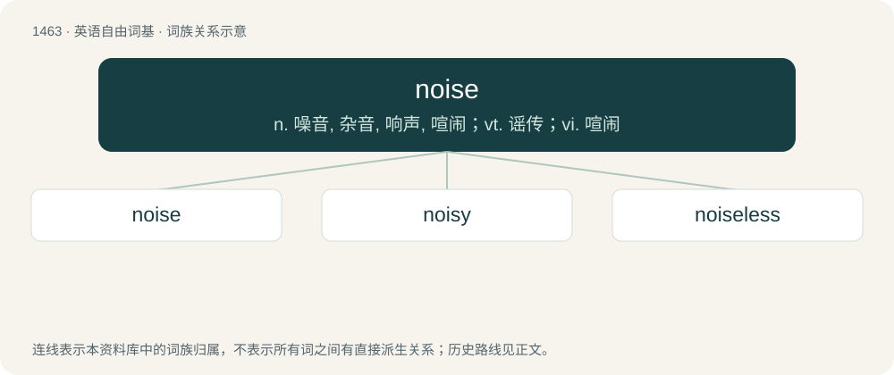

# 1549 · noise — n. 噪音, 杂音, 响声, 喧闹；vt. 谣传；vi. 喧闹

[总目录](../00_总目录_按常用程度.md)

**类型**：英语自由词基　｜　**来源语言**：见词源记录

## 核心含义与来源

- 核心含义：n. 噪音, 杂音, 响声, 喧闹；vt. 谣传；vi. 喧闹
- 英文含义：Various sounds, usually unwanted or unpleasant.
- 词形：noise

**来源记录 1**（名词；Various sounds, usually unwanted or unpleasant.）

From Middle English noyse, noise, from Old French noise (“a dispute, wrangle, strife, noise”), of uncertain origin. According to some, from Latin nausia, nausea (“disgust, nausea”); according to others, from Latin noxia (“hurt, harm, damage, injury”); but neither explanation is satisfactory in regard to either form or sense. Potentially a reduced form of Old French enoiier (“to bother, to disturb”), from Latin inodio (“to make repulsive”) - which would make it a doublet of English annoy (“to bother, to irritate”) and English ennui (“boredom, jadedness, depression”). Compare Piedmontese nojé (“to bother, to annoy”), though this fails to explain the final /z/. Displaced native Old English swēġ.

## 词族图

## 单词速览（常用到不常用）

| 单词 | 音标 | 释义 |
|---|---|---|
| [noise](#w-1) | /ˈnoɪ̯z/ | n. 噪音, 杂音, 响声, 喧闹；vt. 谣传；vi. 喧闹 |
| [noisy](#w-2) | 英 /ˈnɔɪzi/ | a. 嘈杂的, 喧闹的；\[机\] 噪声的, 嘈杂的 |
| [noiseless](#w-3) | /ˈnɒizlis/ | a. 无声的, 寂静的；\[化\] 无噪声 |

## 逐词详解

### 1. noise

**词性**：名词　｜　**音标**：/ˈnoɪ̯z/

**中文释义**：n. 噪音, 杂音, 响声, 喧闹；vt. 谣传；vi. 喧闹

**英文义项**：Various sounds, usually unwanted or unpleasant. / Any sound.

**词源与演化**：

From Middle English noyse, noise, from Old French noise (“a dispute, wrangle, strife, noise”), of uncertain origin. According to some, from Latin nausia, nausea (“disgust, nausea”); according to others, from Latin noxia (“hurt, harm, damage, injury”); but neither explanation is satisfactory in regard to either form or sense. Potentially a reduced form of Old French enoiier (“to bother, to disturb”), from Latin inodio (“to make repulsive”) - which would make it a doublet of English annoy (“to bother, to irritate”) and English ennui (“boredom, jadedness, depression”). Compare Piedmontese nojé (“to bother, to annoy”), though this fails to explain the final /z/. Displaced native Old English swēġ.

**例句**：

> The problems with the new computer system are causing a lot of noise at Head Office.

该用例对应义项：Rumour or complaint.

### 2. noisy

**词性**：形容词　｜　**音标**：英 /ˈnɔɪzi/

**中文释义**：a. 嘈杂的, 喧闹的；\[机\] 噪声的, 嘈杂的

**英文义项**：Making a noise, especially a loud unpleasant sound / Full of noise.

**构词拆分**：noise + -y

**词源与演化**：

From noise + -y.

**用法示例／搭配（非完整句）**：

> the noisy crowd.

该用例对应义项：Making a noise, especially a loud unpleasant sound

### 3. noiseless

**词性**：形容词　｜　**音标**：/ˈnɒizlis/

**中文释义**：a. 无声的, 寂静的；\[化\] 无噪声

**英文义项**：Producing no noise; without noise. / Containing no noise.

**构词拆分**：noise + -less

**词源与演化**：

From noise + -less.

**例句**：

> The movements of the cat were noiseless as it approached the mousehole.

该用例对应义项：Producing no noise; without noise.
