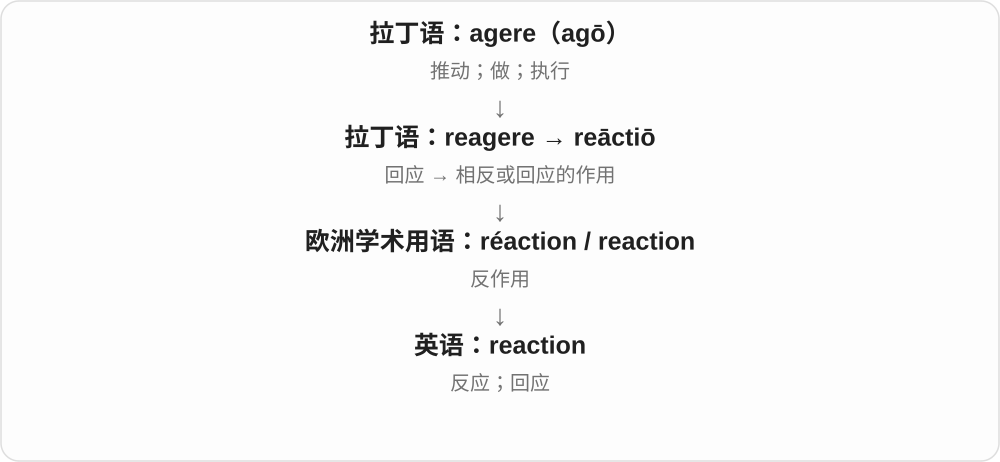

# 1549 · reaction — 回应、反应过度与恢复旧秩序的立场

[逐词精讲目录](../00_逐词精讲目录.md) · [总目录](../00_总目录_按常用程度.md)

## 核心词根与来源

反应过强看 over-，恢复旧秩序看 reactionary 的历史语境；不是反应快的人就叫 reactionary。

**REACTION：回应某个动作，但政治词有自己的历史背景**

reaction → overreaction；reactionary 以独立法语政治词路径另列。

- **反应及程度**：reaction · overreaction
- **政治历史支线**：reactionary

## 词形与演化规律

reaction 的反作用、回应历史；over- + reaction；法语 réactionnaire → reactionary。

## 单词速览（按词族由简到繁）

同一基础词的相关扩展放在一起，先读基础形式，再读扩展；各组之间优先读常用的。具体词源关系见各词讲解。

| 单词 | 音标 | 核心意思 |
|---|---|---|
| [reaction](#w-1) | /riˈækʃən/ | 反应；回应；化学反应 |
| [reactionary](#w-2) | 英 /riˈækʃənəri/；美 /riˈækʃəneri/ | 反动的、主张恢复旧秩序的；持这种立场的人 |
| [overreaction](#w-3) | 英 /ˌəʊvəriˈækʃən/；美 /ˌoʊvəriˈækʃən/ | 反应过度 |

## 逐词讲解

### 1. reaction — 反应；回应；化学反应

**音标**：/riˈækʃən/

**先抓住这个画面**

reaction 是外界先给出一个刺激，另一方随后发生的变化或回应。

**怎么拆**

现代可对应 re- + action 或 react + -ion；历史还联系拉丁语 reāctiō 和法语 réaction，不能只画成英语 react 的后代。

**怎么变成今天的意思**

可以是听到消息后的表情，也可以是物质之间的化学变化。化学反应中的“反”并非一定往相反方向走。

**常见搭配与例句**

a reaction to the news；a chemical reaction；reaction time。

> Her first reaction was surprise.

她的第一反应是惊讶。

> The mixture changed colour during the reaction.

混合物在反应过程中变了颜色。

**别混淆**

reaction 可是自动反应；response 也常指经过组织的回答或应对，两者有交叉。

### 2. reactionary — 反动的、主张恢复旧秩序的；持这种立场的人

**音标**：英 /riˈækʃənəri/；美 /riˈækʃəneri/

**先抓住这个画面**

不只是对事情有反应，而是反对某种社会、政治变化，想把秩序拉回较早状态；常带批评色彩。

**怎么拆**

借法语 réactionnaire，有法国革命后反对革命、恢复旧秩序等政治背景。现代可对应 reaction + -ary，但不是任何反应都能加后缀变成政治反动。

**怎么变成今天的意思**

**法语 réaction、拉丁相关反作用构词 → reaction**  
对动作、刺激的回应

↓

**法语 réactionnaire → reactionary**  
反对革命、变革等 → 主张恢复旧秩序的立场

reactionary views 反动、主张倒退的观点，a reactionary politician 反动政治人物，a reactionary 反动派。评价要结合作者立场与具体主张。

**常见搭配与例句**

reactionary views；reactionary politics；a reactionary。

> The historian examined reactionary movements after the revolution.

历史学者研究了革命后的反动运动。

> The reviewer criticized the novel’s reactionary view of social change.

评论者批评了小说对社会变革所持的倒退立场。

**别混淆**

reactionary 不等于 reactive 反应性的；conservative 保守与 reactionary 有范围重叠，但通常后者更强调恢复旧状态，不能无条件互换。

### 3. overreaction — 反应过度

**音标**：英 /ˌəʊvəriˈækʃən/；美 /ˌoʊvəriˈækʃən/

**先抓住这个画面**

事情只需要一点回应，却用了很大情绪、措施；over- 评的是反应相对于事情过了头。

**怎么拆**

over- 过度 + reaction 反应，名词命名过强回应；不是接在 act 后表示在上面再次行动。

**怎么变成今天的意思**

**法语 réaction、拉丁相关反作用构词 → reaction**  
对动作、刺激的回应

↓

**over- + reaction → overreaction**  
超出合适程度的反应

an overreaction to criticism 对批评的过激反应，call it an overreaction 认为反应过度，avoid an overreaction 避免反应过度。

**常见搭配与例句**

an overreaction to；call it an overreaction；avoid an overreaction。

> She later admitted that cancelling the trip was an overreaction.

她后来承认，取消旅行有些反应过度。

> He described the response as an overreaction to a minor mistake.

他认为，对一个小错误作出这样的回应太过头了。

**别混淆**

overreaction 带程度不恰当的判断，不是所有强烈反应都过度；reaction 可以完全合理。

## 这一组要分清什么

reactionary/reactive 特定政治立场与反应性的区别；overreaction 是程度评价，不是任意负面情绪。

## 串起来练习

The article distinguishes a reaction from an overreaction.

文章区分了正常反应与反应过度。
