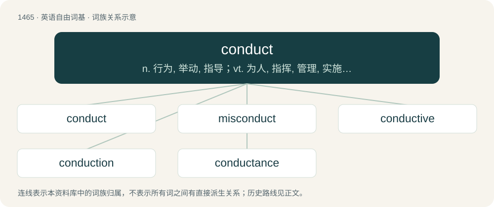

# 1550 · conduct — n. 行为, 举动, 指导；vt. 为人, 指挥, 管理, 实施；vi. 领导, 传导, 指挥

[总目录](../00_总目录_按常用程度.md)

**类型**：英语自由词基　｜　**来源语言**：见词源记录

## 核心含义与来源

- 核心含义：n. 行为, 举动, 指导；vt. 为人, 指挥, 管理, 实施；vi. 领导, 传导, 指挥
- 英文含义：The act or method of controlling or directing.
- 词形：conduct

**来源记录 1**（名词；The act or method of controlling or directing.）

From Late Latin conductus (“defense, escort”), from Latin conductus, perfect passive participle of condūcō (“bring together”); see also conduce. Displaced native Old English þēaw. Doublet of conduit.

## 词族图

## 单词速览（常用到不常用）

| 单词 | 音标 | 释义 |
|---|---|---|
| [conduct](#w-1) | 英 /ˈkɒndʌkt/；美 /ˈkɑndʌkt/ | n. 行为, 举动, 指导；vt. 为人, 指挥, 管理, 实施；vi. 领导, 传导, 指挥 |
| [misconduct](#w-2) | 英 /mɪsˈkɒndʌkt/；美 /mɪsˈkɑndʌkt/ | vt. 办错, 使行为不端；n. 办错, 渎职, 通奸 |
| [conductive](#w-3) | /kənˈdʌktɪv/ | a. 传导性的, 有传导力的, 传导的；\[机\] 传导性的 |
| [conduction](#w-4) | /kənˈdʌkʃən/ | n. 传导；\[化\] 传导 |
| [conductance](#w-5) | /kənˈdʌktəns/ | n. 电导, 电导率, 传导力；\[化\] 电导 |

## 逐词详解

### 1. conduct

**词性**：名词　｜　**音标**：英 /ˈkɒndʌkt/；美 /ˈkɑndʌkt/

**中文释义**：n. 行为, 举动, 指导；vt. 为人, 指挥, 管理, 实施；vi. 领导, 传导, 指挥

**英文义项**：The act or method of controlling or directing. / Skillful guidance or management.

**词源与演化**：

From Late Latin conductus (“defense, escort”), from Latin conductus, perfect passive participle of condūcō (“bring together”); see also conduce. Displaced native Old English þēaw. Doublet of conduit.

**例句**：

> Good conduct will be rewarded and likewise poor conduct will be punished.

该用例对应义项：Behaviour; the manner of behaving.

### 2. misconduct

**词性**：名词　｜　**音标**：英 /mɪsˈkɒndʌkt/；美 /mɪsˈkɑndʌkt/

**中文释义**：vt. 办错, 使行为不端；n. 办错, 渎职, 通奸

**英文义项**：Behavior that is considered to be unacceptable. / A penalty or write-up for improper behavior.

**构词拆分**：mis- + conduct

**词源与演化**：

From mis- + conduct (noun sense).

**例句**：

> The student was banned from using the university's computing resources for two weeks due to gross misconduct on the Internet.

该用例对应义项：Behavior that is considered to be unacceptable.

### 3. conductive

**词性**：形容词　｜　**音标**：/kənˈdʌktɪv/

**中文释义**：a. 传导性的, 有传导力的, 传导的；\[机\] 传导性的

**英文义项**：Able to conduct electrical current or heat. / Of, or relating to conductivity of a material.

**构词拆分**：conduct + -ive

**词源与演化**：

From conduct + -ive.

**例句**：

> Distilled water is very slightly electrically conductive.

该用例对应义项：Able to conduct electrical current or heat.

### 4. conduction

**词性**：名词　｜　**音标**：/kənˈdʌkʃən/

**中文释义**：n. 传导；\[化\] 传导

**英文义项**：The conveying of heat or electricity through material. / The act of leading or guiding.

**构词拆分**：conduct + -ion

**词源与演化**：

Borrowed from Latin conductio, conductionem (“a bringing together”); equivalent to conduct + -ion.

**例句**：

> Copper plays an important role in nerve conduction, bone growth and hormone secretion.

### 5. conductance

**词性**：名词　｜　**音标**：/kənˈdʌktəns/

**中文释义**：n. 电导, 电导率, 传导力；\[化\] 电导

**英文义项**：A measure of the ability of a body to conduct electricity; the reciprocal of its resistance.

**构词拆分**：conduct + -ance

**词源与演化**：

From conduct + -ance. Coined by electrical engineer, mathematician and physicist Oliver Heaviside in 1885.
