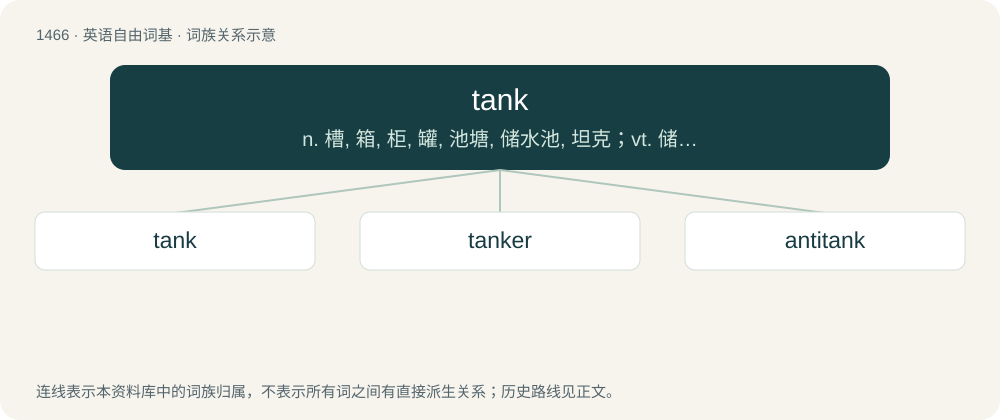

# 1551 · tank — n. 槽, 箱, 柜, 罐, 池塘, 储水池, 坦克；vt. 储于箱中

[总目录](../00_总目录_按常用程度.md)

**类型**：英语自由词基　｜　**来源语言**：见词源记录

## 核心含义与来源

- 核心含义：n. 槽, 箱, 柜, 罐, 池塘, 储水池, 坦克；vt. 储于箱中
- 英文含义：A closed container for liquids or gases.
- 词形：tank

**来源记录 1**（名词；A closed container for liquids or gases.）

From Portuguese tanque (“tank, liquid container”), from an Indo-Aryan language, likely Gujarati ટાંકી (ṭā̃kī, “cistern”) or Marathi टांकी (ṭāṅkī). A false friend can be found in North Germanic: dunk (“canister, keg”), 17th c. tönk, which appears derived from both Low German tunneke, Dutch tonneke (diminutive of "barrel"), and dunka (“to dunk, to dip under water, to moisten”). \* In the sense of armoured vehicle, prototypes were described as tanks for carrying water to disguise their nature and due to physical resemblance. First attested in 1915, but in common usage only as of 1916. Displaced landship, and mostly displaced battlewagon.

## 词族图

## 单词速览（常用到不常用）

| 单词 | 音标 | 释义 |
|---|---|---|
| [tank](#w-1) | 英 /ˈtæŋk/；美 /ˈteɪ̯ŋk/ | n. 槽, 箱, 柜, 罐, 池塘, 储水池, 坦克；vt. 储于箱中 |
| [tanker](#w-2) | 英 /ˈtæŋkə/；美 /ˈtæŋkɚ/ | n. 坦克手, 油船, 空中加油飞机, 运油飞机, 油槽/水槽汽车；\[化\] 槽车; 油槽船 |
| [antitank](#w-3) | /.æntiˈtæŋk/ | a. 反坦克的 |

## 逐词详解

### 1. tank

**词性**：名词　｜　**音标**：英 /ˈtæŋk/；美 /ˈteɪ̯ŋk/

**中文释义**：n. 槽, 箱, 柜, 罐, 池塘, 储水池, 坦克；vt. 储于箱中

**英文义项**：A closed container for liquids or gases. / An open container or pool for storing water or other liquids.

**词源与演化**：

From Portuguese tanque (“tank, liquid container”), from an Indo-Aryan language, likely Gujarati ટાંકી (ṭā̃kī, “cistern”) or Marathi टांकी (ṭāṅkī). A false friend can be found in North Germanic: dunk (“canister, keg”), 17th c. tönk, which appears derived from both Low German tunneke, Dutch tonneke (diminutive of "barrel"), and dunka (“to dunk, to dip under water, to moisten”). \* In the sense of armoured vehicle, prototypes were described as tanks for carrying water to disguise their nature and due to physical resemblance. First attested in 1915, but in common usage only as of 1916. Displaced landship, and mostly displaced battlewagon.

**例句**：

> The ore slurries are directed into an open tank outside the excavation site.

该用例对应义项：An open container or pool for storing water or other liquids.

### 2. tanker

**词性**：名词　｜　**音标**：英 /ˈtæŋkə/；美 /ˈtæŋkɚ/

**中文释义**：n. 坦克手, 油船, 空中加油飞机, 运油飞机, 油槽/水槽汽车；\[化\] 槽车; 油槽船

**英文义项**：A tankship, a vessel used to transport large quantities of fluid. / A motor truck (lorry) with a tank to hold bulk liquid (with or without internal baffles): a fuel tanker (lorry), petrol tanker, road tanker.

**构词拆分**：tank + -er

**词源与演化**：

From tank + -er.

**例句**：

> I swung the tanker around just in time to take off with the lip.

该用例对应义项：A longboard.

### 3. antitank

**词性**：形容词　｜　**音标**：/.æntiˈtæŋk/

**中文释义**：a. 反坦克的

**英文义项**：Of weapons or tactics, designed for thwarting or (especially) attacking tanks or other armored fighting vehicles.

**构词拆分**：anti- + tank

**词源与演化**：

From anti- + tank.

**例句**：

> A TOW missile is an antitank weapon capable of killing everyone in a tank from great distance.

该用例对应义项：Of weapons or tactics, designed for thwarting or (especially) attacking tanks or other armored fighting vehicles.
