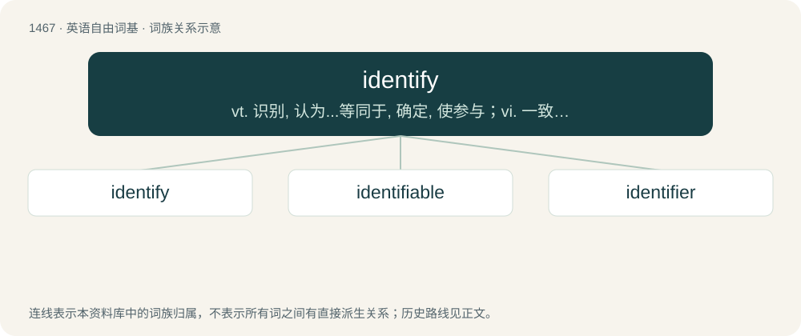

# 1552 · identify — vt. 识别, 认为...等同于, 确定, 使参与；vi. 一致, 认同

[总目录](../00_总目录_按常用程度.md)

**类型**：英语自由词基　｜　**来源语言**：见词源记录

## 核心含义与来源

- 核心含义：vt. 识别, 认为...等同于, 确定, 使参与；vi. 一致, 认同
- 英文含义：To establish the identity of someone or something.
- 词形：identify

**来源记录 1**（动词；To establish the identity of someone or something.）

From French identifier, from Medieval Latin identicus + Latin faciō.

## 词族图

## 单词速览（常用到不常用）

| 单词 | 音标 | 释义 |
|---|---|---|
| [identify](#w-1) | 英 /aɪˈdɛn.tɪ.faɪ/；美 /aɪˈdɛn.(t)ə.faɪ/ | vt. 识别, 认为...等同于, 确定, 使参与；vi. 一致, 认同 |
| [identifiable](#w-2) | /aiˈdentifaiəbl/ | a. 可辨认的；\[法\] 可证明为同一的, 可以办清的 |
| [identifier](#w-3) | /aiˈdentifaiə/ | n. 检验人, 标识符；\[计\] 用户标识符, 用户ID |

## 逐词详解

### 1. identify

**词性**：动词　｜　**音标**：英 /aɪˈdɛn.tɪ.faɪ/；美 /aɪˈdɛn.(t)ə.faɪ/

**中文释义**：vt. 识别, 认为...等同于, 确定, 使参与；vi. 一致, 认同

**英文义项**：To establish the identity of someone or something. / To disclose the identity of someone.

**词源与演化**：

From French identifier, from Medieval Latin identicus + Latin faciō.

**例句**：

> It was hard to identify the shoplifter because the CCTV records didn't have a clear image.

该用例对应义项：To establish the identity of someone or something.

### 2. identifiable

**词性**：形容词　｜　**音标**：/aiˈdentifaiəbl/

**中文释义**：a. 可辨认的；\[法\] 可证明为同一的, 可以办清的

**英文义项**：Capable of being distinguished and named.

**构词拆分**：identify + -able

**词源与演化**：

From identify + -able.

**例句**：

> I don't know where he was from because he had no identifiable accent.

该用例对应义项：Capable of being distinguished and named.

### 3. identifier

**词性**：名词　｜　**音标**：/aiˈdentifaiə/

**中文释义**：n. 检验人, 标识符；\[计\] 用户标识符, 用户ID

**英文义项**：Someone who identifies; a person who establishes the identity of someone or something. / Something that identifies or uniquely points to something or someone else.

**构词拆分**：identify + -er

**词源与演化**：

From identify + -er.

**例句**：

> Arab is rather used as a cultural rather than an ethnic or racial identifier.
