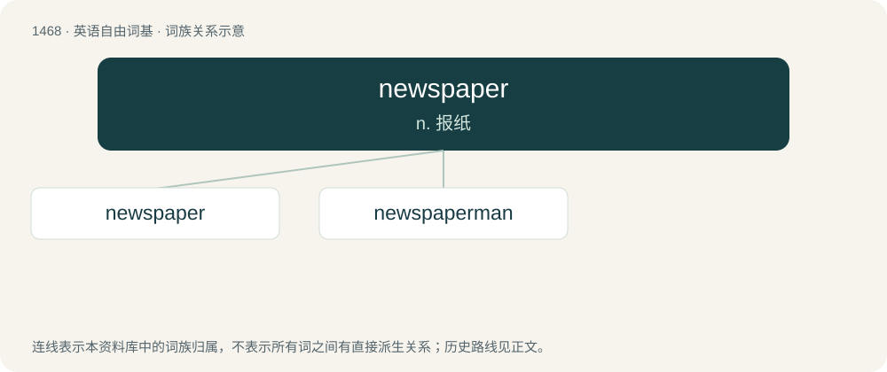

# 1553 · newspaper — n. 报纸

[总目录](../00_总目录_按常用程度.md)

**类型**：英语自由词基　｜　**来源语言**：见词源记录

## 核心含义与来源

- 核心含义：n. 报纸
- 英文含义：A publication, usually published daily or weekly, containing news and other articles. Traditionally a print publication typically printed on cheap, low-quality paper; today usually digital and often also available in print.
- 词形：newspaper

**来源记录 1**（名词；A publication, usually published daily or weekly, containing news and other articles. Traditionally a print publication typically printed on cheap, low-quality paper; today usually digital and often also available in print.）

From news + paper.

## 词族图

## 单词速览（常用到不常用）

| 单词 | 音标 | 释义 |
|---|---|---|
| [newspaper](#w-1) | 英 /ˈnjuːsˌpeɪpə/；美 /ˈn(j)usˌpeɪpɚ/ | n. 报纸 |
| [newspaperman](#w-2) | 美 /ˈn(j)uspeɪpəɹˌmæn/ | n. 新闻记者 |

## 逐词详解

### 1. newspaper

**词性**：名词　｜　**音标**：英 /ˈnjuːsˌpeɪpə/；美 /ˈn(j)usˌpeɪpɚ/

**中文释义**：n. 报纸

**英文义项**：A publication, usually published daily or weekly, containing news and other articles. Traditionally a print publication typically printed on cheap, low-quality paper; today usually digital and often also available in print. / The news organization that produces such a publication.

**构词拆分**：news + paper

**词源与演化**：

From news + paper.

**例句**：

> The paper boy delivers her newspaper to her front porch every weekday.

该用例对应义项：A publication, usually published daily or weekly, containing news and other articles. Traditionally a print publication typically printed on cheap, low-quality paper; today usually digital and often also available in print.

### 2. newspaperman

**词性**：名词　｜　**音标**：美 /ˈn(j)uspeɪpəɹˌmæn/

**中文释义**：n. 新闻记者

**英文义项**：A man who works in the production of the text of a newspaper; a reporter, editor, etc.

**构词拆分**：newspaper + -man

**词源与演化**：

From newspaper + -man. Compare paperboy.

**例句**：

> If you want to be a newspaperman, you have to be observant.
