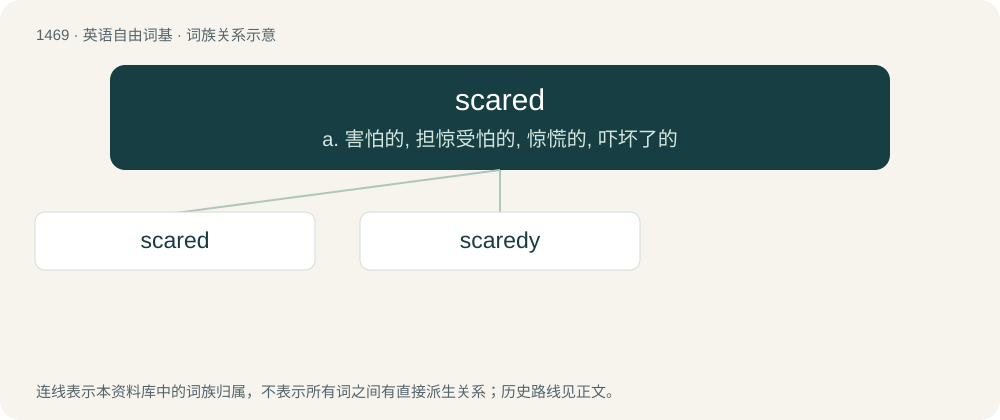

# 1555 · scared — a. 害怕的, 担惊受怕的, 惊慌的, 吓坏了的

[总目录](../00_总目录_按常用程度.md)

**类型**：英语自由词基　｜　**来源语言**：见词源记录

## 核心含义与来源

- 核心含义：a. 害怕的, 担惊受怕的, 惊慌的, 吓坏了的
- 英文含义：Feeling fear; afraid, frightened.
- 词形：scared

**来源记录 1**（形容词；Feeling fear; afraid, frightened.）

From scare + -ed.

## 词族图

## 单词速览（常用到不常用）

| 单词 | 音标 | 释义 |
|---|---|---|
| [scared](#w-1) | 英 /skɛəd/；美 /skɛ(ə)ɹd/ | a. 害怕的, 担惊受怕的, 惊慌的, 吓坏了的 |
| [scaredy](#w-2) |  | 【英文】Characterised by being timorous or afraid. |

## 逐词详解

### 1. scared

**词性**：形容词　｜　**音标**：英 /skɛəd/；美 /skɛ(ə)ɹd/

**中文释义**：a. 害怕的, 担惊受怕的, 惊慌的, 吓坏了的

**英文义项**：Feeling fear; afraid, frightened.

**构词拆分**：From scare + -ed.

**词源与演化**：

From scare + -ed.

**例句**：

> The child was really scared of the dark.

该用例对应义项：Feeling fear; afraid, frightened.

### 2. scaredy

**词性**：形容词

**英文义项**：Characterised by being timorous or afraid.

**构词拆分**：scared + -y

**词源与演化**：

Back-formation from scaredy-cat, equivalent to scared + -y.

**例句**：

> You're not a scaredy pants, are you?
