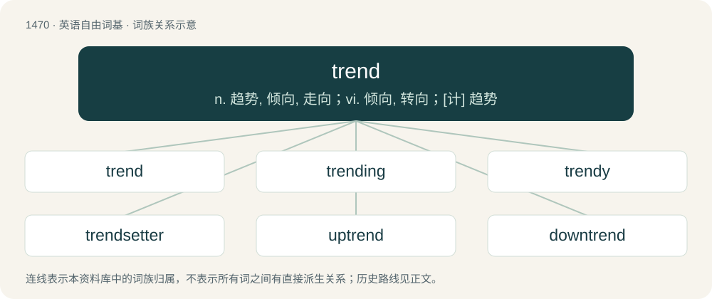

# 1556 · trend — n. 趋势, 倾向, 走向；vi. 倾向, 转向；\[计\] 趋势

[总目录](../00_总目录_按常用程度.md)

**类型**：英语自由词基　｜　**来源语言**：见词源记录

## 核心含义与来源

- 核心含义：n. 趋势, 倾向, 走向；vi. 倾向, 转向；\[计\] 趋势
- 英文含义：An inclination in a particular direction.
- 词形：trend

**多个词源／构词路径**：同一拼写可能有不同来源；以下按词性和含义分别列出。

**来源记录 1**（名词；An inclination in a particular direction.）

From Middle English trenden (“to roll about, turn, revolve”), from Old English trendan (“to roll about, turn, revolve”), from Proto-West Germanic \*trandijan (“to turn, roll, revolve”), apparently derived from a strong verb Proto-West Germanic \*trindan. Cognate with Dutch trent (“circumference”). Akin to Old English trinde (“ball”), Old English tryndel (“circle, ring”). More at trindle, trundle.

**来源记录 2**（名词；Clean wool.）

Compare German trennen (“to separate”).

## 词族图

## 单词速览（常用到不常用）

| 单词 | 音标 | 释义 |
|---|---|---|
| [trend](#w-1) | /tɹɛnd/ | n. 趋势, 倾向, 走向；vi. 倾向, 转向；\[计\] 趋势 |
| [trending](#w-2) | /trendɪŋ/ | v. 伸向( trend的现在分词 ); 趋向; 倾向; 使趋向 |
| [trendy](#w-3) | /ˈtɹɛndi/ | a. 随潮流的, 时髦的, 赶潮流的 |
| [trendsetter](#w-4) | 英 /ˈtɹɛn(d)ˌsetə/ | n. 新式样的创立者, 新式样的推广者 |
| [uptrend](#w-5) | /ˈʌptrend/ | n. 上升趋势, 好转趋势 |
| [downtrend](#w-6) | /ˈdauntrend/ | n. 下降趋势 |

## 逐词详解

### 1. trend

**词性**：名词　｜　**音标**：/tɹɛnd/

**中文释义**：n. 趋势, 倾向, 走向；vi. 倾向, 转向；\[计\] 趋势

**英文义项**：An inclination in a particular direction. / A tendency.

**词源与演化**：

From Middle English trenden (“to roll about, turn, revolve”), from Old English trendan (“to roll about, turn, revolve”), from Proto-West Germanic \*trandijan (“to turn, roll, revolve”), apparently derived from a strong verb Proto-West Germanic \*trindan. Cognate with Dutch trent (“circumference”). Akin to Old English trinde (“ball”), Old English tryndel (“circle, ring”). More at trindle, trundle.

**例句**：

> There is a trend, these days, for people in films not to smoke.

该用例对应义项：A tendency.

### 2. trending

**词性**：形容词　｜　**音标**：/trendɪŋ/

**中文释义**：v. 伸向( trend的现在分词 ); 趋向; 倾向; 使趋向

**英文义项**：Popular or becoming more popular.

**构词拆分**：trend + -ing

**词源与演化**：

From trend + -ing.

**例句**：

> This topic is trending among teens and tweens on Twitter.

### 3. trendy

**词性**：形容词　｜　**音标**：/ˈtɹɛndi/

**中文释义**：a. 随潮流的, 时髦的, 赶潮流的

**英文义项**：Of, or in accordance with the latest trend, fashion or hype.

**构词拆分**：trend + -y

**词源与演化**：

From trend + -y.

**例句**：

> I hate those trendy pre-wrinkled shirts.

该用例对应义项：Of, or in accordance with the latest trend, fashion or hype.

### 4. trendsetter

**词性**：名词　｜　**音标**：英 /ˈtɹɛn(d)ˌsetə/

**中文释义**：n. 新式样的创立者, 新式样的推广者

**英文义项**：Someone who starts a trend, or makes something more popular.

**构词拆分**：trend + setter

**词源与演化**：

From trend + setter.

### 5. uptrend

**词性**：名词　｜　**音标**：/ˈʌptrend/

**中文释义**：n. 上升趋势, 好转趋势

**英文义项**：An upward trend, or an upturn.

**构词拆分**：up- + trend

**词源与演化**：

From up- + trend.

**例句**：

> At Wall Street, some insiders made a killing by going short, when everyone had been sucked into an unsustainable uptrend.

### 6. downtrend

**词性**：名词　｜　**音标**：/ˈdauntrend/

**中文释义**：n. 下降趋势

**英文义项**：Any gradual movement towards a lower state or value.

**构词拆分**：down- + trend

**词源与演化**：

From down- + trend.

**例句**：

> The stock market took a long time to recover from the downtrend.

该用例对应义项：Any gradual movement towards a lower state or value.
