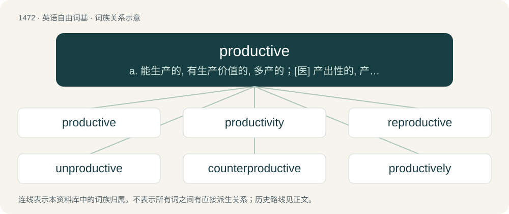

# 1559 · productive — a. 能生产的, 有生产价值的, 多产的；\[医\] 产出性的, 产生性的

[总目录](../00_总目录_按常用程度.md)

**类型**：英语自由词基　｜　**来源语言**：见词源记录

## 核心含义与来源

- 核心含义：a. 能生产的, 有生产价值的, 多产的；\[医\] 产出性的, 产生性的
- 英文含义：Capable of producing something, especially in abundance; fertile.
- 词形：productive

**来源记录 1**（形容词；Capable of producing something, especially in abundance; fertile.）

Borrowed from Late Latin productivus, equivalent to product + -ive.

## 词族图

## 单词速览（常用到不常用）

| 单词 | 音标 | 释义 |
|---|---|---|
| [productive](#w-1) | /pɹəˈdʌk.tɪv/ | a. 能生产的, 有生产价值的, 多产的；\[医\] 产出性的, 产生性的 |
| [productivity](#w-2) | 英 /ˌpɹɒdʌkˈtɪvəti/；美 /ˌpɹoʊdʌkˈtɪvəti/ | n. 生产力；\[经\] 生产率, 生产能力 |
| [reproductive](#w-3) | 英 /ˌɹiːpɹəˈdʌktɪv/；美 /ˌɹipɹəˈdʌktɪv/ | a. 生殖的, 再生的, 复制的；\[医\] 生殖的, 复现的 |
| [unproductive](#w-4) | /ˌʌn.pɹəˈdʌk.tɪv/ | a. 不生产的, 无出产的, 不毛的；\[经\] 非生意性的, 浪费的 |
| [counterproductive](#w-5) | /ˌkaʊntəpɹəˈdʌktɪv/ | a. 反生产的；使达不到预期目标的 |
| [productively](#w-6) |  | adv. 有结果地；有成果地 |

## 逐词详解

### 1. productive

**词性**：形容词　｜　**音标**：/pɹəˈdʌk.tɪv/

**中文释义**：a. 能生产的, 有生产价值的, 多产的；\[医\] 产出性的, 产生性的

**英文义项**：Capable of producing something, especially in abundance; fertile. / Yielding good or useful results; constructive.

**构词拆分**：product + -ive

**词源与演化**：

Borrowed from Late Latin productivus, equivalent to product + -ive.

**用法示例／搭配（非完整句）**：

> a productive set

该用例对应义项：A type of set of natural numbers, related to mathematical logic; a set S is productive if there exists a total recursive function f such that ∀x∈ℕ,~~W\_x⊆S⇒f(x)∈A⧵W\_x, where W\_x is a recursive function whose Gödel number is x.

### 2. productivity

**词性**：名词　｜　**音标**：英 /ˌpɹɒdʌkˈtɪvəti/；美 /ˌpɹoʊdʌkˈtɪvəti/

**中文释义**：n. 生产力；\[经\] 生产率, 生产能力

**英文义项**：The state of being productive, fertile, or efficient. / The rate at which goods or services are produced by a standard population of workers; those workers' degree of efficiency.

**构词拆分**：productive + -ity

**词源与演化**：

From productive + -ity.

**例句**：

> You can see the computer age everywhere but in the productivity statistics.

该用例对应义项：The rate at which goods or services are produced by a standard population of workers; those workers' degree of efficiency.

### 3. reproductive

**词性**：形容词　｜　**音标**：英 /ˌɹiːpɹəˈdʌktɪv/；美 /ˌɹipɹəˈdʌktɪv/

**中文释义**：a. 生殖的, 再生的, 复制的；\[医\] 生殖的, 复现的

**英文义项**：Of or relating to reproduction. / That reproduces.

**构词拆分**：re- + productive

**词源与演化**：

From re- + productive.

**例句**：

> The octopus exits only to look for food and for reproductive purposes.

### 4. unproductive

**词性**：形容词　｜　**音标**：/ˌʌn.pɹəˈdʌk.tɪv/

**中文释义**：a. 不生产的, 无出产的, 不毛的；\[经\] 非生意性的, 浪费的

**英文义项**：Not productive; useless; fruitless. / No longer used to produce new words (see examples).

**构词拆分**：un- + productive

**词源与演化**：

From un- + productive.

**例句**：

> Juggling is an amusing pastime, but generally unproductive.

该用例对应义项：Not productive; useless; fruitless.

### 5. counterproductive

**词性**：形容词　｜　**音标**：/ˌkaʊntəpɹəˈdʌktɪv/

**中文释义**：a. 反生产的；使达不到预期目标的

**英文义项**：More of a hindrance than a help.

**构词拆分**：counter- + productive

**词源与演化**：

From counter- + productive.

**例句**：

> ... Otherwise it is (or will be) hard to avoid a counterproductive situation.

### 6. productively

**词性**：副词

**中文释义**：adv. 有结果地；有成果地

**英文义项**：In a productive manner.

**构词拆分**：productive + -ly

**词源与演化**：

From productive + -ly.

**例句**：

> Improvements may easily be imagined which would annihilate vast portions of the productively invested wealth of individuals; such (e. g.) as a mechanical invention that superseded railways in England, or a development of trade that rendered English wheatgrowing unprofitable: and economic changes of this kind, though smaller in degree, are continually occurring.

该用例对应义项：In a productive manner.
