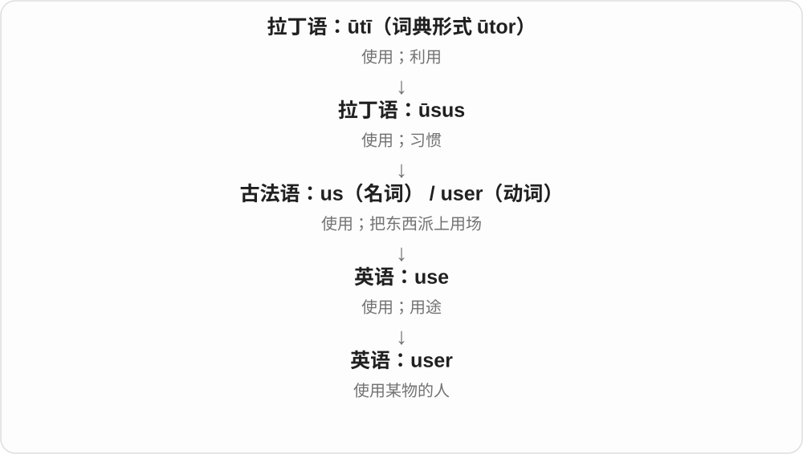

# 1559 · user — 使用者与用户名

[逐词精讲目录](../00_逐词精讲目录.md) · [总目录](../00_总目录_按常用程度.md)

## 核心词根与来源

账户名不等于真实姓名，使用者也不必是设备所有人。看产品说明时先确认系统把谁称作 user。

**USER：使用某工具、服务的人，不一定是付款或管理的人**

user 为基础，username 是识别账户的名称；从人物到标识相邻学习。

- **人物与账户标识**：user · username
- **name 的用户身份组合及复数**：username · usernames

## 词形与演化规律

use + -er → user；user + name → username。

名称识别账户，和现实姓名、展示名称可有区别。

## 单词速览（按词族由简到繁）

同一基础词的相关扩展放在一起，先读基础形式，再读扩展；各组之间优先读常用的。具体词源关系见各词讲解。

| 单词 | 音标 | 核心意思 |
|---|---|---|
| [user](#w-1) | 英 /ˈjuːzə/；美 /ˈjuːzər/ | 使用者；用户 |
| [username](#w-2) | 英 /ˈjuːzəneɪm/；美 /ˈjuːzərneɪm/ | 用户名；账号标识名 |
| [usernames](#w-3) | 英 /ˈjuːzəneɪmz/；美 /ˈjuːzərneɪmz/ | 用户名、账户标识名〔复数〕 |

## 逐词讲解

### 1. user — 使用者；用户

**音标**：英 /ˈjuːzə/；美 /ˈjuːzər/

**先抓住这个画面**

user 把焦点转到正在用某个东西的人。设计一个按钮时，user 关心的是自己能否顺利完成操作。

**怎么拆**

use + -er；-er 在这里表示做这个动作的人。来自英语自身的派生，use 的动词 /z/ 保留下来。

**怎么变成今天的意思**

从工具使用者到软件用户，核心没变。user 描述的是使用关系，未必是购买关系：付钱的人和实际操作的人可能不同。

**常见搭配与例句**

a new user；a regular user；user feedback；a user account。

> New users can try the service for a week.

新用户可以试用这项服务一周。

> We watched a user struggle to find the save button.

我们看到一位用户费了不少劲才找到保存按钮。

**别混淆**

user 是使用者；customer 是顾客。单独称某人 a user，在特定人际语境还可能指“总是利用别人的人”，语气负面。

### 2. username — 用户名；账号标识名

**音标**：英 /ˈjuːzəneɪm/；美 /ˈjuːzərneɪm/

**先抓住这个画面**

系统里用这个名称认出某个账号，它未必等于现实姓名。

**怎么拆**

user + name，user 是 use + -er；user 的 s 常读 /z/。前半限定这个 name 用于识别用户身份。

**怎么变成今天的意思**

**英语 user〔use + -er〕；name**  
并列组合的两部分

↓

**user〔use + -er〕 + name → username**  
系统识别用户账号的名称

choose a username 是选用户名，enter your username 是输入账号标识。是否能用邮箱、是否公开显示，取决于系统，不由词名保证。

**常见搭配与例句**

choose a username；enter a username；a username field。

> Choose a username that you can remember.

选一个你记得住的用户名。

> The username appears beside each comment.

用户名显示在每条评论旁。

**别混淆**

username 识别账号，display name 是展示名称，real name 是现实姓名；有的平台可以三者相同，也可不同。

### 3. usernames — 用户名、账户标识名〔复数〕

**音标**：英 /ˈjuːzəneɪmz/；美 /ˈjuːzərneɪmz/

**先抓住这个画面**

系统用来分清不同账户的名称，是 usernames；不一定是使用者的真实姓名。

**怎么拆**

use 去 e + -er → user，user + name → username，再加 -s，/m/ 后读 /z/。

**怎么变成今天的意思**

**user + name → username**  
用于识别账户的名称

↓

**username + -s → usernames**  
多个账户名称

choose usernames 选择用户名；a list of usernames 用户名列表。

**常见搭配与例句**

different usernames 不同用户名；usernames beside comments 评论旁的用户名。

> The students chose different usernames.

学生们选择了不同的用户名。

> The report listed usernames rather than real names.

报告列的是用户名，而不是真实姓名。

**别混淆**

username 侧重账户识别，display name 侧重展示；两者是否一样，由具体系统决定。

## 这一组要分清什么

user 使用者、customer 客户、owner 所有人角色可能重叠；username 与 password 用户名密码不同。

## 串起来练习

The user entered a username and password.

使用者输入了用户名和密码。
