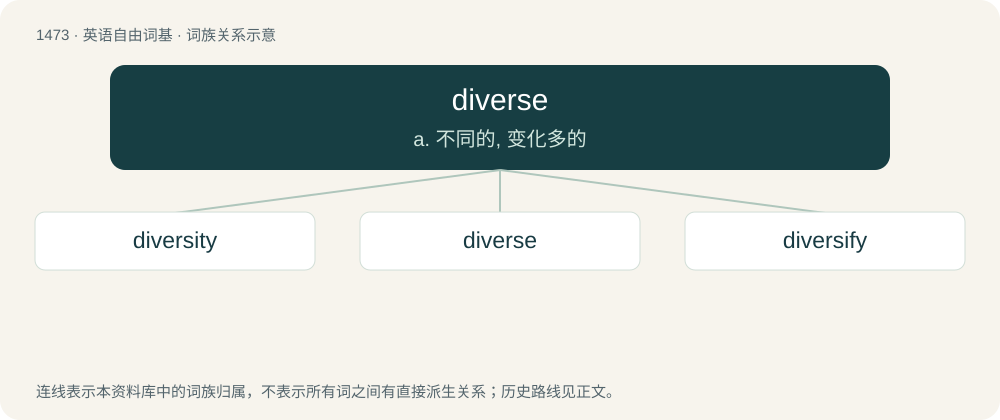

# 1560 · diverse — a. 不同的, 变化多的

[总目录](../00_总目录_按常用程度.md)

**类型**：英语自由词基　｜　**来源语言**：见词源记录

## 核心含义与来源

- 核心含义：a. 不同的, 变化多的
- 英文含义：Consisting of different elements; various.
- 词形：diverse

**来源记录 1**（动词；To make (something) different or varied in form or quality; to alter, to change, to vary.）

From Middle English diversen (“to differ, diverge; to become different, change; to vary; to change or vary (something); to make a distinction, distinguish; to divert”), from Anglo-Norman diverser, Middle French diverser, and Old French diverser (“to alter, change; to differ, diverge; to disagree”), from Late Latin diversare (“to differ”), and then either: \* a frequentative form of Latin dīvertere, the present active infinitive of dīvertō (see etymology 1); or \* from dī- (variant of dis- (prefix meaning ‘apart, in two’)) + versāre (the present active infinitive of versō (“to alter, change; to keep turning, whirl”), a frequentative form of vertō: see etymology 1). Etymology 2 sense 1 (“synonym of diversify”) became obsolete in the 16th century, and was probably recoined in the 20th century.

## 词族图

## 单词速览（常用到不常用）

| 单词 | 音标 | 释义 |
|---|---|---|
| [diversity](#w-1) | /daɪˈvɜː(ɹ)sɪti/ | n. 差异, 多样性；\[化\] 多样性 |
| [diverse](#w-2) | 英 /daɪˈvɜːs/；美 /daɪˈvɝs/ | a. 不同的, 变化多的 |
| [diversify](#w-3) | 英 /daɪˈvɜː.sɪ.faɪ/；美 /daɪˈvɝ.sə.faɪ/ | vt. 使多样化, 使变化 |

## 逐词详解

### 1. diversity

**词性**：名词　｜　**音标**：/daɪˈvɜː(ɹ)sɪti/

**中文释义**：n. 差异, 多样性；\[化\] 多样性

**英文义项**：The quality of being diverse or different; a difference or unlikeness. / A variety; diverse types or examples.

**构词拆分**：diverse + -ity

**词源与演化**：

From Middle English diversite, from Old French diversité, from Latin dīversitās, equivalent to diverse + -ity. Displaced native Old English mislīcnes.

**例句**：

> Using Esperanto for international communication is the solution for preserving linguistic diversity.

### 2. diverse

**词性**：动词　｜　**音标**：英 /daɪˈvɜːs/；美 /daɪˈvɝs/

**中文释义**：a. 不同的, 变化多的

**英文义项**：To make (something) different or varied in form or quality; to alter, to change, to vary. / To make the scope of (business, investments, etc.) different or varied, especially so as to balance and mitigate risks.

**词源与演化**：

From Middle English diversen (“to differ, diverge; to become different, change; to vary; to change or vary (something); to make a distinction, distinguish; to divert”), from Anglo-Norman diverser, Middle French diverser, and Old French diverser (“to alter, change; to differ, diverge; to disagree”), from Late Latin diversare (“to differ”), and then either: \* a frequentative form of Latin dīvertere, the present active infinitive of dīvertō (see etymology 1); or \* from dī- (variant of dis- (prefix meaning ‘apart, in two’)) + versāre (the present active infinitive of versō (“to alter, change; to keep turning, whirl”), a frequentative form of vertō: see etymology 1). Etymology 2 sense 1 (“synonym of diversify”) became obsolete in the 16th century, and was probably recoined in the 20th century.

**例句**：

> The manufacturing sector is the most diverse in the Eastern Caribbean area.

### 3. diversify

**词性**：动词　｜　**音标**：英 /daɪˈvɜː.sɪ.faɪ/；美 /daɪˈvɝ.sə.faɪ/

**中文释义**：vt. 使多样化, 使变化

**英文义项**：To make (something) diverse or varied in form or quality; to give variety to (something) to distinguish by numerous aspects or differences. / To make the scope of (business, investments, etc.) diverse, especially so as to balance and mitigate risks.

**构词拆分**：diverse + -ify

**词源与演化**：

Borrowed from Middle French diversifier, equivalent to diverse + -ify.

**例句**：

> Diversify a course of study.

该用例对应义项：make (more) diverse
