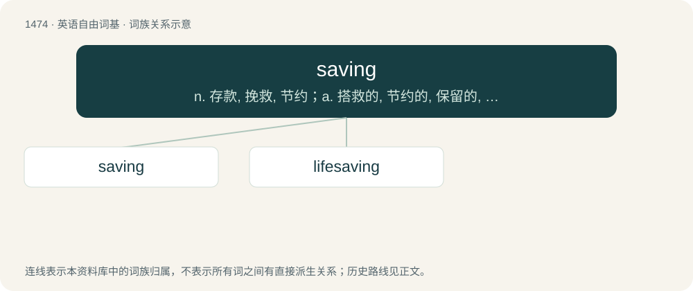

# 1561 · saving — n. 存款, 挽救, 节约；a. 搭救的, 节约的, 保留的, 补偿的；prep. 除...之外

[总目录](../00_总目录_按常用程度.md)

**类型**：英语自由词基　｜　**来源语言**：见词源记录

## 核心含义与来源

- 核心含义：n. 存款, 挽救, 节约；a. 搭救的, 节约的, 保留的, 补偿的；prep. 除...之外
- 英文含义：A reduction in cost or expenditure.
- 词形：saving

**来源记录 1**（名词；A reduction in cost or expenditure.）

From save + -ing.

## 词族图

## 单词速览（常用到不常用）

| 单词 | 音标 | 释义 |
|---|---|---|
| [saving](#w-1) | 英 /ˈseɪ.vɪŋ/ | n. 存款, 挽救, 节约；a. 搭救的, 节约的, 保留的, 补偿的；prep. 除...之外 |
| [lifesaving](#w-2) | /ˈlaifseiviŋ/ | a. 救命的, 救生用的 |

## 逐词详解

### 1. saving

**词性**：名词　｜　**音标**：英 /ˈseɪ.vɪŋ/

**中文释义**：n. 存款, 挽救, 节约；a. 搭救的, 节约的, 保留的, 补偿的；prep. 除...之外

**英文义项**：A reduction in cost or expenditure. / Something (usually money) that is saved, particularly money that has been set aside for the future.

**构词拆分**：save + -ing

**词源与演化**：

From save + -ing.

**例句**：

> The collapse of Enron wiped out the life savings of many people, leaving them poor in their retirement.

该用例对应义项：Something (usually money) that is saved, particularly money that has been set aside for the future.

### 2. lifesaving

**词性**：名词　｜　**音标**：/ˈlaifseiviŋ/

**中文释义**：a. 救命的, 救生用的

**英文义项**：The act of saving a life, especially from drowning.

**构词拆分**：life + saving

**词源与演化**：

From life + saving.

**例句**：

> I’m normally a big fan of lifesaving, but in his case we can make an exception.

该用例对应义项：The act of saving a life, especially from drowning.
