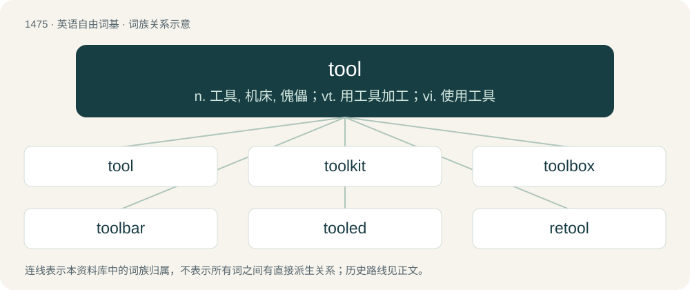

# 1562 · tool — n. 工具, 机床, 傀儡；vt. 用工具加工；vi. 使用工具

[总目录](../00_总目录_按常用程度.md)

**类型**：英语自由词基　｜　**来源语言**：见词源记录

## 核心含义与来源

- 核心含义：n. 工具, 机床, 傀儡；vt. 用工具加工；vi. 使用工具
- 英文含义：Any physical device meant to ease or do a task.
- 词形：tool

**来源记录 1**（名词；Any physical device meant to ease or do a task.）

From Middle English tool, tol, from Old English tōl (“tool, implement, instrument”, literally “that with which one prepares something”), perhaps borrowed from Old Norse tól, but at any rate ultimately from Proto-Germanic \*tōlą (“that which is used in preparation, tool”), from Proto-Indo-European \*dewh₂- (“to tie to, secure”), equivalent to taw (“to prepare”) + -le (agent suffix). Cognate with Scots tuil (“tool, implement, instrument, device”), Icelandic tól (“tool”), Faroese tól (“tool, instrument”). Related to Old English tāwian (“to make, prepare, or cultivate”); see taw, and tow ("fibres used for spinning").

## 词族图

## 单词速览（常用到不常用）

| 单词 | 音标 | 释义 |
|---|---|---|
| [tool](#w-1) | 美 /tul/ | n. 工具, 机床, 傀儡；vt. 用工具加工；vi. 使用工具 |
| [toolkit](#w-2) | 美 /ˈtulˌkɪt/ | \[计\] 工具包 |
| [toolbox](#w-3) | 英 /ˈtuːlˌbɒks/；美 /ˈtuːlˌbɑks/ | n. 工具箱；\[计\] 工具箱 |
| [toolbar](#w-4) | 英 /ˈtuːl.bɑː/；美 /ˈtul.bɑɹ/ | \[计\] 工具栏 |
| [tooled](#w-5) | 英 /tuːld/ | vt. 用工具给…加工（tool的过去式与过去分词形式） |
| [retool](#w-6) | /riːˈtuːl/ | \[化\] 重新装备 |
| [toolset](#w-7) | 美 /ˈtulˌsɛt/ | n. 工具箱；成套工具 |
| [tooltip](#w-8) | /ˈtu(ː)l.tɪp/ | 工具提示; 提示信息; 提示框; 提示文本 |

## 逐词详解

### 1. tool

**词性**：名词　｜　**音标**：美 /tul/

**中文释义**：n. 工具, 机床, 傀儡；vt. 用工具加工；vi. 使用工具

**英文义项**：Any physical device meant to ease or do a task. / Any piece of equipment used in a profession, such as a craftsman's.

**构词拆分**：taw (“to prepare”) + -le

**词源与演化**：

From Middle English tool, tol, from Old English tōl (“tool, implement, instrument”, literally “that with which one prepares something”), perhaps borrowed from Old Norse tól, but at any rate ultimately from Proto-Germanic \*tōlą (“that which is used in preparation, tool”), from Proto-Indo-European \*dewh₂- (“to tie to, secure”), equivalent to taw (“to prepare”) + -le (agent suffix). Cognate with Scots tuil (“tool, implement, instrument, device”), Icelandic tól (“tool”), Faroese tól (“tool, instrument”). Related to Old English tāwian (“to make, prepare, or cultivate”); see taw, and tow ("fibres used for spinning").

**例句**：

> A spreadsheet app and a bookkeeping app are some of the principal tools of a bookkeeper.

该用例对应义项：Anything that aids someone to perform an operation; an instrument; a means.

### 2. toolkit

**词性**：名词　｜　**音标**：美 /ˈtulˌkɪt/

**中文释义**：\[计\] 工具包

**英文义项**：A set of tools kept together, especially comprising all the tools suitable for some particular type of work. / A set of personal abilities, skills, or resources to draw on.

**构词拆分**：tool + kit

**词源与演化**：

From tool + kit.

**用法示例／搭配（非完整句）**：

> a financial planning toolkit for small businesses

该用例对应义项：A set of personal abilities, skills, or resources to draw on.

### 3. toolbox

**词性**：名词　｜　**音标**：英 /ˈtuːlˌbɒks/；美 /ˈtuːlˌbɑks/

**中文释义**：n. 工具箱；\[计\] 工具箱

**英文义项**：A storage case for tools. / A set of pre-existing routines for use in writing new programs.

**构词拆分**：tool + box

**词源与演化**：

From tool + box.

**例句**：

> I left my toolbox in the basement next to the furnace.

### 4. toolbar

**词性**：名词　｜　**音标**：英 /ˈtuːl.bɑː/；美 /ˈtul.bɑɹ/

**中文释义**：\[计\] 工具栏

**英文义项**：A row of buttons, usually marked with icons, used to activate the functions of an application or operating system.

**构词拆分**：tool + bar

**词源与演化**：

From tool + bar.

**例句**：

> Can you see the toolbar at the bottom of the screen?

### 5. tooled

**词性**：形容词　｜　**音标**：英 /tuːld/

**中文释义**：vt. 用工具给…加工（tool的过去式与过去分词形式）

**英文义项**：Worked with a tool. / Impressed with an ornamental design.

**构词拆分**：From tool + -ed.

**词源与演化**：

From tool + -ed.

### 6. retool

**词性**：动词　｜　**音标**：/riːˈtuːl/

**中文释义**：\[化\] 重新装备

**英文义项**：To adjust; to optimize; to rebuild.

**构词拆分**：re- + tool

**词源与演化**：

From re- + tool.

**例句**：

> He decided it was time to retool last year's marketing brochure.

该用例对应义项：To adjust; to optimize; to rebuild.

### 7. toolset

**词性**：名词　｜　**音标**：美 /ˈtulˌsɛt/

**中文释义**：n. 工具箱；成套工具

**英文义项**：A collection of tools; a toolkit. / A set of utility programs, subroutines or similar software.

**构词拆分**：tool + set

**词源与演化**：

From tool + set.

### 8. tooltip

**词性**：名词　｜　**音标**：/ˈtu(ː)l.tɪp/

**中文释义**：工具提示; 提示信息; 提示框; 提示文本

**英文义项**：An element of a graphical user interface in the form of a box of text that appears when a cursor is made to hover over an item; normally used to explain the function of the item.

**构词拆分**：tool + tip

**词源与演化**：

From tool + tip, originally used with toolbars to provide a tip or hint as to what function each graphical icon represented. The term was introduced as ToolTip by Microsoft in the 1990s.
