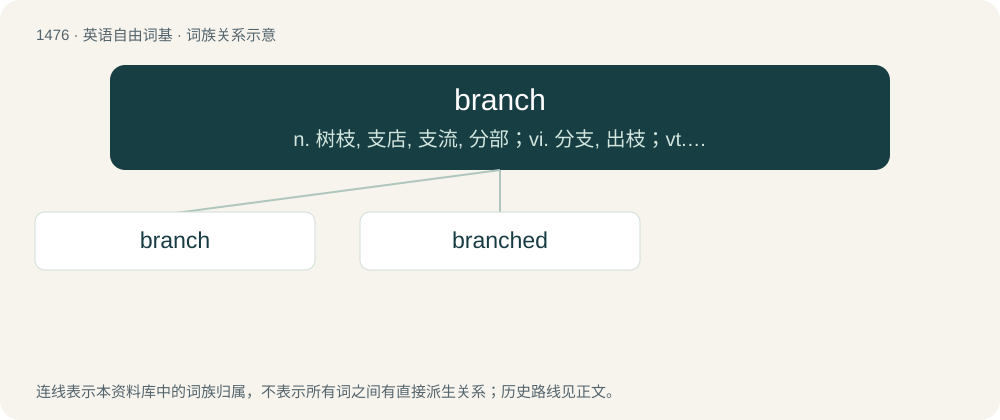

# 1564 · branch — n. 树枝, 支店, 支流, 分部；vi. 分支, 出枝；vt. 分割, 用枝状叶脉刺绣花纹装饰

[总目录](../00_总目录_按常用程度.md)

**类型**：英语自由词基　｜　**来源语言**：见词源记录

## 核心含义与来源

- 核心含义：n. 树枝, 支店, 支流, 分部；vi. 分支, 出枝；vt. 分割, 用枝状叶脉刺绣花纹装饰
- 英文含义：The woody part of a tree arising from the trunk and usually dividing.
- 词形：branch

**来源记录 1**（名词；The woody part of a tree arising from the trunk and usually dividing.）

From Middle English branche, braunche, bronche, from Old French branche, branke, from Late Latin branca (“footprint”, later also “paw, claw”) (whence Middle High German pranke, German Pranke (“paw”)), of unknown origin. Perhaps of Celtic origin, from a hypothetical Gaulish \*vranca, from Proto-Indo-European \*wrónk-eh₂. If so, then Indo-European cognates include Old Norse rá, vró (“angle, corner”), and possibly Lithuanian rankà (“hand”), Old Church Slavonic рѫка (rǫka, “hand”), Albanian rangë (“yardwork”). The verb is from Middle English braunchen, from the noun.

## 词族图

## 单词速览（常用到不常用）

| 单词 | 音标 | 释义 |
|---|---|---|
| [branch](#w-1) | 英 /bɹɑːnt͡ʃ/；美 /bɹænt͡ʃ/ | n. 树枝, 支店, 支流, 分部；vi. 分支, 出枝；vt. 分割, 用枝状叶脉刺绣花纹装饰 |
| [branched](#w-2) |  | a. 分枝的；枝状的；有枝的 |

## 逐词详解

### 1. branch

**词性**：名词　｜　**音标**：英 /bɹɑːnt͡ʃ/；美 /bɹænt͡ʃ/

**中文释义**：n. 树枝, 支店, 支流, 分部；vi. 分支, 出枝；vt. 分割, 用枝状叶脉刺绣花纹装饰

**英文义项**：The woody part of a tree arising from the trunk and usually dividing. / Any of the parts of something that divides like the branch of a tree.

**词源与演化**：

From Middle English branche, braunche, bronche, from Old French branche, branke, from Late Latin branca (“footprint”, later also “paw, claw”) (whence Middle High German pranke, German Pranke (“paw”)), of unknown origin. Perhaps of Celtic origin, from a hypothetical Gaulish \*vranca, from Proto-Indo-European \*wrónk-eh₂. If so, then Indo-European cognates include Old Norse rá, vró (“angle, corner”), and possibly Lithuanian rankà (“hand”), Old Church Slavonic рѫка (rǫka, “hand”), Albanian rangë (“yardwork”). The verb is from Middle English braunchen, from the noun.

**例句**：

> Our main branch is downtown, and we have branches in all major suburbs.

该用例对应义项：A location of an organization with several locations.

### 2. branched

**词性**：形容词

**中文释义**：a. 分枝的；枝状的；有枝的

**英文义项**：Having branches, or specific kinds of branches.

**构词拆分**：From branch + -ed.

**词源与演化**：

From branch + -ed.

**例句**：

> Long branched hairs on its legson which pollen collects.

该用例对应义项：resembling a fork; divided or separated into two branches
