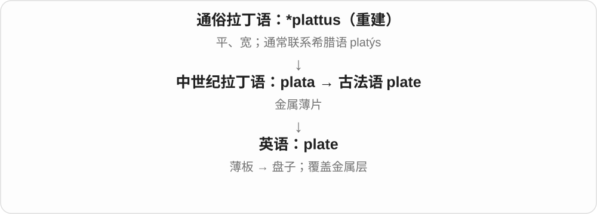
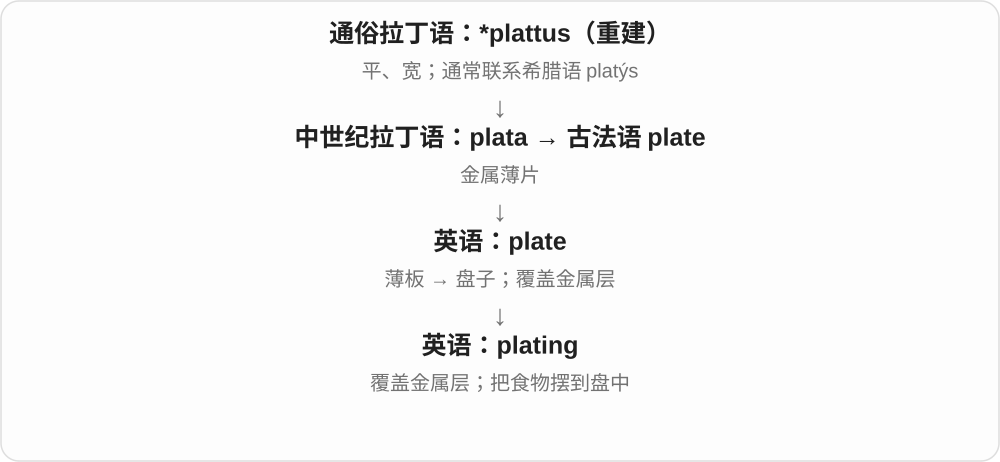
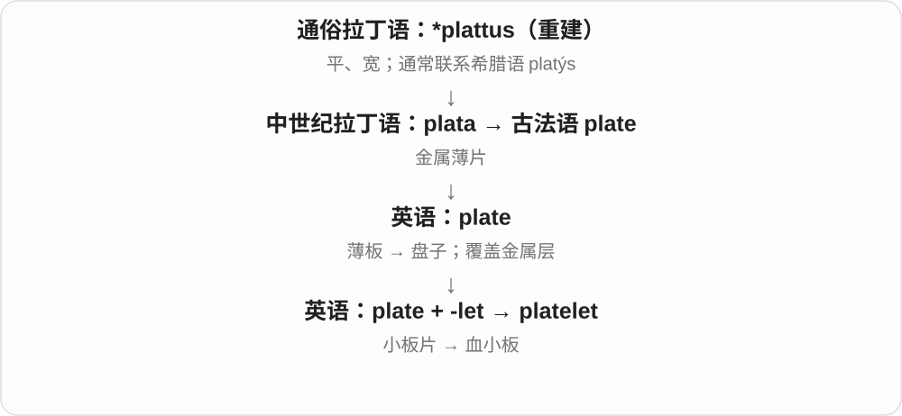

# 1567 · plate — 平展的一片：盘、护板、镀层按对象理解

[逐词精讲目录](../00_逐词精讲目录.md) · [总目录](../00_总目录_按常用程度.md)

## 核心词根与来源

plate 的盘子和板片共享平展材料意象，组合却不能一律译成盘。boilerplate 的套话义和 breastplate 的马具义各有专门路径。

**PLATE：一片铺开，再看用途**

plate → plating、platelet；nameplate、boilerplate、breastplate 分别选标牌、板材历史、胸前护板。

- **基础、表层与小板**：plate · plating · platelet
- **标牌、固定材料与护胸**：nameplate · boilerplate · breastplate
- **plate → plates：薄平片、盘子与牌板**：plate · plates

## 词形与演化规律

plate 的古法语扁平板片词族 → plate；plate + -ing/-let；name/boiler/breast + plate。

金属薄片等旧义，经平面形状扩展到餐盘、牌板等。

## 单词速览（按词族由简到繁）

同一基础词的相关扩展放在一起，先读基础形式，再读扩展；各组之间优先读常用的。具体词源关系见各词讲解。

| 单词 | 音标 | 核心意思 |
|---|---|---|
| [plate](#w-1) | 英 /pleɪt/；美 /pleɪt/ | 盘子；薄板；板块；镀上金属层 |
| [plates](#w-7) | /pleɪts/ | 盘子；薄片、板；牌照；板块〔复数〕 |
| [plating](#w-2) | 英 /ˈpleɪtɪŋ/；美 /ˈpleɪtɪŋ/ | 镀层；覆镀；金属板覆盖；摆盘 |
| [platelet](#w-3) | 英 /ˈpleɪtlət/；美 /ˈpleɪtlət/ | 血小板；小板片 |
| [nameplate](#w-4) | /ˈneɪmpleɪt/ | 名牌；姓名铭牌；标识牌 |
| [boilerplate](#w-5) | 英 /ˈbɔɪləpleɪt/；美 /ˈbɔɪlərpleɪt/ | 锅炉钢板；可反复套用的固定文字或代码 |
| [breastplate](#w-6) | /ˈbrestpleɪt/ | 胸甲、护胸；防止马鞍后滑的胸带 |

## 逐词讲解

### 1. plate — 盘子；薄板；板块；镀上金属层

**音标**：英 /pleɪt/；美 /pleɪt/

**先抓住这个画面**

抓住一片比较平、比较宽的东西：能盛菜的是盘子，能盖住表面的是板片。

**怎么拆**

经古法语 plate 来自中世纪拉丁语 plata“金属薄片”，更早通常联系重建的 *plattus 与希腊语 platýs。

**怎么变成今天的意思**

a dinner plate 是餐盘；a metal plate 是金属板；a tectonic plate 是岩石圈板块。动词 plate 指覆上金属层，也可指给食物摆盘。

**常见搭配与例句**

a plate of food；metal plates；plate the dessert。

> She put the sliced fruit on a white plate.

她把切好的水果放在白盘子上。

> A metal plate covers the opening.

一块金属板盖住了开口。

**别混淆**

plate 通常较浅、展开；bowl 通常较深。地质 plate 是专业延伸，不是漂在液态海洋上的普通餐盘。

### 2. plates — 盘子；薄片、板；牌照；板块〔复数〕

**音标**：/pleɪts/

**先抓住这个画面**

一块比较薄、平的东西，是 plate 的形状线索；餐盘、金属板、车牌、地球构造的板块，都各自发展出专门用法。

**怎么拆**

plate + -s，/t/ 后读 /s/。plate 经古法语接中世纪拉丁 plata 金属薄片，较早通常联系 *plattus 及希腊 platýs 宽、平；星号表示重建形式。

**怎么变成今天的意思**

**较早宽、平词族 → 拉丁、法语相关形式 → plate**  
薄平片、板 → 盘等器物

↓

**plate + -s → plates**  
多个盘子、牌板或板块

dinner plates 餐盘；metal plates 金属板；number plates 车牌；tectonic plates 构造板块。

**常见搭配与例句**

plates on the table；plates fitted together。

> She set the plates around the table.

她沿桌边摆好了盘子。

> The sign was made from two thin metal plates.

这块标牌用两块薄金属板做成。

**别混淆**

plate 常指较平的盘或板，bowl 通常更深、适合盛汤等。dish 范围更广，也可说一道菜；The plates are empty 说盘子空了，The dishes are delicious 说菜好吃。

### 3. plating — 镀层；覆镀；金属板覆盖；摆盘

**音标**：英 /ˈpleɪtɪŋ/；美 /ˈpleɪtɪŋ/

**先抓住这个画面**

给表面覆上一层薄金属；在厨房里，又可以是把食物安排到盘面上。

**怎么拆**

这里的覆镀、摆盘等常用义由 plate 动词 + -ing 形成；不同义项跟着 plate 的不同用法走。

**怎么变成今天的意思**

gold plating 是镀金层或镀金过程；food plating 是摆盘。名字相同，不表示食物表面需要镀金。

**常见搭配与例句**

chrome plating；gold plating；careful plating。

> The gold plating had worn away around the edges.

边缘处的镀金层已经磨掉了。

> The chef paid as much attention to plating as to flavour.

厨师对摆盘和味道同样重视。

**别混淆**

plating 可是过程，也可是覆层；plate 还可以是整块金属板，厚度与结构要看上下文。

### 4. platelet — 血小板；小板片

**音标**：英 /ˈpleɪtlət/；美 /ˈpleɪtlət/

**先抓住这个画面**

名字像“小盘片”；在血液里，这些很小的细胞碎片参与形成凝块，帮助堵住出血处。

**怎么拆**

plate 板片 + -let 小，先抓住小而扁的形状，再联系血液里的专门含义。

**怎么变成今天的意思**

最常见于 platelet count“血小板计数”。血小板不是红细胞，也不是负责携氧的那一类血液成分。

**常见搭配与例句**

platelet count；blood platelets；platelet function。

> The blood test included a platelet count.

这次血液检查包括血小板计数。

> Platelets help form clots at the site of an injury.

血小板帮助在受损部位形成凝块。

**别混淆**

platelet 主要按形状命名；另一个术语 thrombocyte 更突出血凝块这一功能联系。

### 5. nameplate — 名牌；姓名铭牌；标识牌

**音标**：/ˈneɪmpleɪt/

**先抓住这个画面**

名字不只口头叫，还被刻、印在一块固定的小牌上。

**怎么拆**

name + plate（板、牌），plate 这里不是装食物的盘子。也可指报刊刊名标识等相关用法。

**怎么变成今天的意思**

**英语 name；plate**  
并列组合的两部分

↓

**name + plate → nameplate**  
写有姓名、名称等的牌、标识

a brass nameplate 是黄铜铭牌，a desk nameplate 是桌上姓名牌。机器铭牌也可能附型号、额定信息，但具体内容看实物。

**常见搭配与例句**

a brass nameplate；a desk nameplate；a door nameplate。

> A brass nameplate was fixed beside the door.

门边固定着一块黄铜姓名牌。

> Her new desk came with a nameplate.

她的新办公桌配有姓名牌。

**别混淆**

nameplate 常是较固定、硬质的标牌，nametag 常是临时佩戴姓名标签；材料与使用习惯可有重叠。

### 6. boilerplate — 锅炉钢板；可反复套用的固定文字或代码

**音标**：英 /ˈbɔɪləpleɪt/；美 /ˈbɔɪlərpleɪt/

**先抓住这个画面**

同一块版反复印相同内容，后来就像把一段现成文字复制到很多文件里。

**怎么拆**

boiler 锅炉 + plate 金属板；原指制造锅炉的板材，后与可重复用于印刷的预制版片相联，发展出套话、固定模板内容义。

**怎么变成今天的意思**

常见于合同、新闻稿、程序代码。它可以高效地处理固定结构，也可能显得没有针对性。

**常见搭配与例句**

boilerplate language；boilerplate code；standard boilerplate。

> The letter was mostly boilerplate, with only the name changed.

信里大多是固定套用的文字，只改了名字。

> The framework generates the boilerplate code for new projects.

框架为新项目生成通用的基础代码。

**别混淆**

boilerplate 重复使用，未必没有用；platitude 多指看似有道理却空泛的陈词。

### 7. breastplate — 胸甲、护胸；防止马鞍后滑的胸带

**音标**：/ˈbrestpleɪt/

**先抓住这个画面**

护甲前面挡在胸口的一片；马具里的同名物件却多是胸前带具，作用是稳住马鞍，不一定是一块钢板。

**怎么拆**

breast 胸 + plate 板片，来自中古英语相应组合。plate 选扁平板片而非吃饭盘子义；后有不同专门器物名称。

**怎么变成今天的意思**

**breast 胸；plate 板片**  
部位与护板两个材料

↓

**中古英语 brestplate → breastplate**  
胸部护甲；后来也指相应胸前器具

a metal breastplate 金属胸甲，a decorated breastplate 饰纹胸甲，a horse’s breastplate 马的胸带。

**常见搭配与例句**

a metal breastplate；a decorated breastplate；a horse’s breastplate。

> The knight wore a polished breastplate.

骑士穿着擦亮的胸甲。

> The rider checked the horse’s breastplate before setting off.

骑手出发前检查了马的胸带。

**别混淆**

breastplate 的 plate 不必是餐盘；马具义说固定鞍的胸前带具，与骑手胸甲不同。

## 这一组要分清什么

platelet 是血小板等专名，不是家里所有小餐盘的通用称呼；breastplate 胸甲与马胸带看对象。

## 串起来练习

The display includes a breastplate with decorative plating.

展柜里有一件带装饰镀层的胸甲。
