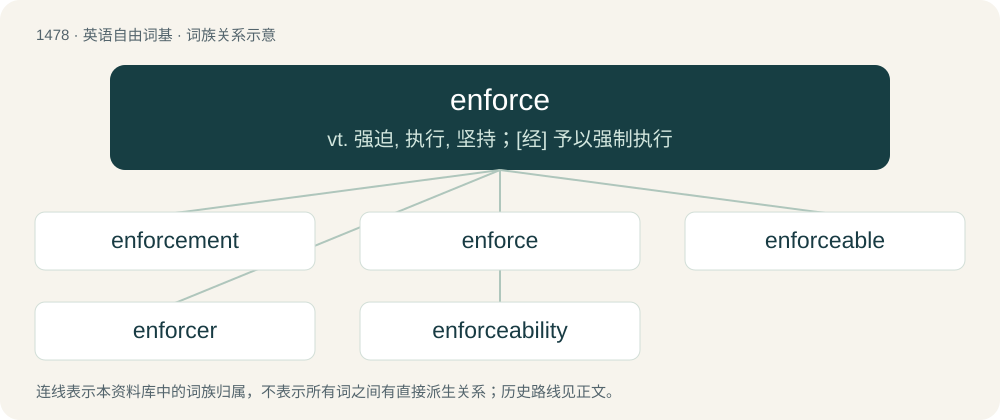

# 1568 · enforce — vt. 强迫, 执行, 坚持；\[经\] 予以强制执行

[总目录](../00_总目录_按常用程度.md)

**类型**：英语自由词基　｜　**来源语言**：见词源记录

## 核心含义与来源

- 核心含义：vt. 强迫, 执行, 坚持；\[经\] 予以强制执行
- 英文含义：To keep up, impose or bring into effect something, not necessarily by force.
- 词形：enforce

**来源记录 1**（动词；To keep up, impose or bring into effect something, not necessarily by force.）

From Middle English enforcen, from Old French enforcier, from Late Latin infortiāre, from in- + fortis (“strong”).

## 词族图

## 单词速览（常用到不常用）

| 单词 | 音标 | 释义 |
|---|---|---|
| [enforcement](#w-1) | 英 /ɪnˈfɔːsm(ə)nt/；美 /ɪnˈfoɹsm(ə)nt/ | n. 执行, 强制；\[法\] 实施, 加强, 厉行 |
| [enforce](#w-2) | 英 /ɪnˈfɔːs/；美 /ɪnˈfoɹs/ | vt. 强迫, 执行, 坚持；\[经\] 予以强制执行 |
| [enforceable](#w-3) | /inˈfɔː səbl/ | a. 可实施的, 可强行的 |
| [enforcer](#w-4) | /ɪnˈfɔːsə/ | n. 实施者, 强制者；\[计\] 监视程序 |
| [enforceability](#w-5) |  | \[法\] 强制性 |

## 逐词详解

### 1. enforcement

**词性**：名词　｜　**音标**：英 /ɪnˈfɔːsm(ə)nt/；美 /ɪnˈfoɹsm(ə)nt/

**中文释义**：n. 执行, 强制；\[法\] 实施, 加强, 厉行

**英文义项**：The act of enforcing; compulsion. / A giving force to; a putting in execution.

**构词拆分**：enforce + -ment

**词源与演化**：

From Old French enforcement, see enforce + -ment.

**例句**：

> The payments were blocked just in time by alert law enforcement officials.

### 2. enforce

**词性**：动词　｜　**音标**：英 /ɪnˈfɔːs/；美 /ɪnˈfoɹs/

**中文释义**：vt. 强迫, 执行, 坚持；\[经\] 予以强制执行

**英文义项**：To keep up, impose or bring into effect something, not necessarily by force. / To apply a rule or enforcement action to a person or user account.

**词源与演化**：

From Middle English enforcen, from Old French enforcier, from Late Latin infortiāre, from in- + fortis (“strong”).

**例句**：

> The victim was able to enforce his evidence against the alleged perpetrator.

该用例对应义项：To give strength or force to; to affirm, to emphasize.

### 3. enforceable

**词性**：形容词　｜　**音标**：/inˈfɔː səbl/

**中文释义**：a. 可实施的, 可强行的

**英文义项**：Capable of being enforced.

**构词拆分**：enforce + -able

**词源与演化**：

From enforce + -able.

**例句**：

> There must be active and enforceable mechanisms to protect copyright exceptions and limitations, including fair use and fair dealing regimes.

### 4. enforcer

**词性**：名词　｜　**音标**：/ɪnˈfɔːsə/

**中文释义**：n. 实施者, 强制者；\[计\] 监视程序

**英文义项**：One who enforces. / A hired strongman, especially working for the underworld.

**构词拆分**：enforce + -er

**词源与演化**：

From enforce + -er.

**例句**：

> The mob enforcer kept a pair of brass knuckles in his coat pocket.

### 5. enforceability

**词性**：名词

**中文释义**：\[法\] 强制性

**英文义项**：The quality of being enforceable.

**构词拆分**：enforce + -ability

**词源与演化**：

From enforce + -ability.
