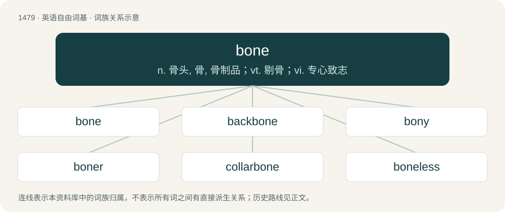

# 1570 · bone — n. 骨头, 骨, 骨制品；vt. 剔骨；vi. 专心致志

[总目录](../00_总目录_按常用程度.md)

**类型**：英语自由词基　｜　**来源语言**：见词源记录

## 核心含义与来源

- 核心含义：n. 骨头, 骨, 骨制品；vt. 剔骨；vi. 专心致志
- 英文含义：A composite material consisting largely of calcium phosphate and collagen and making up the skeleton of most vertebrates.
- 词形：bone

**多个词源／构词路径**：同一拼写可能有不同来源；以下按词性和含义分别列出。

**来源记录 1**（名词；A composite material consisting largely of calcium phosphate and collagen and making up the skeleton of most vertebrates.）

From Middle English bon, from Old English bān (“bone, tusk; the bone of a limb”), from Proto-Germanic \*bainą (“bone”), from \*bainaz (“straight”), possibly from Proto-Indo-European \*bʰeyh₂- (“to hit, strike, beat”). Cognate with Scots bane, been, bean, bein, bain (“bone”), North Frisian bian, Biin, biinj (“bone; leg”), West Frisian bien (“bone”), Dutch been (“bone; leg”), German Low German Been, Bein (“bone”), German Bein (“leg”), German Gebein (“bones”), Swedish ben (“bone; leg”), Norwegian Bokmål, Norwegian Nynorsk, and Icelandic bein (“bone; leg”), Breton benañ (“to cut, hew”), Latin perfinēs (“break through, break into pieces, shatter”), Avestan 𐬠𐬫𐬈𐬥𐬙𐬈 (byente, “they fight, hit”). Related also to Old Norse beinn (“straight, right, favourable, advantageous, convenient, friendly, fair, keen”) (whence Middle English bain, bayne, bayn, beyn (“direct, prompt”), Scots bein, bien (“in good condition, pleasant, well-to-do, cosy, well-stocked, pleasant, keen”)), Icelandic beinn (“straight, direct, hospitable”), Norwegian bein (“straight, direct, easy to deal with”). See bain, bein.

**来源记录 2**（动词；To apprehend, steal.）

Unknown; probably related in some way to Etymology 1, above.

**来源记录 3**（动词；To sight along an object or set of objects to check whether they are level or in line.）

Borrowed from French bornoyer (“to look at with one eye, to sight”), from borgne (“one-eyed”).

## 词族图

## 单词速览（常用到不常用）

| 单词 | 音标 | 释义 |
|---|---|---|
| [bone](#w-1) | 英 /bəʊn/；美 /boʊn/ | n. 骨头, 骨, 骨制品；vt. 剔骨；vi. 专心致志 |
| [backbone](#w-2) | 英 /ˈbækˌbəʊn/；美 /ˈbækˌboʊn/ | n. 脊椎, 志气, 骨干, 支柱；\[计\] 主干网, 主干网点 |
| [bony](#w-3) | 英 /ˈbəʊni/；美 /ˈboʊni/ | a. 如骨的, 多骨的, 瘦骨嶙峋的 |
| [boner](#w-4) | 英 /ˈbəʊ.nə(ɹ)/；美 /ˈboʊ.nɚ/ | n. 可笑的错误 |
| [collarbone](#w-5) | /ˈkɒləbəun/ | n. 锁骨；\[医\] 锁骨 |
| [boneless](#w-6) | /ˈbəjnlis/ | a. 无骨的 |
| [jawbone](#w-7) | /ˈdʒɒːbəun/ | n. 颚骨, 下颚骨, 信用；v. 赊买 |
| [wishbone](#w-8) | 美 /ˈwɪʃˌboʊn/ | n. 叉骨 |
| [herringbone](#w-9) | Canada /ˈhɛɹɪŋˌboʊn/ | n. 鲱鱼鱼骨, 交叉缝式, 人字形；a. 人字形的；v. (使)成人字形 |
| [cheekbone](#w-10) | 美 /ˈt͡ʃikˌboʊn/ | n. 颧骨 |
| [bonehead](#w-11) | 英 /ˈbəʊnˌhɛd/；美 /ˈboʊnˌhɛd/ | n. 笨蛋 |
| [boneyard](#w-12) | 美 /ˈboʊnˌjɑɹd/ | n. 墓地, (非正式)动物尸骨堆放地 |
| [tailbone](#w-13) | 英 /ˈteɪlˌbəʊn/；美 /ˈteɪlˌboʊn/ | 尾骨 |
| [fishbone](#w-14) | /ˈfiʃbəun/ | n. 鱼骨 |

## 逐词详解

### 1. bone

**词性**：名词　｜　**音标**：英 /bəʊn/；美 /boʊn/

**中文释义**：n. 骨头, 骨, 骨制品；vt. 剔骨；vi. 专心致志

**英文义项**：A composite material consisting largely of calcium phosphate and collagen and making up the skeleton of most vertebrates. / Any of the components of an endoskeleton, made of this material.

**词源与演化**：

From Middle English bon, from Old English bān (“bone, tusk; the bone of a limb”), from Proto-Germanic \*bainą (“bone”), from \*bainaz (“straight”), possibly from Proto-Indo-European \*bʰeyh₂- (“to hit, strike, beat”). Cognate with Scots bane, been, bean, bein, bain (“bone”), North Frisian bian, Biin, biinj (“bone; leg”), West Frisian bien (“bone”), Dutch been (“bone; leg”), German Low German Been, Bein (“bone”), German Bein (“leg”), German Gebein (“bones”), Swedish ben (“bone; leg”), Norwegian Bokmål, Norwegian Nynorsk, and Icelandic bein (“bone; leg”), Breton benañ (“to cut, hew”), Latin perfinēs (“break through, break into pieces, shatter”), Avestan 𐬠𐬫𐬈𐬥𐬙𐬈 (byente, “they fight, hit”). Related also to Old Norse beinn (“straight, right, favourable, advantageous, convenient, friendly, fair, keen”) (whence Middle English bain, bayne, bayn, beyn (“direct, prompt”), Scots bein, bien (“in good condition, pleasant, well-to-do, cosy, well-stocked, pleasant, keen”)), Icelandic beinn (“straight, direct, hospitable”), Norwegian bein (“straight, direct, easy to deal with”). See bain, bein.

**例句**：

> Let's head to the casino and roll them bones!

该用例对应义项：A domino or die.

### 2. backbone

**词性**：名词　｜　**音标**：英 /ˈbækˌbəʊn/；美 /ˈbækˌboʊn/

**中文释义**：n. 脊椎, 志气, 骨干, 支柱；\[计\] 主干网, 主干网点

**英文义项**：The series of vertebrae, separated by disks, that encloses and protects the spinal cord, and runs down the middle of the back in vertebrate animals. / Any fundamental support, structure, or infrastructure.

**构词拆分**：back + bone

**词源与演化**：

From Middle English bakbon, bakebon, bac-bon; equivalent to back + bone. Compare the semantically analogous English ridgebone.

**例句**：

> He would make a good manager, if he had a little more backbone.

该用例对应义项：Courage, fortitude, or strength.

### 3. bony

**词性**：形容词　｜　**音标**：英 /ˈbəʊni/；美 /ˈboʊni/

**中文释义**：a. 如骨的, 多骨的, 瘦骨嶙峋的

**英文义项**：Resembling, having the appearance or consistence of, or relating to bone; osseous. / Full of bones.

**构词拆分**：bone + -y

**词源与演化**：

From Middle English bony, equivalent to bone + -y.

**例句**：

> That bony fellow could use a few hot dinners.

该用例对应义项：With little flesh; skinny, thin.

### 4. boner

**词性**：名词　｜　**音标**：英 /ˈbəʊ.nə(ɹ)/；美 /ˈboʊ.nɚ/

**中文释义**：n. 可笑的错误

**英文义项**：An erect penis. / An often perverse sense of enjoyment from or predilection towards something.

**构词拆分**：bone + -er

**词源与演化**：

From bone + -er.

**例句**：

> Why do politicians have such a boner for meaningless memorials?

该用例对应义项：An often perverse sense of enjoyment from or predilection towards something.

### 5. collarbone

**词性**：名词　｜　**音标**：/ˈkɒləbəun/

**中文释义**：n. 锁骨；\[医\] 锁骨

**英文义项**：The bone joining the shoulder and the breastbone.

**构词拆分**：collar + bone

**词源与演化**：

From Middle English colar bane; equivalent to collar + bone.

**例句**：

> The scapula, or shoulder blade, connects the upper arm bone to the collarbone.

### 6. boneless

**词性**：形容词　｜　**音标**：/ˈbəjnlis/

**中文释义**：a. 无骨的

**英文义项**：Without bones, especially as pertaining to meat or poultry prepared for eating. / Without pizza crust; without pizza bones.

**构词拆分**：bone + -less

**词源与演化**：

From Middle English bonles, banles, from Old English bānlēas (“boneless”), from Proto-Germanic \*bainalausaz, equivalent to bone + -less. Cognate with Scots baneless (“boneless”), Dutch beenloos (“boneless; legless”), German beinlos (“legless”), Swedish benlös (“boneless”), Icelandic beinlaus (“boneless”).

**用法示例／搭配（非完整句）**：

> boneless, skinless chicken

该用例对应义项：Without bones, especially as pertaining to meat or poultry prepared for eating.

### 7. jawbone

**词性**：名词　｜　**音标**：/ˈdʒɒːbəun/

**中文释义**：n. 颚骨, 下颚骨, 信用；v. 赊买

**英文义项**：The bone of the lower jaw; the mandible. / Any of the bones in the lower or upper jaw.

**构词拆分**：jaw + bone

**词源与演化**：

From Middle English jawe bone, a partial calque of earlier Middle English chawlbone, chawylbon, chavylbone, chawle boon, chavyl bon (“jaw bone”, literally “chavel bone”), see chavel-bone; equivalent to jaw + bone.

### 8. wishbone

**词性**：名词　｜　**音标**：美 /ˈwɪʃˌboʊn/

**中文释义**：n. 叉骨

**英文义项**：A forked bone between the neck and breast of a bird consisting chiefly of the two clavicles fused at their median or lower end, regarded as a lucky charm in some countries. / A spar in two parts, between which a sail is hoisted, the wishbone extending its clew.

**构词拆分**：wish + bone

**词源与演化**：

From wish + bone.

**例句**：

> Just pull the wishbone apart while making a wish.

### 9. herringbone

**词性**：名词　｜　**音标**：Canada /ˈhɛɹɪŋˌboʊn/

**中文释义**：n. 鲱鱼鱼骨, 交叉缝式, 人字形；a. 人字形的；v. (使)成人字形

**英文义项**：A bone of a herring. / A zigzag pattern, especially made by bricks, on a cloth, or by stitches in sewing.

**构词拆分**：herring + bone

**词源与演化**：

From herring + bone.

### 10. cheekbone

**词性**：名词　｜　**音标**：美 /ˈt͡ʃikˌboʊn/

**中文释义**：n. 颧骨

**英文义项**：The small prominent bone of the cheek.

**构词拆分**：cheek + bone

**词源与演化**：

From Middle English chekebon, chekbone, from Old English ċēacbān (“cheekbone”); equivalent to cheek + bone. Compare Dutch kaakbeen (“jawbone”).

**例句**：

> Other injuries included a broken nose, a dislocated shoulder and a hairline fracture of a cheekbone.

### 11. bonehead

**词性**：名词　｜　**音标**：英 /ˈbəʊnˌhɛd/；美 /ˈboʊnˌhɛd/

**中文释义**：n. 笨蛋

**英文义项**：Someone who is thick-skulled, stupid, or stubborn. / A member of a neo-Nazi, white supremacist, and antisemitic offshoot of the skinhead subculture.

**构词拆分**：bone + head

**词源与演化**：

From bone + head.

**例句**：

> That person is a bonehead, right?

### 12. boneyard

**词性**：名词　｜　**音标**：美 /ˈboʊnˌjɑɹd/

**中文释义**：n. 墓地, (非正式)动物尸骨堆放地

**英文义项**：A graveyard. / In the game of dominoes, the pile of upside-down pieces that have yet to be used.

**构词拆分**：bone + yard

**词源与演化**：

From bone + yard.

**用法示例／搭配（非完整句）**：

> a 440 V-8 from the boneyard

该用例对应义项：A dumpsite for obsolete or unusable aircraft etc; a junkyard.

### 13. tailbone

**词性**：名词　｜　**音标**：英 /ˈteɪlˌbəʊn/；美 /ˈteɪlˌboʊn/

**中文释义**：尾骨

**英文义项**：The final fused vertebrae at the base of the spine; the coccyx.

**构词拆分**：tail + bone

**词源与演化**：

From tail + bone.

**例句**：

> He broke his tailbone when he fell down the stairs.

### 14. fishbone

**词性**：名词　｜　**音标**：/ˈfiʃbəun/

**中文释义**：n. 鱼骨

**英文义项**：A bone from a fish. / Something with an appearance or structure suggestive of a fish's skeleton.

**构词拆分**：fish + bone

**词源与演化**：

From fish + bone.

**例句**：

> He choked on a fishbone.

该用例对应义项：A bone from a fish.
